# **FZMotion 用户操作指导手册**

**(V3.0- Motar)**


### 目录

| 1     | 系统硬件说明与搭建   | 1  |
|-------|-------------|----|
| 1.1   | 场地准备        | 1  |
| 1.2   | 相机位置规划      | 1  |
| 1.3   | 相机安装器具      | 2  |
| 1.4   | 线缆与布线规则     | 4  |
| 1.5   | 相机角度与焦距调整   | 5  |
| 1.5.1 | 总体流程        | 5  |
| 1.5.2 | 相机辅助按钮      | 6  |
| 1.5.3 | 调整相机角度      | 6  |
| 1.5.4 | 光圈调节        | 7  |
| 1.5.5 | 镜头对焦        | 8  |
| 1.5.6 | 对焦效果参考      | 8  |
| 2     | 运行环境配置推荐与安装 | 9  |
| 2.1   | 运行环境配置推荐    | 9  |
| 2.2   | 软件安装        | 9  |
| 2.3   | 软件主界面介绍     | 13 |
| 2.4   | 界面面板独立拖动与交互 | 14 |
| 3     | 导航栏         | 16 |
| 3.1   | 相机          | 16 |
| 3.2   | 标定          | 16 |
| 3.3   | 世界坐标系       | 17 |
| 3.4   | 动捕          | 17 |
| 4     | 菜单栏         | 18 |
| 4.1   | 文件          | 18 |
| 4.1.1 | 打开工程文件      | 18 |
| 4.1.2 | 保存工程文件      | 19 |
| 4.1.3 | 打开数据文件      | 20 |
| 4.1.4 | 导入标定文件      | 20 |

| 4.1.5 | 导出标定文件      | 21 |
|-------|-------------|----|
| 4.1.6 | 导入资产文件      | 21 |
| 4.2   | 功能          | 22 |
| 4.2.1 | 图表视图(实时模式)  | 22 |
| 4.2.2 | 图表视图(离线模式)  | 23 |
| 4.2.3 | 数据手套        | 24 |
| 4.2.4 | 北极星         | 27 |
| 4.2.5 | 同步精灵        | 28 |
| 4.3   | 系统(菜单栏)     | 32 |
| 4.3.1 | 关于          | 32 |
| 4.3.2 | 帮助          | 33 |
| 4.3.3 | 快捷键         | 33 |
| 4.4   | 语言(菜单栏)     | 34 |
| 5     | 系统功能区       | 35 |
| 5.1   | 设置蒙版        | 35 |
| 5.2   | 保留资产点蒙版     | 36 |
| 5.3   | 清除蒙版        | 36 |
| 5.4   | 开启自校准       | 37 |
| 5.5   | 清除自校准       | 37 |
| 5.6   | 水平布局        | 37 |
| 5.7   | 垂直布局        | 38 |
| 5.8   | 2D 按钮       | 39 |
| 5.9   | 3D 按钮       | 39 |
| 5.10  | 场监相机        | 40 |
| 6     | 相机页面        | 41 |
| 6.1   | 2D 显示(实时模式) | 41 |
| 6.2   | 手动蒙版        | 42 |
| 6.2.1 | 绘制图形蒙版      | 42 |
| 6.2.2 | 保留资产点手动蒙版   | 42 |
| 6.3   | 2D 显示(离线模式) | 43 |

| 6.4    | 相机管理       | 43 |
|--------|------------|----|
| 6.4.1  | 相机管理面板默认状态 | 43 |
| 6.4.2  | 相机管理面板高级设置 | 44 |
| 6.4.3  | 同步性监测      | 44 |
| 6.4.4  | 设置相机帧率     | 45 |
| 6.4.5  | 恢复默认参数     | 45 |
| 6.4.6  | 相机分组       | 46 |
| 6.4.7  | 全选相机       | 48 |
| 6.4.8  | 相机 ID 显示模式 | 48 |
| 6.4.9  | 相机使能       | 49 |
| 6.4.10 | 相机格式设置     | 50 |
| 6.4.11 | 相机属性       | 50 |
| 6.4.12 | 相机属性高级设置   | 51 |
| 6.4.13 | 相机参数设置     | 52 |
| 6.5    | 场监相机配置     | 55 |
| 6.5.1  | 相机列表与画面显示  | 55 |
| 6.5.2  | 相机属性       | 56 |
| 6.5.3  | 参与录制       | 56 |
| 6.5.4  | 相机选择       | 56 |
| 7      | 标定页面       | 57 |
| 7.1    | 标定杆类型选择    | 57 |
| 7.2    | 标定指示灯选择    | 58 |
| 7.3    | 常规标定       | 58 |
| 7.4    | 局部标定       | 59 |
| 7.5    | 全局校准       | 59 |
| 7.6    | 开始标定       | 59 |
| 7.7    | 重置标定       | 60 |
| 7.8    | 标定计算       | 60 |
| 8      | 世界坐标系页面    | 62 |
| 8.1    | 设置世界坐标系    | 62 |

| 8.2    | 预设世界坐标系   | 63 |
|--------|-----------|----|
| 8.3    | 地杆高度设置    | 63 |
| 8.4    | 地面校准      | 64 |
| 8.5    | 自定义地杆模式   | 64 |
| 8.6    | 世界坐标系偏移设置 | 65 |
| 8.7    | 重置世界坐标系   | 66 |
| 9      | 动捕页面      | 67 |
| 9.1    | 3D 渲染区    | 67 |
| 9.1.1  | 区域功能      | 67 |
| 9.1.2  | 旋转与缩放     | 68 |
| 9.1.3  | 资产选择      | 68 |
| 9.1.4  | 右键菜单      | 68 |
| 9.2    | 3D 面板功能区  | 73 |
| 9.2.1  | 适应窗口      | 74 |
| 9.2.2  | 视图设置      | 74 |
| 9.2.3  | 测量        | 75 |
| 9.2.4  | 质心调整      | 75 |
| 9.2.5  | 刚体旋转      | 76 |
| 9.2.6  | 配置工具      | 77 |
| 9.2.7  | 探针测量      | 78 |
| 9.2.8  | 显示点与相机射线  | 79 |
| 9.2.9  | 选择动捕对象    | 80 |
| 9.2.10 | 对象属性      | 80 |
| 9.2.11 | 轨迹设置      | 81 |
| 9.2.12 | 显示对象设置    | 81 |
| 9.2.13 | 创建自定义骨骼   | 82 |
| 9.2.14 | 动捕模式选择    | 84 |
| 9.2.15 | 显示视场      | 84 |
| 9.2.16 | 追踪质量      | 85 |
| 9.2.17 | 视野追踪      | 85 |

| 9.3    | 3D 面板功能区离线模式 | 86  |
|--------|--------------|-----|
| 10     | 交互面板功能区      | 88  |
| 10.1   | 刚体创建         | 88  |
| 10.2   | 创建人体         | 89  |
| 10.3   | 创建灵巧手        | 91  |
| 10.4   | 创建自定义骨骼      | 92  |
| 10.4.1 | 创建           | 93  |
| 10.4.2 | 展示           | 95  |
| 10.5   | 资产管理         | 96  |
| 10.5.1 | 资产排序         | 96  |
| 10.5.2 | 资产选择         | 97  |
| 10.5.3 | 资产使能         | 98  |
| 10.5.4 | 资产属性         | 99  |
| 10.6   | 工程管理         | 102 |
| 10.6.1 | 工程管理面板组成部分   | 102 |
| 10.6.2 | 文件属性         | 102 |
| 10.6.3 | 异常文件显示       | 103 |
| 10.6.4 | 文件右键功能列表     | 103 |
| 10.6.5 | 新增项目文件夹      | 108 |
| 10.6.6 | 项目文件夹右键功能列表  | 108 |
| 10.6.7 | 多选文件批量右键功能列表 | 110 |
| 10.6.8 | 数据导出设置       | 113 |
| 10.6.9 | 批量导出设置       | 117 |
| 10.7   | 传输设置面板说明     | 117 |
| 10.7.1 | 传输 IP 设置     | 117 |
| 10.7.2 | 传输对象设置       | 118 |
| 10.7.3 | 传输帧率设置       | 118 |
| 10.7.4 | 设置坐标系        | 119 |
| 10.7.5 | 设置骨骼数据类型     | 119 |
| 10.7.6 | 传输机器人类型      | 120 |
|        |              |     |

| 10.7.7  | UE 传输            | 120 |
|---------|------------------|-----|
| 10.7.8  | VRPN 传输          | 120 |
| 10.7.9  | Haption 传输       | 121 |
| 10.7.10 | Crazyswarn 传输    | 122 |
| 10.7.11 | DTrack 传输        | 122 |
| 10.7.12 | MavLink 传输       | 123 |
| 10.7.13 | 开始传输数据           | 123 |
| 11      | 数据录制面板说明         | 124 |
| 11.1    | 实时状态             | 124 |
| 11.1.1  | 设置数据保存路径         | 124 |
| 11.1.2  | 设置数据保存名称         | 124 |
| 11.1.3  | 数据录制与停止          | 124 |
| 11.1.4  | 数据录制倒计时设置        | 125 |
| 11.1.5  | 录制时长信息           | 125 |
| 11.1.6  | 录制帧数信息           | 125 |
| 11.2    | 离线状态             | 125 |
| 11.2.1  | 指定帧              | 126 |
| 11.2.2  | 播放速率             | 126 |
| 11.2.3  | 跳到首帧             | 126 |
| 11.2.4  | 上一帧              | 126 |
| 11.2.5  | 播放与暂停            | 126 |
| 11.2.6  | 下一帧              | 127 |
| 11.2.7  | 跳到尾帧             | 127 |
| 11.2.8  | 进度条              | 127 |
| 11.2.9  | 播放时间             | 127 |
| 11.2.10 | 帧号               | 128 |
| 11.2.11 | 循环模式             | 128 |
| 12      | 同步精灵说明           | 129 |
| 12.1    | 主要接口与功能介绍        | 129 |
| 12.1.1  | 隔离输入 ISOLATED IN | 130 |

| 12.1.2  | 通用输入 GENERAL IN   | 130 |
|---------|-------------------|-----|
| 12.1.3  | 锁相输入 GENLOCK IN   | 130 |
| 12.1.4  | 时码输入 SMPTE IN     | 130 |
| 12.1.5  | VESA IN           | 131 |
| 12.1.6  | 隔离输出 ISOLATED OUT | 131 |
| 12.1.7  | 通用输出 GENERAL OUT  | 131 |
| 12.1.8  | 锁相输出 GENLOCK OUT  | 131 |
| 12.1.9  | 时码输出 SMPTE OUT    | 131 |
| 12.1.10 | VESA OUT          | 131 |
| 12.1.11 | POE               | 131 |
| 12.1.12 | DC24V             | 131 |
| 12.2    | 输入设置              | 132 |
| 12.2.1  | 输入源               | 132 |
| 12.2.2  | 内部时钟频率            | 132 |
| 12.2.3  | 信号极性              | 133 |
| 12.2.4  | 信号分频与倍频           | 134 |
| 12.2.5  | 相机帧率              | 134 |
| 12.3    | 时码设置              | 134 |
| 12.3.1  | 时码输入源             | 134 |
| 12.3.2  | 内部时码格式            | 135 |
| 12.3.3  | 一键授时              | 135 |
| 12.4    | 锁相设置              | 135 |
| 12.5    | 输出 1-3 和隔离输出      | 136 |
| 12.5.1  | 输出类型              | 136 |
| 12.5.2  | 信号极性              | 137 |
| 12.5.3  | 信号分频和倍频           | 137 |
| 12.5.4  | 延迟                | 138 |
| 12.6    | 录制触发              | 138 |
| 12.6.1  | 触发类型              | 138 |
| 12.6.2  | 触发源               | 138 |

| 12.6.3 | 触发极性       | 138 |
|--------|------------|-----|
| 12.7   | 端口状态       | 139 |
| 12.8   | 时码与同步信号的关系 | 139 |
| 13     | 图表视图说明     | 142 |
| 13.1   | 面板介绍       | 142 |
| 13.2   | 资产类型与曲线类型  | 143 |
| 13.3   | 数轴模式       | 143 |
| 13.3.1 | 三通道坐标      | 144 |
| 13.3.2 | 混合坐标       | 144 |
| 13.4   | 追踪状态       | 144 |
| 13.5   | 显示曲线信息     | 144 |
| 14     | 数据编辑说明     | 145 |
| 14.1   | 数据编辑功能     | 145 |
| 14.1.1 | 修剪         | 146 |
| 14.1.2 | 填充         | 146 |
| 14.1.3 | 平滑         | 146 |
| 14.1.4 | 交换         | 146 |
| 14.1.5 | 自动处理       | 146 |
| 14.2   | 标签功能       | 146 |
| 14.2.1 | 取消标签       | 146 |
| 14.2.2 | 快速指认       | 147 |
| 14.2.3 | 创建点集       | 147 |
| 14.2.4 | 添加         | 147 |
| 14.3   | 图表视图编辑     | 147 |
| 14.3.1 | 区间内删除点     | 147 |
| 14.3.2 | 关键帧加新点     | 148 |
| 15     | 系统消息面板说明   | 149 |
| 16     | 人体模板贴点指导   | 150 |
| 16.1   | 头部点位       | 150 |
| 16.2   | 后背点位       | 150 |

| 16.3    | 前胸点位                           | 152 |
|---------|--------------------------------|-----|
| 16.4    | 手臂点位                           | 153 |
| 16.5    | 腰部点位                           | 156 |
| 16.6    | 腿部点位                           | 157 |
| 17      | ROS 数据连通说明                     | 160 |
| 17.1    | ROS 软件安装                       | 160 |
| 17.1.1  | Ubuntu 不同的版本对应 ROS 不同的版本       | 160 |
| 17.1.2  | 配置 Ubuntu 软件库                  | 160 |
| 17.1.3  | 设置安装源                          | 161 |
| 17.1.4  | 设置密钥                           | 161 |
| 17.1.5  | 更新 Ubuntu 20.04 LTS 的最新可用软件包列表 | 162 |
| 17.1.6  | 开始安装 ROS noetic                | 163 |
| 17.1.7  | 初始化 rosdep                     | 164 |
| 17.1.8  | 执行 rosdep update 更新            | 165 |
| 17.1.9  | 添加 ros 环境变量                    | 166 |
| 17.1.10 | 安装 ROS Install                 | 166 |
| 17.2    | VRPN 安装                        | 167 |
| 17.2.1  | 版本确认                           | 167 |
| 17.2.2  | VRPN 安装                        | 167 |
| 17.3    | ROS 与 FZMotion 通信              | 168 |
| 18      | 北极星使用说明                        | 174 |
| 18.1    | 北极星安装                          | 174 |
| 18.1.1  | 讯道机安装                          | 174 |
| 18.1.2  | 电影机安装                          | 174 |
| 18.2    | 北极星 V1.5 连接                    | 175 |
| 18.3    | 北极星 V1.5 配置                    | 175 |
| 18.3.1  | 北极星驱动安装                        | 175 |
| 18.3.2  | 北极星参数设置                        | 177 |
| 18.4    | 北极星手眼标定                        | 182 |
| 18.5    | 同步精灵                           | 184 |
|         |                                |     |

| 18.5.1 | 同步盒 SYNCER 连接    | 184 |
|--------|------------------|-----|
| 18.5.2 | 同步盒 SYNCER 配置    | 185 |
| 19     | 保养说明与故障排查        | 187 |
| 19.1   | 相机保养说明           | 187 |
| 19.1.1 | 相机防护             | 187 |
| 19.1.2 | 相机清洁             | 187 |
| 19.1.3 | 使用规范             | 188 |
| 19.2   | 常见故障排查(相机研发)     | 188 |
| 19.2.1 | 采集图像全黑、图像出现黑线等问题 | 188 |
| 19.2.2 | 丢帧、丢失包、重传包等问题    | 191 |
| 20     | 其他周边说明           | 192 |
| 20.1   | 虚拟机安装            | 192 |
| 20.1.1 | 创建虚拟机            | 192 |
| 20.1.2 | 开启虚拟机            | 193 |
| 20.2   | 运行虚拟机            | 194 |
| 21     | FAQ 常见问题         | 201 |
| 21.1   | 北极星              | 201 |
| 21.1.1 | FZMotion 未读取到北极星 | 201 |
| 21.2   | 同步精灵             | 201 |
| 21.2.1 | 同步盒连接后没有时码       | 201 |
| 21.3   | 相机               | 202 |
| 21.3.1 | 相机无二维数据          | 202 |
| 修订记录   |                  | 205 |
| 格式说明   |                  | 206 |

### 1 系统硬件说明与搭建

### <span id="page-11-1"></span><span id="page-11-0"></span>1.1 场地准备

在安装运动捕捉系统前需要选择合适的场地,通常对场地有如下要求:

1、减少红外干扰的环境

为获得最佳的跟踪效果,应最大限度的减少捕捉空间中的红外线干扰。动作捕捉系 统通常都是使用 850nm 波长的红外光作为补充光源,阳光中包含全波段的光,其中也包 含 850nm 的红外光,会成为动捕系统的干扰因素,影响系统工作,因此应尽量布设窗帘 等将阳光入射的窗户遮挡,另外也应避免场地内使用白炽灯、卤素灯等。

#### 2、减少镜面反射

尽量避免场地内出现镜面反射,如金属物体、反光地面、玻璃等物体,可能会反射 相机红外光,产生干扰点,影响动捕系统工作。

#### 3、尽量减少障碍物

尽量去除场地中遮挡相机视线的障碍物,移除场地内桌椅、电线等杂物,确保捕捉 区域内无遮挡物。若场地内有固定结构,需提前测试其是否造成标记点遮挡,必要时增 加相机数量补充盲区。

### <span id="page-11-2"></span>1.2 相机位置规划

对于常见的跟踪骨骼和刚体的 3D 位置和方向等应用,建议将相机放置在场地的外 围。这种布局方式通常会最大限度地增加相机重叠并最大限度地减少相机覆盖范围的浪 费。另外也建议将相机布局在捕捉空间的最高位置处,这样可以最大化利用相机的捕捉 范围,同时也减少相机拍摄到对侧相机的红外照明光源,一般原则如下:

- 1、将相机安装在所需捕捉空间的最大高度处。
- 2、在捕捉空间区域周围等距分布相机。
- 3、调整摄像机的角度并将它们对准捕捉空间中心。
- 4、在非常小的设置区域,相机可以纵向瞄准以增加垂直覆盖范围,但这通常会减少 相机重叠,从而降低标记点的连续性和数据质量。


图 1.1 典型的相机布局位置

### <span id="page-12-0"></span>1.3 相机安装器具

相机一般的搭建主要分为临时搭建测试和永久搭建。临时搭建主要使用三脚架进行 临时固定,方便随时调整相机布局与拆除。永久搭建主要使用桁架作为永久固定装置, 将相机搭建在桁架上,单相机也可以根据项目情况实现桁架范围内的位置和角度调整。 下面本手册将介绍安装过程中必要的几个辅助装置:

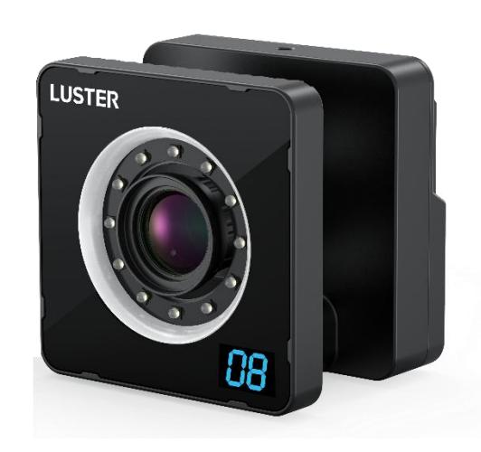

图 1.2 相机本体

相机根据不同相机型号,具备 3-5 个 1/4 英寸安装孔位,可以满足正装和吊装的需

求。

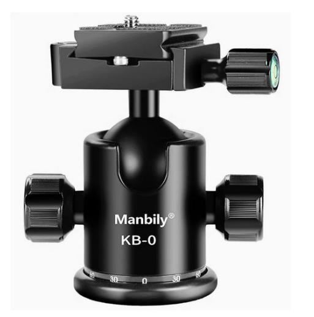

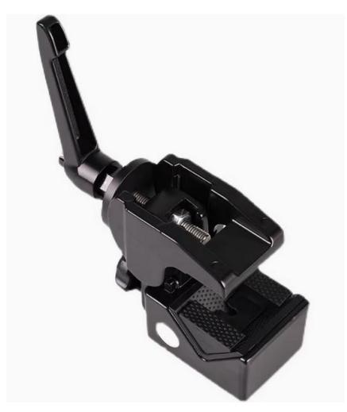

图 1.3 云台和大力夹

**Note:** 三脚架因其稳定性较差,建议仅用作临时验证使用。

通过大力夹带的 1/4 和 3/8 螺丝,安装到大力夹内,再将云台拧到大力夹上,完成 下图组装。快装板和相机之间使用快装板自带的 1/4 英寸螺丝进行紧固,将螺丝与相机 螺孔对齐后旋转螺丝,直到压紧。特殊情况下可用工具再锁紧 90°。

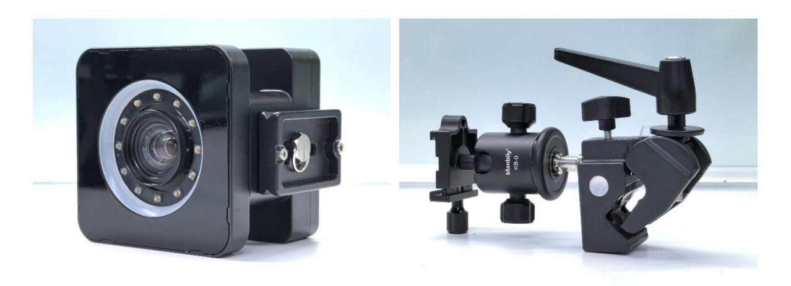

图 1.4 快装板安装与云台大力夹安装

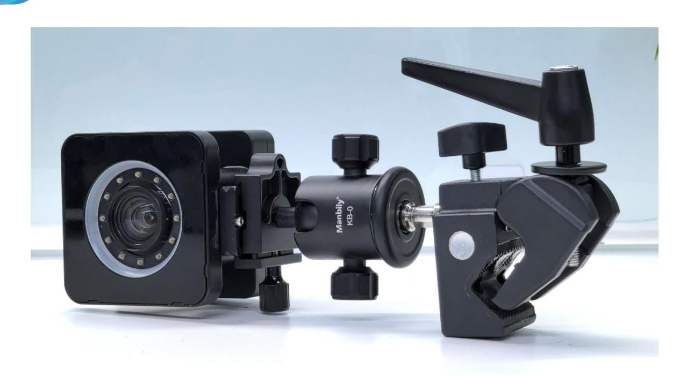

图 1.5 整体组装

### <span id="page-14-0"></span>1.4 线缆与布线规则

- 1、动捕相机的供电与数据传输均使用同一个 RJ45 网口完成,所以与相机直接连接 的交换机或交换机的某个端口需要支持 POE/POE+/POE++的供电支持,协议支持 802.3bt/at/af 及向下兼容。在本说明中,交换机被粗略的分为 2 种类型:
  - 1)上传交换机:只传输数据,该交换机一般上传带宽较大;
- 2)数据交换机:既传输数据,又给相机供电,该交换机支持 POE 供电,但带宽一 般。
  - 2、基于此,基本的连接方式主要有 2 种:
- 1)当相机数量小于 1 个数据交换机端口数量的时候,可以直接使用 1 台数据交换 机完成链路连接。
- 2)当相机数量大于 1 个数据交换机,需要 2 台数据交换机时,需要用上传交换机 来串联这些数据交换机,以此提供更大的网络带宽,保证数据连接正常。

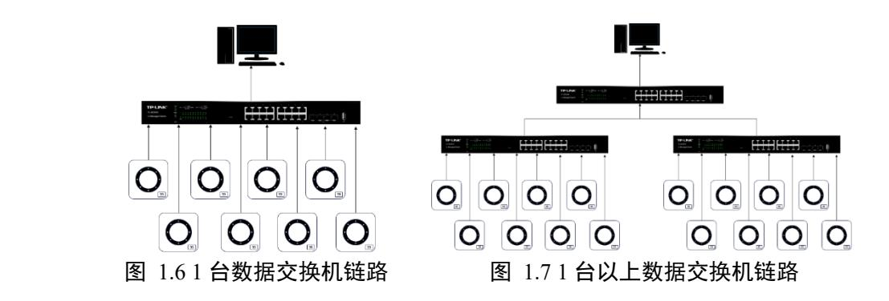

### <span id="page-15-0"></span>1.5 相机角度与焦距调整

为了保证每台相机能够充分的利用起来,需要保证每台相机对焦清晰,并且相机需 要覆盖到目标捕捉区域。

### <span id="page-15-1"></span>1.5.1 总体流程

- (1)确保相机摆放位置符合使用要求;
- (2)选择某一相机调节相机角度、对焦;
- (3)设置相机图像模式为"灰度图"模式,提高曝光时间和补光时间(两者参数需 保持一致),以获得亮度较好的图像;

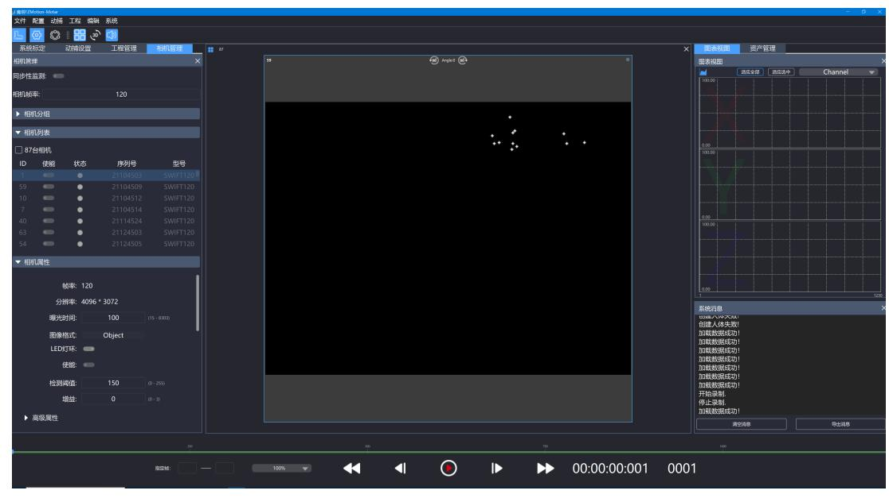

图 1.8 2D 相机界面

- (4)将标记点放在捕捉区域内,所要调整角度相机的正对角位置;
- (5)调整相机角度同时查看显示器中的相机画面,确保所需的捕获空间在相机的

#### 覆盖区域中;

- (6)参照"相机预览",放大标记点图像,使其充满画面;
- (7)调整相机焦距(细节部分在下面介绍),图像尽可能的优化;
- (8)重复上述操作,调整其他相机。

### <span id="page-16-0"></span>1.5.2 相机辅助按钮

对于其他动捕系统来说一个人调整相机角度时会比较困难,操作者需要在相机和 PC 之间往返多次,以查看 2D 视图调整相机角度。但是,FZMotion 相机背部拥有辅助 按钮,时对准目标更容易。长按按钮 3s,FZMotion 中图像会自动切换到灰度图像"灰 度图模式",曝光值也会优化,同时画面中会出现虚拟的水平/竖直线辅助调节相机角度。 这个功能简化了使用者的工作量。

### <span id="page-16-1"></span>1.5.3 调整相机角度

所有相机位置摆放好之后,需要调整相机角度,以保证相机尽可能的覆盖捕捉区域。 相机安装在固定结构上,调节相机安装云台角度,相机视场对准捕获区域。

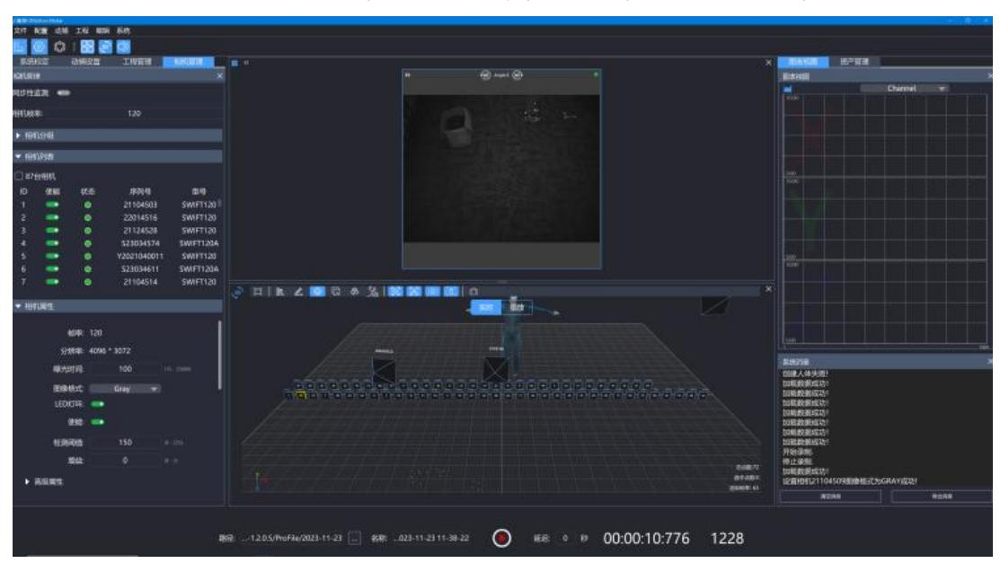

图 1.9 软件界面内相机灰度图显示

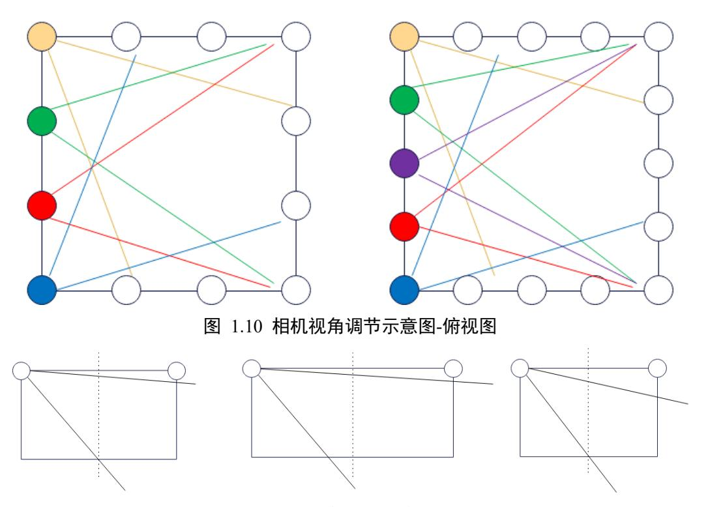

图 1.11 相机视角调节示意图-侧视图

### <span id="page-17-0"></span>1.5.4 光圈调节

光圈一般设置到数字最小值和次小值中间的位置,该数值越小,相机图像亮度越高, 但清晰成像范围会有所缩减。该值的计算需要一套复杂过程,故本手册按照经验值来指 导设置。

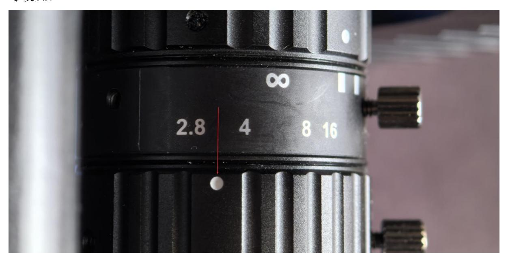

图 1.12 光圈位置说明

### <span id="page-18-0"></span>1.5.5 镜头对焦

因光学镜头的清晰成像区间的特性,本手册提供经验方法以供快速使用。如成像的 最远距离为 9 米处,那么对焦平面理论上在 3 米位置最合适,即基本原则为对焦平面在 最远工作距离的 1/3 处。

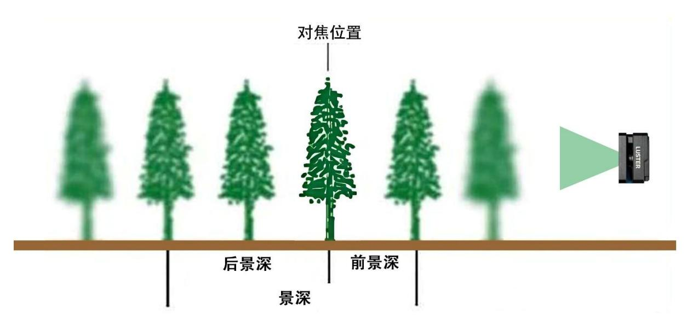

图 1.13 景深位置说明

### <span id="page-18-1"></span>1.5.6 对焦效果参考

所有 Swift 相机都可以在捕捉范围内的任何距离处调节相机镜头焦距,优化图像。 相机模式改为"灰度图",调节相机参数:提高曝光、LED 亮度,放大图像到标记点最 大,查看图像清晰度,然后调节相机镜头焦距,使标记点清晰成像。标记点对焦清晰判 断基本原则:①标记点最亮;②圆形最小;③边缘最锐利;

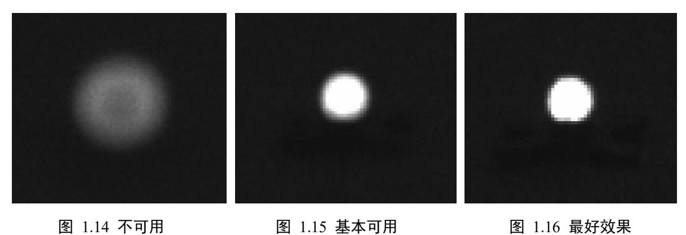

8

### 2 运行环境配置推荐与安装

### <span id="page-19-1"></span><span id="page-19-0"></span>2.1 运行环境配置推荐

组件 基本 推荐 极好 CPU Intel 酷睿 i7 9700K 单 颗 8 核 8 线程 主频 3.6G Intel 酷睿 i7 13700KF 单 颗 16 核 24 线程 主频 3.4G Intel 酷睿 i9 13900KF 单 颗 24 核 32 线程 主频 3.0G 内存 16G DDR4/2666MHZ 32G DDR5 5200MHz 64G DDR5 5200MHz 显卡 RTX 3060 + RTX 4070 + RTX 4070Ti + 网卡 板载千兆电 独立双口万兆电网卡+板载 千兆电 独立双口万兆电网卡+板载 千兆电 操作系统 Windows 10,Windows 11 Windows 10,Windows 11 Windows 10,Windows 11

表 2.1 电脑配置映射表

### <span id="page-19-2"></span>2.2 软件安装

- 1、双击打开 FZMotion 软件,系统提示"需要管理员权限执行",单击"是"按钮;
- 2、选择安装语言,选择中文或其他所需语言,单击"确定"按钮;
- 3、选择目标位置,根据电脑实际情况选择要安装的目录,单击"下一步"按钮;
- 4、选择附加任务,根据实际使用需求选择,单击"下一步"按钮;
- 5、准备安装,点击"安装"按钮;
- 6、正准备安装,选择"不关闭该应用程序",单击"下一步"按钮;
- 7、正在安装过程,根据实际情况选择安装相关插件,等待安装完成;
- 8、安装完成,根据实际情况选择是否直接运行,单击"完成"按钮,直接运行需要 插入加密狗。

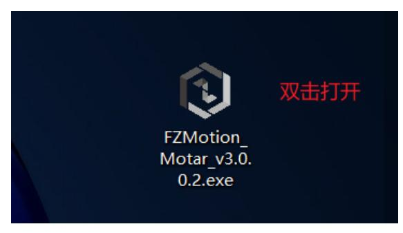

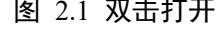

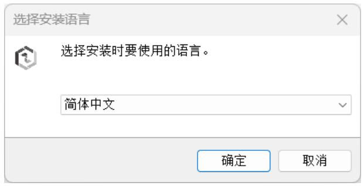

图 2.1 双击打开 图 2.2 选择安装语言

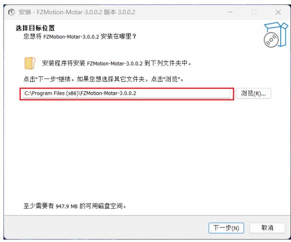

图 2.3 选择安装路径 图 2.4 选择创建快捷方式

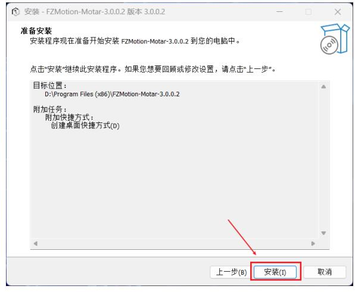

图 2.5 开始安装 图 2.6 跳过已打开应用

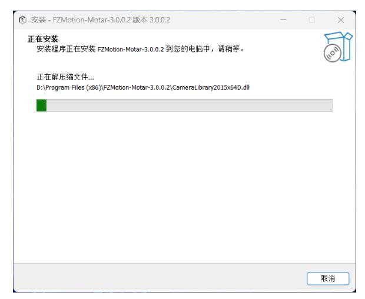

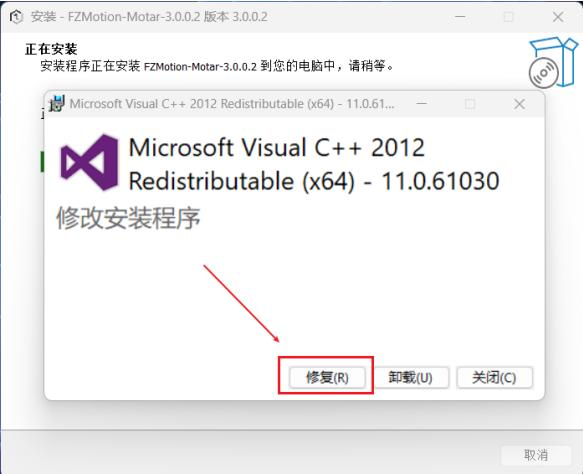

图 2.7 安装中请等待 图 2.8 安装 VC2012 库

**Note:** 在弹出的 VC 安装界面中,如果按钮是"修复",证明系统已经安装该插件,可以直接点击 "关闭"跳过,如果按钮是"安装",则点击"安装"按钮进行安装。如果单击了修复后,提示修复失 败,点击关闭即可。

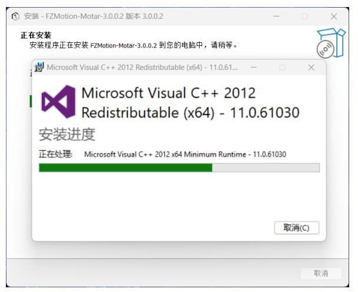

图 2.9 安装 VC2012 库中 图 2.10 VC2012 库安装完成

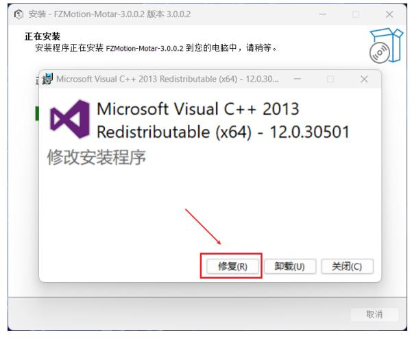

图 2.11 安装 VC2013 库 图 2.12 VC2013 库安装完成

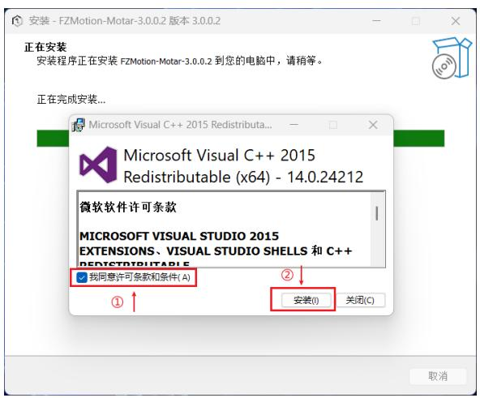

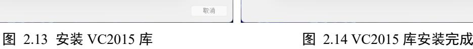

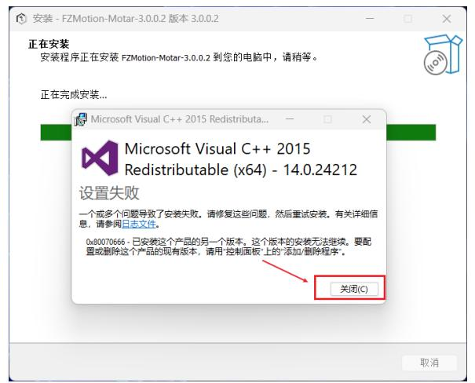

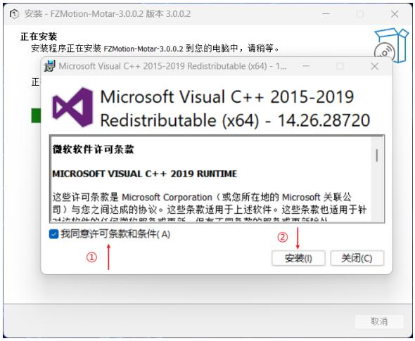

图 2.15 安装 VC2015-2019 库 图 2.16 VC2015-2019 库安装完成

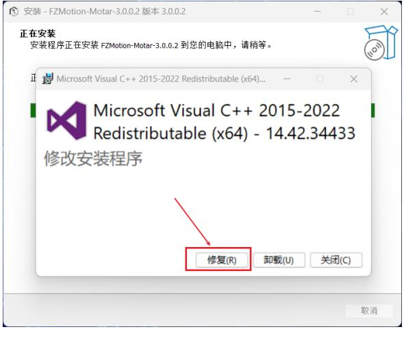

图 2.17 安装 VC2015-2020 库 图 2.18 VC2015-2020 库安装完成

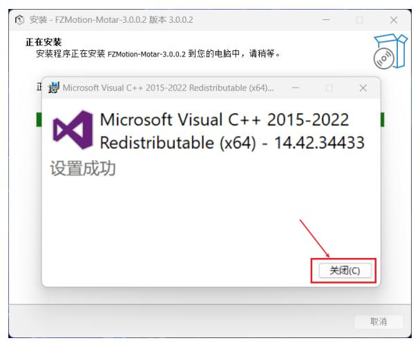

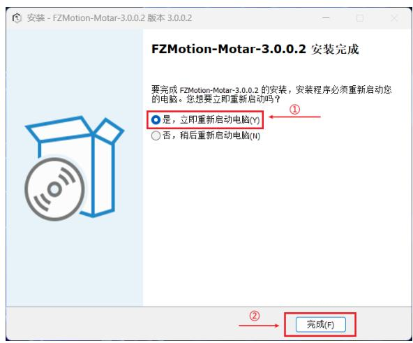

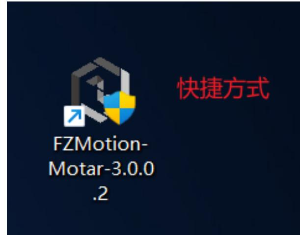

图 2.19 安装完成重启 图 2.20 桌面生成快捷方式

### <span id="page-23-0"></span>2.3 软件主界面介绍

双击或右键打开桌面生成的软件快捷方式。

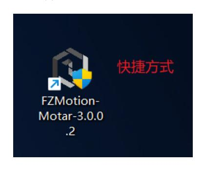

图 2.21 桌面快捷方式

软件初次启动,出现欢迎使用界面,可以快速选择您所需的使用场景,软件针对各 个场景做了不同的使用体验优化,帮助您快速使用软件。本文以通用场景作为主要说明 对象进行后续使用步骤说明。

该界面下方显示加密狗到期信息,可到期前及时续期。

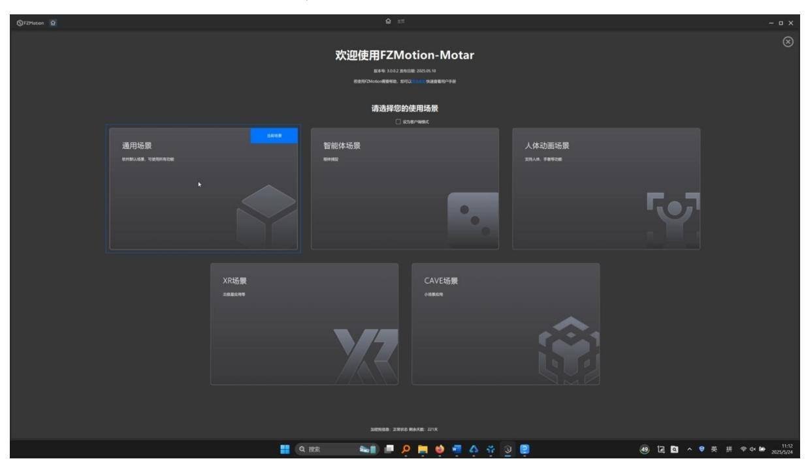

图 2.22 主页引导

单击通用场景,进入到软件主界面。

主界面主要由左侧导航栏、顶部菜单栏、系统功能区、2D 面板功能区、3D 面板功 能区、2D 渲染区、3D 渲染区、交互面板功能区、数据录制与回放功能等组成。

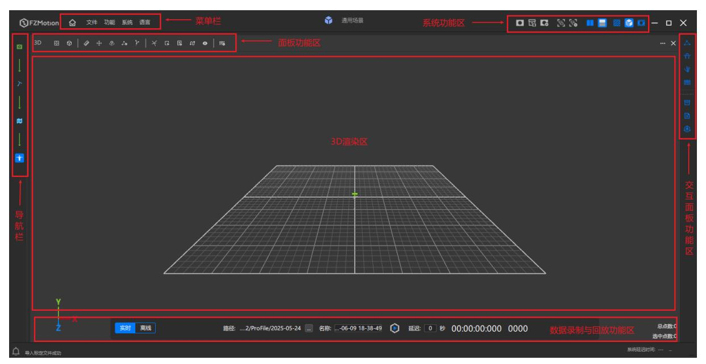

图 2.23 3D 主要功能分布

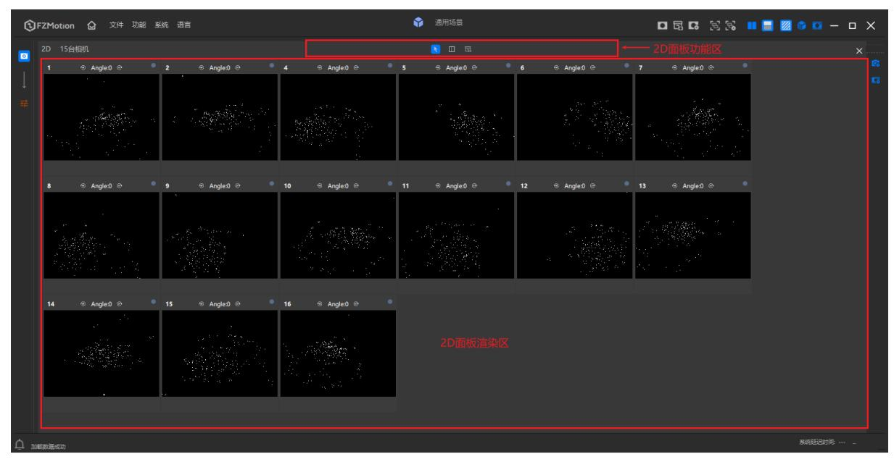

图 2.24 2D 主要功能分布

系统左侧导航栏从上到下的 4 个功能区,也是对应我们初次使用的操作流程。4 个 功能区从上到下分别为:相机管理、T 型标定(空间标定)、L 型标定(地面标定)、动 捕。

### <span id="page-24-0"></span>2.4 界面面板独立拖动与交互

打开软件进入主界面,在侧边菜单栏点击打开任意功能后,在系统面板范围内拖动 放置,软件无卡顿,再次点击后窗口正常收起。当打开多个功能项时,菜单窗口按序从

#### 右至左排列。

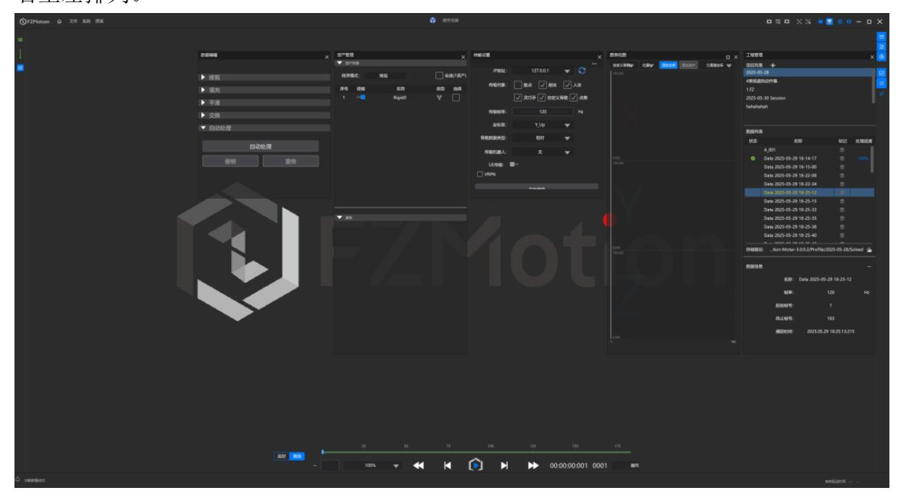

图 2.25 软件各模块交互

### 3 导航栏

### <span id="page-26-1"></span><span id="page-26-0"></span>3.1 相机

主要以显示 2D 界面为主,该界面可以进行相机管理、蒙版等配置。

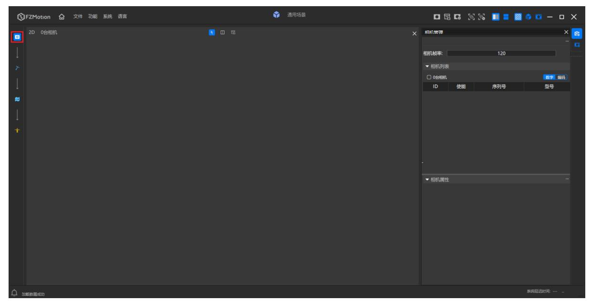

图 3.1 相机选项卡

### <span id="page-26-2"></span>3.2 标定

主要以显示 2D 界面为主,该界面可以进行系统的空间校准。

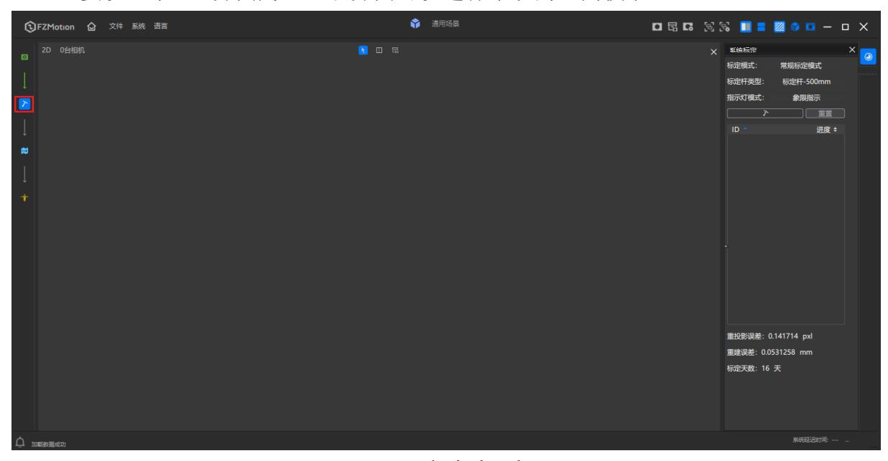

图 3.2 标定选项卡

### <span id="page-27-0"></span>3.3 世界坐标系

主要显示 2D 和 3D 渲染界面,用于设置世界坐标系原点。

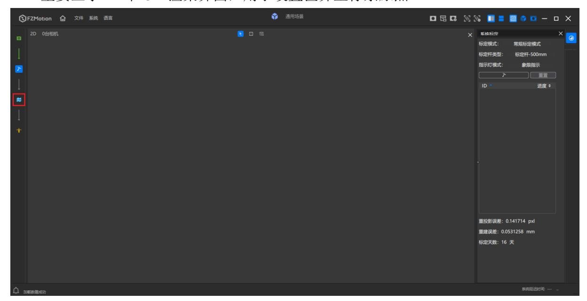

图 3.3 世界坐标系选项卡

### <span id="page-27-1"></span>3.4 动捕

常用使用界面,主要显示 3D 渲染,资产管理、交互、数据传输等各综合功能。

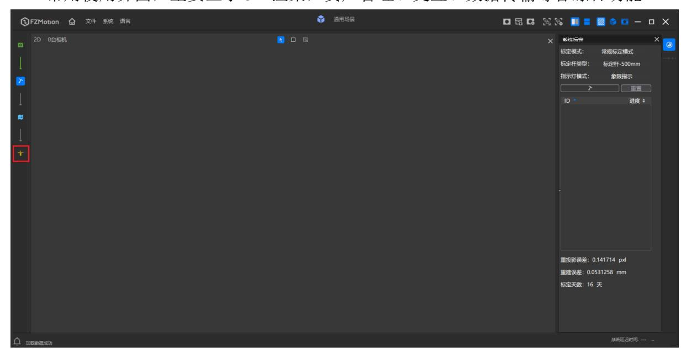

图 3.4 动捕选项卡

### 4 菜单栏

### <span id="page-28-1"></span><span id="page-28-0"></span>4.1 文件

打开软件进入主界面,点击"文件"菜单栏,出现选项框,包含"打开工程文件"、 "保存工程文件"、"打开数据文件"、"导入标定文件"、"导出标定文件"与"导入资产 文件"。

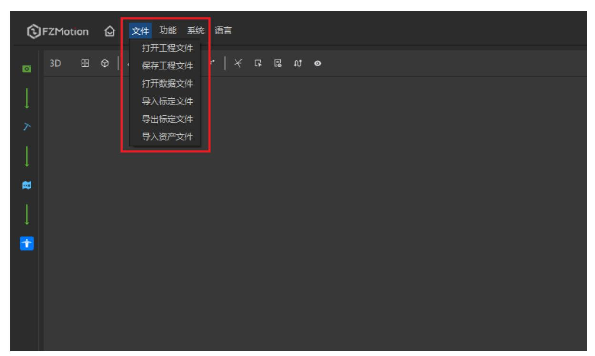

图 4.1 文件菜单

### <span id="page-28-2"></span>4.1.1 打开工程文件

选择"打开工程文件",弹出打开工程文件窗口,选择文件路径后打开工程文件。

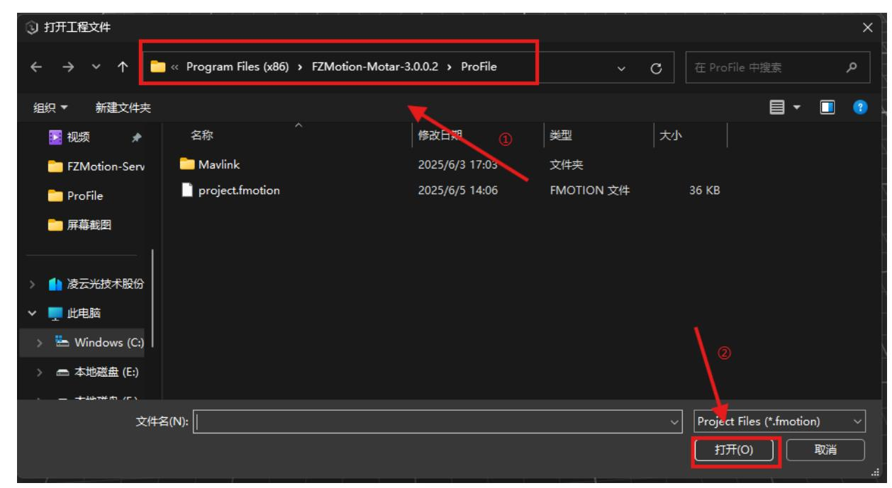

图 4.2 打开工程文件

### <span id="page-29-0"></span>4.1.2 保存工程文件

点击"保存工程文件"弹出保存工程文件窗口,选择路径命名文件,点击保存后系 统消息提示保存工程文件。

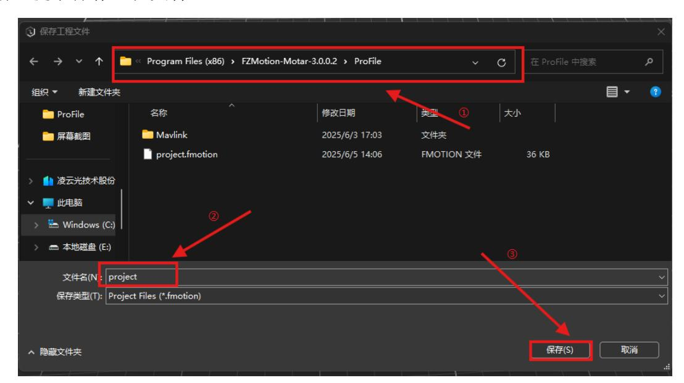

图 4.3 保存工程文件

### <span id="page-30-0"></span>4.1.3 打开数据文件

选择"打开数据文件",弹出文件选择对话框,打开数据文件所在位置,选择数据文 件后点击打开按钮,界面显示数据文件加载成功。

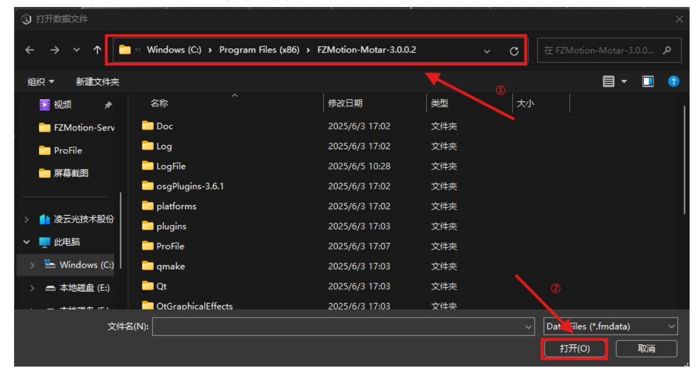

图 4.4 打开数据文件

### <span id="page-30-1"></span>4.1.4 导入标定文件

选择"导入标定文件",弹出导入标定文件窗口,选择标定文件后系统消息提示导入 标定文件成功。

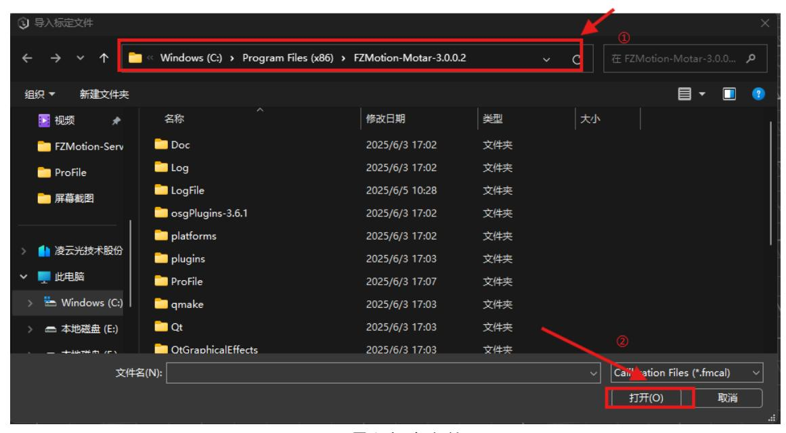

图 4.5 导入标定文件

### <span id="page-31-0"></span>4.1.5 导出标定文件

选择"导出标定文件",弹出导出标定文件窗口,选择文件路径、命名文件(文件保 存类型固定为.fmcal)后标定文件在文件夹中显示。

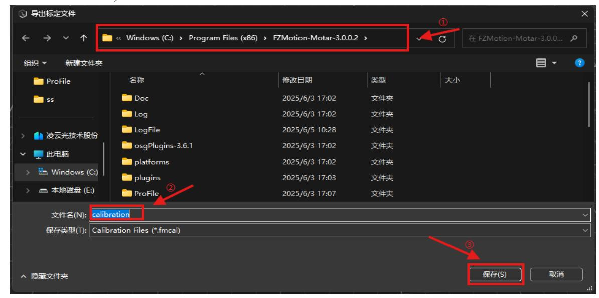

图 4.6 导出标定文件

### <span id="page-31-1"></span>4.1.6 导入资产文件

选择"导入资产文件",弹出导入资产文件窗口,打开资产文件所在路径,选择资产 文件后点击打开按钮,在资产列表中显示导入的资产文件。若导入已有资产文件,界面 中资产信息无变化。

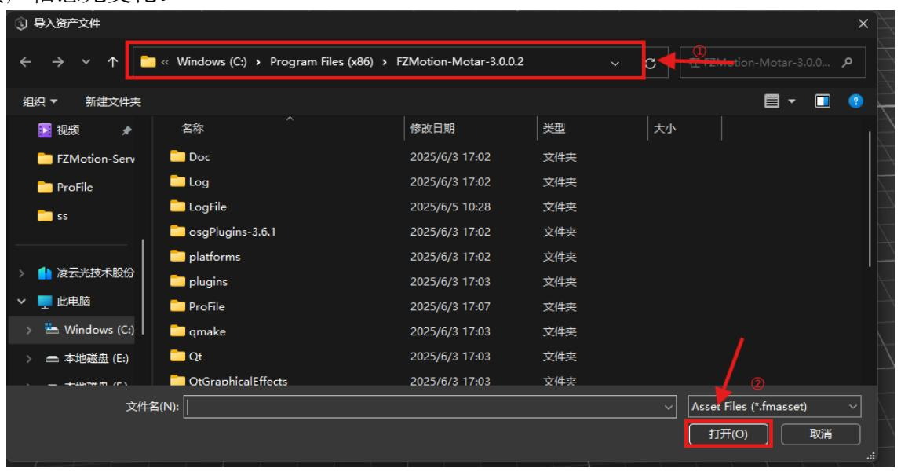

图 4.7 导入资产文件

### <span id="page-32-0"></span>4.2 功能

打开软件进入:

- 1、通用场景下,点击"功能"菜单栏,出现选项框,包含"图表视图"、"手套配置"、 "北极星"与"同步精灵"。
  - 2、智能体场景下,"功能"菜单包括"图表视图"、与"同步精灵";
- 3、XR 场景下,"功能"菜单包括"图表视图"、"人体创建"、"自定义骨骼"、"手 套配置"、"灵巧手创建"与"同步精灵";
- 4、CAVE 场景下,"功能"菜单包括"图表视图"、"北极星"与"同步精灵";人体 动画场景下,功能菜单包括"图表视图"、"北极星"与"同步精灵"。

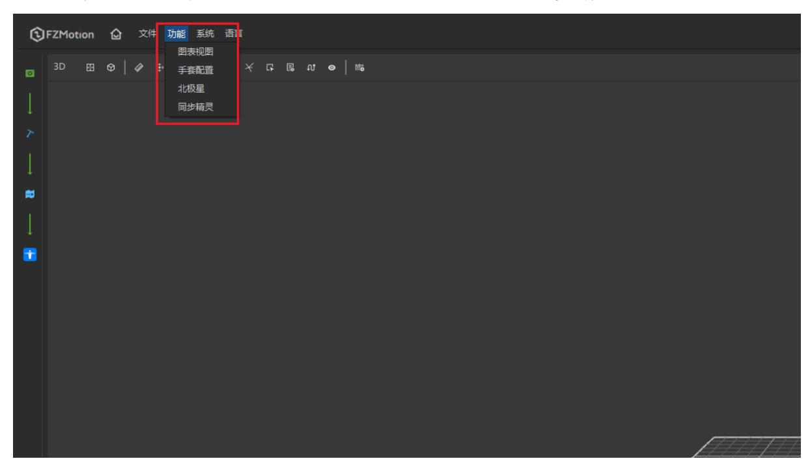

图 4.8 功能菜单

### <span id="page-32-1"></span>4.2.1 图表视图(实时模式)

选择"图表视图",系统右侧弹出"图表视图"窗口。在图表视图面板中,图表观测 类型选择框可选"点"、"刚体"和"自定义骨骼"。

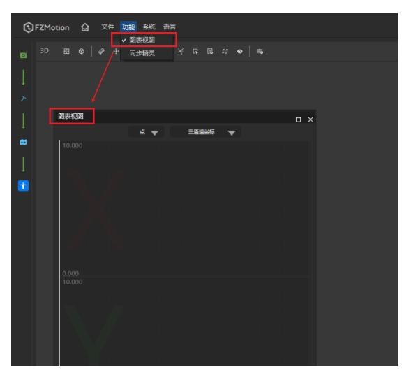

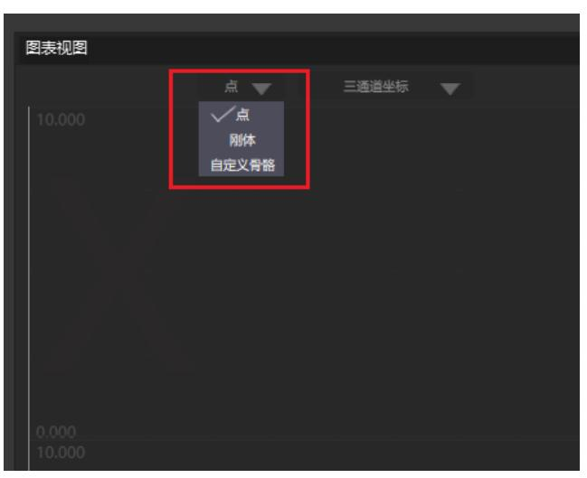

图 4.9 图表视图 图 4.10 曲线类型

- 1、选择"点"时,界面显示坐标类型(三通道坐标和混合坐标);
- 2、选择"刚体"时,界面显示查看类型(位置、角度(E)、速度、加速度、角速度、 角加速度和角度(Q))和坐标类型(三通道坐标和混合坐标);

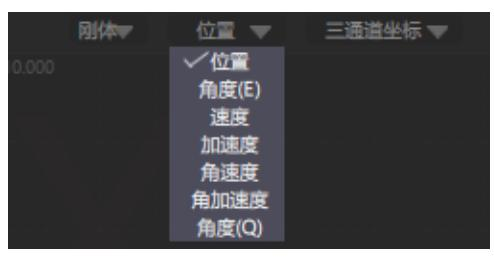

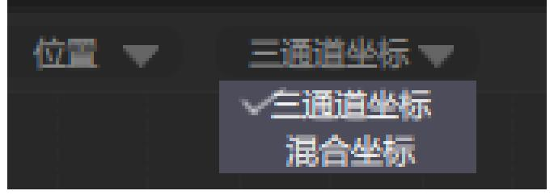

图 4.11 曲线显示信息 图 4.12 曲线显示模式

3、选择"自定义骨骼"时,界面显示查看类型(位置、角度(E)和角度(Q))和 坐标类型(三通道坐标和混合坐标);


图 4.13 曲线显示信息 图 4.14 曲线显示模式

### <span id="page-33-0"></span>4.2.2 图表视图(离线模式)

1、选择"点"时,界面显示适应全部、适应选中和坐标类型(三通道坐标、混合坐 标和追踪坐标);

图 4.15 曲线显示模式

2、选择"刚体"时,界面显示查看类型(位置、角度(E)、速度、加速度、角速度、角加速度和 角度(Q))、适应全部、适应选中和坐标类型(三通道坐标和混合坐标);


图 4.16 曲线显示信息 图 4.17 曲线显示模式

3、选择"自定义骨骼"时,界面显示查看类型(位置、角度(E)和角度(Q))、 适应全部、适应选中和坐标类型(三通道坐标和混合坐标);


图 4.18 曲线显示信息 图 4.19 曲线显示模式

### <span id="page-34-0"></span>4.2.3 数据手套

选择"手套配置",系统右侧弹出"手套配置"窗口,显示手套配置信息,包含 Manus 手套配置,无远弗届手套配置和 StrenchSense 手套配置。


图 4.20 手套配置

#### 4.2.3.1 Manus 手套连接说明

打开手套面板展开 Manus 手套设备,如图 1。首先打开 Manus 客户端,Manus 手套 与 Manus 本身客户端连接成功,手部动作在客户端正常显示。再点击 FZMotion 中的连 接客户端按钮,系统消息提示连接成功后,点击刷新手套按钮,刷新出连接的手套列表。

将手套与人体绑定:在捕获空间中创建人体,手套面板选择刷新出的手套,右键, 选择"绑定",在弹出的人体列表子菜单中,选择期望绑定人体。绑定成功后,动捕场景 中,绑定手套的人体的手部动作,将与手套佩戴者的手部动作一致。

解绑:选择绑定人体的手套,右键,选择"解除绑定"。解绑成功后,动捕场景手人 体手部动作恢复默认。


图 4.21 连接 Manus 手套

#### 4.2.3.2 Vrtrix 手套连接说明

打开手套面板展开无远弗届手套设备,如图 2。首先打开无远弗届客户端,无远弗 届一对手套与无远弗届本身客户端连接成功,手部动作在客户端正常显示。再点击 FZMotion 中的添加按钮,选择与手套对应的版本,系统消息提示连接成功后,点击刷新 手套按钮,刷新出连接的手套列表。

将手套与人体绑定:在捕获空间中创建人体,手套面板选择刷新出的手套,右键, 选择"绑定",在弹出的人体列表子菜单中,选择期望绑定人体。绑定成功后,动捕场景 中,绑定手套的人体的手部动作,将与手套佩戴者的手部动作一致。

解绑:选择绑定人体的手套,右键,选择"解除绑定"。解绑成功后,动捕场景手人 体手部动作恢复默认。

删除:删除添加的手套,删除后,手套列表刷新,不再显示删除手套。


图 4.22 连接无远弗届手套

#### 4.2.3.3 StrenchSense 手套连接说明

打开手套面板展开 StrenchSense 手套设备,如图 3。首先打开 StrenchSense 客户端, StrenchSense 手套与 StrenchSense 本身客户端连接成功,手部动作在客户端正常显示。 再点击 FZMotion 中的连接客户端按钮,系统消息提示连接成功后,点击刷新手套按钮, 刷新出连接的手套列表。

将手套与人体绑定:在捕获空间中创建人体,手套面板选择刷新出的手套,右键, 选择"绑定",在弹出的人体列表子菜单中,选择期望绑定人体。绑定成功后,动捕场景 中,绑定手套的人体的手部动作,将与手套佩戴者的手部动作一致。

解绑:选择绑定人体的手套,右键,选择"解除绑定"。解绑成功后,动捕场景手人 体手部动作恢复默认。

服务器地址:输入与客户端内一致的地址,未经修改的话按默认即可。


图 4.23 连接 StrenchSense 手套

### <span id="page-37-0"></span>4.2.4 北极星

选择"北极星",系统右侧弹出"北极星"窗口,面板显示北极星配置信息,包含 SN、ID、状态、绑定刚体、标定进度。


图 4.24 连接北极星

将一个带有标记点的刚体与北极星设备粘在一起,将北极星设备插入电脑后,打开 北极星面板,面板中可自动刷新出插入的北极星设备,将该刚体与北极星设备放在标定 好的捕获空间中,在三维界面框选住该刚体标记点,右键选择"创建刚体",打开资产面 板,查看该刚体信息,在北极星面板选中该北极星设备,右键,选择"绑定",在子菜单 中选择之前创建好的刚体(如图 [4.25](#page-38-1)),待北极星设备进入待标定状态(黄色)后,进 入场中,拿起该刚体,沿着该刚体的 xyz 进行俯仰、偏航和旋转的摇晃,直到北极星标 定完成。


图 4.25 北极星绑定刚体 图 4.26 北极星标定过程

<span id="page-38-1"></span>北极星列表状态共有四种(如图 [4.25](#page-38-1)):未绑定(透明色)、未去零偏(红色)、待 标定(黄色)、已标定(绿色)。

配置:右键选中一个北极星设备,选择"配置"后,可更改选中北极星的时延(如 图 [4.27](#page-38-2))。


图 4.27 北极星配置 图 4.28 北极星解绑

<span id="page-38-2"></span>解绑:若想刚体与北极星解除绑定,则选中该北极星设备后,右键选择"解绑",(如 图 [4.27](#page-38-2))。

### <span id="page-38-0"></span>4.2.5 同步精灵

选择"同步精灵",系统右侧弹出"同步精灵"窗口。


图 4.29 同步精灵 图 4.30 同步精灵配置

同步精灵硬件主要功能用作 FZMotion 动捕系统与外围硬件设备的同步工作与功能 控制。信号输入可用于控制动捕系统的工作频率、时钟注入、数据录制状态、数据发送 状态等。

#### 4.2.5.1 硬件连接

SYNCER 通过网线连入 FZMotion 系统,针对不同的系统情况主要分为 2 种连接方 式。当系统内只有一台数据交换机时,可直接用网线将 SYNCER 连入 POE 数据交换机, SYNCER 的供电由该交换机直接提供。


图 4.31 系统内具备只有 1 台数据交换机

当系统内有多台数据交换机时,需要用上传交换机统一上传数据,可用网线将 SYNCER 连入上传交换机,因上传交换机无 POE 供电能力,故 SYNCER 需要用配套提 供的电源适配器单独供电。


图 4.32 系统内具备多台数据交换机

#### 4.2.5.2 输入源配置

将 SYNCER 连入系统后,等待数秒后,软件会自动读取到 SYNCER 设备。在 FZMotion 主菜单,功能>同步精灵,打开同步精灵面板,显示 SYNCER 相关的配置功 能。


图 4.33 打开同步精灵面板

通过同步精灵面板右上方点出高级设置,展开所有功能。


图 4.34 展开高级设置

在输入源处选择接入信号发送的对应端口,选择完成后,系统将从该端口读取 TTL 同步信号,并让 FZMotion 系统工作在该频率。信号停止,动捕相机也停止工作。


图 4.35 设置输入源

#### 4.2.5.3 输出源配置

在信号输出端口处,勾选某个输出端口,出现可配置选项,输出类型选择输出的端 口名称,对应会将动捕频率按照 TTL 电平方波形式输出到指定端口。


图 4.36 这是住处类型

### <span id="page-42-0"></span>4.3 系统(菜单栏)

打开软件进入主界面,菜单栏包括"关于"、"帮助"和"快捷键"。


图 4.37 系统菜单

### <span id="page-42-1"></span>4.3.1 关于

点击"关于"按钮弹出"关于"的窗口,显示软件的名称、版本号和发布日期,以 及软件使用的第三方库等信息。


图 4.38 关于

### <span id="page-43-0"></span>4.3.2 帮助

点击"帮助"按钮,系统跳转打开"FZMotion 用户使用手册-Motar.pdf"文档。

### <span id="page-43-1"></span>4.3.3 快捷键

软件左上角导航栏内点击"系统"选择"快捷键"后弹出所有快捷键提示窗口。


图 4.39 快捷键

### <span id="page-44-0"></span>4.4 语言(菜单栏)

打开软件进入主界面,菜单栏包括"简体中文"和"English"。

- 1、选择"简体中文",界面语言皆切换为中文(除数据文件名称等);
- 2、选择"English",界面语言皆切换为英文(除数据文件名称等);


图 4.40 语言菜单

### 5 系统功能区

<span id="page-45-0"></span>标定前的蒙版相关操作在系统功能区,分别为【全部蒙版】、【保留资产点蒙版】、 【清除蒙版】。


图 5.1 蒙版功能区

### <span id="page-45-1"></span>5.1 设置蒙版

点击软件顶部右上方的设置蒙版进行相机蒙版。动捕环境中往往存在大量与动捕目 标无关的物体、背景图案或光线反射等干扰因素。例如在布满复杂纹理的房间内进行人 体动捕,这些环境元素可能会被相机误识别为标记点或动捕对象的一部分,导致标定数 据出现偏差。设置蒙版可划定有效动捕区域,将环境干扰区域屏蔽,使动捕软件仅针对 蒙版内的目标进行分析,避免无关信息影响标定结果的准确性。


图 5.2 全部蒙版

### <span id="page-46-0"></span>5.2 保留资产点蒙版

点击软件顶部右上方的保留资产点蒙版进行相机蒙版,此方法可将资产的散点保留 不进行蒙版。


图 5.3 保留资产点蒙版

### <span id="page-46-1"></span>5.3 清除蒙版

点击软件顶部右上方的清除蒙版进行相机蒙版清除。


图 5.4 清除蒙版

### <span id="page-47-0"></span>5.4 开启自校准

在软件顶部右上方支持开启自校准,软件在运行过程中可以进行数据采集校准,当 达到固定时间或采集数量后进行自动校准。


图 5.5 开启自校准

### <span id="page-47-1"></span>5.5 清除自校准

在软件顶部右上方支持清除自校准,可以对自校准的结果进行清除。


图 5.6 清除自校准

### <span id="page-47-2"></span>5.6 水平布局

在"世界坐标系"选项卡下,单击【水平布局】,2D 与 3D 渲染区域按照水平方式 自动布局。


图 5.7 水平布局

### <span id="page-48-0"></span>5.7 垂直布局

在"世界坐标系"选项卡下,单击【垂直布局】,2D 与 3D 渲染区域按照垂直方式 自动布局。


图 5.8 垂直布局

### <span id="page-49-0"></span>5.8 2D 按钮

在"世界坐标系"选项卡下,单击【2D】按钮,可以显示和隐藏 2D 渲染区域。


图 5.9 2D 窗口

### <span id="page-49-1"></span>5.9 3D 按钮

在"世界坐标系"选项卡下,单击【3D】按钮,可以显示和隐藏 2D 渲染区域。


图 5.10 3D 窗口

### <span id="page-50-0"></span>5.10 场监相机

在"世界坐标系"选项卡下,单击【场监相机】按钮,可以显示和隐藏场监相机区 域。


图 5.11 场监相机

### 6 相机页面

<span id="page-51-0"></span>在"相机"选项卡下,具备以下相关功能。


图 6.1 相机选项卡

### <span id="page-51-1"></span>6.1 2D 显示(实时模式)

进入动捕流程后打开 2D 显示,点击任意 1 台相机图像后,边框变为蓝色。实时状 态下右键显示相机信息包含型号、模式、帧号、曝光和 object,再次右键显示隐藏相机 信息,点击"隐藏相机信息"后相机信息隐藏;图像格式可将 2D 图像格式切换为灰度 图或 object。


图 6.2 切换灰度图模式 图 6.3 OBJECT 模式


### <span id="page-52-0"></span>6.2 手动蒙版

### <span id="page-52-1"></span>6.2.1 绘制图形蒙版

在二维面板中,可以选择手动蒙版类型进行设置,包含添加矩形蒙版、添加圆形蒙 版、移除矩形蒙版、移除圆形蒙版、橡皮擦功能类型。


图 6.4 绘制图形蒙版

### <span id="page-52-2"></span>6.2.2 保留资产点手动蒙版

在二维面板中可以选择保留资产点进行手动蒙版。


图 6.5 保留资产点蒙版区域

### <span id="page-53-0"></span>6.3 2D 显示(离线模式)

离线状态下右键显示相机信息,包含型号、模式、帧号、曝光和 object,再次右键 显示隐藏相机信息,点击后相机信息隐藏。


图 6.6 显示相机信息 图 6.7 隐藏相机信息

### <span id="page-53-1"></span>6.4 相机管理

### <span id="page-53-2"></span>6.4.1 相机管理面板默认状态

默认显示相机帧率设置和当前接入相机的基本信息(例如 ID、序列号和型号)。


图 6.8 相机管理面板

### <span id="page-54-0"></span>6.4.2 相机管理面板高级设置

点击相机管理面板右上角【...】打开高级设置,出现同步性监测、恢复默认参数和 相机分组功能区。


图 6.9 展开高级设置

### <span id="page-54-1"></span>6.4.3 同步性监测

点击同步性监测开关,出现同步性监测信息窗口,可观测当前软件接入相机的同步 状态。该曲线越平稳,同步性越好。图标数轴为延迟时间,横轴为每一台相机。


图 6.10 相机同步性监测

### <span id="page-55-0"></span>6.4.4 设置相机帧率

在【相机帧率】输入框中可设置当前系统的目标帧率值,修改之后动捕软件连接的 相机帧率和动捕频率会对应修改。


图 6.11 设置相机帧率

### <span id="page-55-1"></span>6.4.5 恢复默认参数

在修改了相机参数的时候,点击【恢复默认参数】按钮,即可将所有相机参数恢复 为软件初始安装连接相机时的默认参数。


图 6.12 恢复默认参数

### <span id="page-56-0"></span>6.4.6 相机分组

相机分组功能可以将相机分为多个组别,每个组的相机拥有自己的参数,且可以一 件选中一个组的相机进行统一配置。

#### 6.4.6.1 新建相机分组

点击【+新建分组】可以创建相机分组,相机分组在添加相机后,可以对分组内的相 机进行统一操作(例如快速选中、修改相机参数)。


图 6.13 新建相机分组

#### 6.4.6.2 修改相机分组名称

双击相机分组条目,可以对相机分组名称进行修改。


图 6.14 修改分组名称

#### 6.4.6.3 加入/移除相机分组

在某个相机上右键出现菜单【加至分组】或【移除分组】,选择对应操作项后可选择 具体操作的分组进行设置。


图 6.15 加入移除相机分组

#### 6.4.6.4 删除相机分组

鼠标移至分组信息时出现【删除】按钮,点击后可对选中相机分组进行删除。


图 6.16 删除相机分组

### <span id="page-58-0"></span>6.4.7 全选相机

点击【全选】复选框,可以对所有相机进行选中,进行统一的参数设置。


图 6.17 全选相机

### <span id="page-58-1"></span>6.4.8 相机 ID 显示模式

设置相机 ID 显示模式【数字/编码】,可以对相机在二维区域、三维区域、标定列表

中的 ID 显示模式进行设置。因相机编号显示器只支持 2 位数字显示,故在相机数量大 于 100 台时,相机编号显示器开始显示字母和数字的组合,软件设置为编码形式,可以 快速对应软件中和现实世界中的相机关系。


图 6.18 编码模式设置

### <span id="page-59-0"></span>6.4.9 相机使能

选中某个相机,可通过使能开关对相机进行使能控制。使能关闭后,该相机在二维 界面中的显示变为默认图像,三维界面中该相机消失,标定流程中也不会参与,录制和 数据传输过程中也不会包含该相机,开启使能后效果反之。


图 6.19 相机使能

### <span id="page-60-0"></span>6.4.10 相机格式设置

点击图像格式下拉框,可对选中相机的图像格式进行设置(Object/Gray)。Object 格 式主要用于观测反光点位置,灰度图主要用于查看动捕实景。

### <span id="page-60-1"></span>6.4.11 相机属性

选中一台相机后,显示默认相机属性参数,包含曝光时间、增益和图像格式。


图 6.20 相机属性及配置

#### 6.4.11.1 曝光时间

控制相机感光元件接收光线时长的关键参数。当在夜间虚拟直播、暗光实验室等光 线不足的动捕场景中,通过延长曝光时间,能让更多光线进入相机,使画面更明亮,确 保演员的肢体动作、表情细节等动捕数据被完整清晰捕捉;而当需要捕捉运动员跳跃、 舞蹈演员快速旋转等高动态动作时,缩短曝光时间可瞬间定格动作,避免因物体移动造 成的画面模糊,保障骨骼点定位的准确性。

#### 6.4.11.2 增益

通过电路放大感光元件的电信号强度,实现画面亮度的提升。在动捕过程中遇到灯 光突然故障、户外动捕遭遇乌云遮挡等突发弱光情况时,在动捕软件中临时调高增益, 可快速增亮画面,保证动捕拍摄不中断,防止关键动作数据丢失。对于户外移动动捕、 低成本小型动捕项目等不便使用大量专业补光设备的场景,适度提高增益,能在一定程 度上弥补光线不足,维持正常动捕工作。不过,增益数值越高,画面产生的噪点就越明 显,这些噪点可能会被动捕软件误判为标记点,从而造成骨骼识别错误、动作数据偏差 等问题,因此使用增益功能时,需在画面亮度与数据准确性之间谨慎权衡。

#### 6.4.11.3 图像格式

目前支持 Obejct 格式和灰度图格式。Object 格式主要用于观测反光点位置,灰度图 主要用于查看动捕实景。点击图像格式下拉框,可对选中相机的图像格式进行设置 (Object/Gray)。


图 6.21 图像格式

### <span id="page-61-0"></span>6.4.12 相机属性高级设置

点击相机属性区域右上角的【高级设置】后,将出现帧率、分辨率、序列号、相机 厂商、相机型号、固件版本、IP 显示信息和曝光时间、增益、图像格式、LED 灯环、使 能、检测阈值、补光时间、补光亮度、辅助瞄准、MTU、边缘阈值、圆度 0、圆度 1、 圆度 2、面积 0、面积 1、面积 2 设置参数。


图 6.22 展开高级设置


图 6.23 高级设置内容

### <span id="page-62-0"></span>6.4.13 相机参数设置

打开相机高级属性后,可在面板中对曝光时间、增益、图像格式、LED 灯环、使能、 检测阈值、补光时间、补光亮度、辅助瞄准、MTU、边缘阈值、圆度 0、圆度 1、圆度 2、面积 0、面积 1、面积 2 参数进行配置。

#### 6.4.13.1 使能

会决定目标相机是否参与二维、三维、标定、录制、数据传输等流程。

#### 6.4.13.2 检测阈值

检测阈值就是指原图中点的亮度阈值。

#### 6.4.13.3 补光时间

相机在拍摄过程中进行补光操作的持续时长。该参数默认会和曝光时间一致,特殊 情况也可以单独设置。单位为微妙(us)。

#### 6.4.13.4 补光亮度

用于调节补光设备输出光线的强弱程度。不同的拍摄环境和动捕需求对光线强度要 求各异。在明亮的室外环境进行动捕,过高的补光亮度会使画面过曝,导致目标物体细 节丢失,此时需降低补光亮度,作为环境光的补充,使动捕对象的轮廓和动作更清晰; 在室内光线昏暗的场景,增加补光亮度可有效提升画面整体亮度,让动捕软件能准确识 别演员身上的标记点以及细微的动作变化。合理调整补光亮度,能在不同光照条件下平 衡画面明暗,确保动捕相机捕捉到的图像具备良好的对比度和清晰度,为后续动作分析 与数据处理提供优质素材。

#### 6.4.13.5 MTU

在网络通信中,能够在网络中传输的最大数据包大小。在动捕系统中,若涉及多台 相机数据的实时传输与整合,或需将动捕数据远程传输至其他设备进行处理时,MTU 设 置就显得尤为关键。较大的 MTU 值可使数据以更大的数据包形式传输,能在一定程度 上减少传输过程中的数据包拆分与重组次数,提高数据传输效率,适合网络状况良好、 带宽充足的场景,确保动捕数据(如大量的图像数据、动作分析结果等)快速、完整地 传输;但如果网络存在不稳定因素,过大的 MTU 可能导致数据包丢失、重传,此时适 当减小 MTU,虽会增加数据包数量,但能提升数据传输的可靠性,保障动捕数据在复 杂网络环境下稳定传输,避免数据丢失影响动捕效果。

#### 6.4.13.6 边缘阈值

边缘阈值参数一般不建议非专业人员进行设置。边缘阈值用于界定图像中物体边缘 的判定标准。边缘是图像中像素值发生剧烈变化的区域(如物体边界、明暗交界线等), 而边缘阈值用于设定一个 "敏感度标准"。当像素值的变化幅度超过该阈值时,相机将 其判定为 "边缘",并强化这些区域的对比度;若变化幅度未达到阈值,则视为 "非边 缘"(如平滑的背景区域),处理时可能弱化或忽略。

#### 6.4.13.7 圆度参数

圆度参数(圆度 0、圆度 1、圆度 2 等)通常用于评估图像中圆形或近似圆形物体 (如动捕系统中常用的圆形标记点)的形状与标准圆形的接近程度。圆度 0 指 object 面 积在[2,100]范围内时,使用此圆度阈值进行约束,圆度 1 指 object 面积在[100,400]范围 内时,使用此圆度阈值进行约束,圆度 2 指 object 面积在[400,4000]范围内时,使用此圆 度阈值进行约束。

#### 6.4.13.8 面积参数

面积参数(面积 0、面积 1、面积 2 等)就是原图目标点占的像素大小,大于设定 面积阈值就可以送出 mark 点。面积 0 用于限制像素面积小于此阈值 object 点的输出, 面积 1 用于限制圆度 0 约束的面积阈值上限,以及圆度 1 约束的面积阈值下限;面积 2 用于限制圆度 1 约束的面积阈值上限,以及圆度 2 约束的面积阈值下限。


图 6.24 相机参数设置


图 6.25 相机参数设置

### <span id="page-65-0"></span>6.5 场监相机配置

### <span id="page-65-1"></span>6.5.1 相机列表与画面显示

场监相机图像显示面板显示相机采集的实时图像,鼠标右键菜单可选择是否显示相 机信息。


图 6.26 场监相机

### <span id="page-66-0"></span>6.5.2 相机属性

场监相机配置面板中显示场监相机列表,相机属性。场监相机图像显示面板显示场 监相机实时图像。相机属性信息中包括相机使能设置,相机帧率显示,相机分辨率显示, 相机名称显示。

### <span id="page-66-1"></span>6.5.3 参与录制

是否参与录制按钮控制在数据录制过程中是否录制场监相机的数据。

### <span id="page-66-2"></span>6.5.4 相机选择

全选按钮控制是否全部选中相机,相机选中后显示相机属性信息。


图 6.27 相机选择

### 7 标定页面

<span id="page-67-0"></span>在"标定"选项卡下,单击右侧【系统标定】,显示出系统标定面板。


图 7.1 系统标定面板

### <span id="page-67-1"></span>7.1 标定杆类型选择

在标定面板中可以选择标定杆类型,支持 125mm、250mm、500mm 和自定义类型。


图 7.2 标定干类型

### <span id="page-68-0"></span>7.2 标定指示灯选择

在标定面板中可以选择标定指示灯类型,支持象限模式和颜色模式。象限模式在标 定过程中,标定进度通过灯环不同象限位置亮起说明相机标定状态;颜色模式在标定过 程中,标定进度通过红色、黄色、绿色说明相机标定状态。


图 7.3 指示灯模式

### <span id="page-68-1"></span>7.3 常规标定

在标定面板中可以选择常规标定,即初始化安装软件时没有标定情况下,可以进行 常规标定。


图 7.4 常规标定

### <span id="page-69-0"></span>7.4 局部标定

在标定面板中可以选择局部标定,在已经标定过的场景中如果某个相机位置发生了 变化, 可以选择局部标定进行优化;并且可以选择局部标定的具体相机。


图 7.5 局部标定

### <span id="page-69-1"></span>7.5 全局校准

在标定面板中可以选择全局校准模式,对全部相机进行标定校准。该标定方式只标 定相机外参,不标定相机内参。第一次标定必须使用常规标定。快速标定可使用本功能。


图 7.6 全局校准

### <span id="page-69-2"></span>7.6 开始标定

在选择好标定模式、标定杆类型、标定指示灯类型、点击开始标定按钮进入标定状

态。


图 7.7 开始标定

### <span id="page-70-0"></span>7.7 重置标定

在标定过程中如果想中断标定流程,可点击重置标定按钮进行重置。


图 7.8 重置标定

### <span id="page-70-1"></span>7.8 标定计算

当软件标定采集数据达到目标数量后,系统标定面板出现标定计算按钮,点击标定 计算按钮开始计算。


图 7.9 标定计算

### 8 世界坐标系页面

<span id="page-72-0"></span>在"世界坐标系"选项卡下,单击右侧【设置世界坐标系】,显示出设置世界坐标系 面板。


图 8.1 设置世界坐标系面板

### <span id="page-72-1"></span>8.1 设置世界坐标系

在设置世界坐标系面板中,标定计算成功以后,点击设置世界坐标系按钮进行坐标 系原点设置。在多人动捕或多设备协同工作的场景中,不同相机、传感器采集的数据需 要在同一空间体系下整合。设置世界坐标系,就如同为所有动捕设备和数据划定一个共 同的 "地图",确保每个设备捕捉到的动作数据,无论是来自哪个角度、哪台相机,都能 基于同一套空间规则进行定位,避免因参照标准不统一导致数据错位或无法拼接的问题。


图 8.2 设置世界坐标系

### <span id="page-73-0"></span>8.2 预设世界坐标系

在设置世界坐标系面板中支持选择其他标定文件解析对应的坐标系信息进行设置。


图 8.3 预设世界坐标系

### <span id="page-73-1"></span>8.3 地杆高度设置

在设置世界坐标系面板中支持修改地杆高度,在设置世界坐标系前进行地面高度设 置。


图 8.4 地杆高度设置

### <span id="page-74-0"></span>8.4 地面校准

在设置世界坐标系面板中支持进行地面校准。地面校准通过对真实地面(可以是摆 放在某一平面的反光点)的识别与定位,在动捕系统的虚拟空间中构建一个标准参考平 面。在人体动捕场景中,它能准确界定人物站立、行走、跳跃等动作的起始位置与运动 高度,使动捕数据中的垂直位移、腾空高度等参数符合真实物理空间逻辑。


图 8.5 地面校准

### <span id="page-74-1"></span>8.5 自定义地杆模式

在设置世界坐标系面板中可以自定义地杆点,进行世界坐标系设置。实时、非录制、 非定帧状态下,设置世界坐标系面板高级设置打开后,打开自定义地杆模式后,三维场 景内选中单个点后,右键菜单中可显示此项,点击后显示子菜单,包含【设为圆点】、【X 轴点】、【Z 轴点】三个选项,根据实际选点及要设置的关系分别选择对应点后设为对应 点位。


图 8.6 自定义地杆

### <span id="page-75-0"></span>8.6 世界坐标系偏移设置

在设置世界坐标系面板中,可以对世界坐标系进行偏移,通过设置数值或拖动三向 轴修改。


图 8.7 世界坐标系偏移

### <span id="page-76-0"></span>8.7 重置世界坐标系

在设置世界坐标系面板中进行了坐标系修改以后,可以点击重置世界坐标系按钮进 行重置。


图 8.8 重置世界坐标系

### 9 动捕页面

### <span id="page-77-1"></span><span id="page-77-0"></span>9.1 3D 渲染区

### <span id="page-77-2"></span>9.1.1 区域功能

3D 显示区主要显示动捕实时、离线三维场景,包括地面、标定后相机空间位姿、实 时动捕对象位姿等,如图所示。


图 9.1 3D 渲染区域

- 1、顶部工具栏左侧为辅助功能按钮区,右侧
- 图 9.2 按钮为高级设置控制按钮,
- 图 9.3 为关闭按钮;
- 2、中间为 3D 显示区,显示实时或离线播放动捕帧数据渲染效果;
- 3、左下角坐标系指示器显示当前观测视点相对世界坐标系的旋转关系;
- 4、右下角统计信息显示当前动捕总点数和选中点数。底部中间区域内实时/离线切 换按钮可切换当前实时、离线状态,按钮右侧对应显示录制(实时)、播放(离线)控制 面板;
  - 5、右键渲染区域,在弹出的菜单中有相关关联操作。

### <span id="page-78-0"></span>9.1.2 旋转与缩放

三维场景内鼠标操作定义如下:左键用于选择对象,右键用于旋转,中键用于平移, 滚轮用于缩放。

### <span id="page-78-1"></span>9.1.3 资产选择

- 1、实时动捕或离线播放数据过程中,鼠标左键单击场景内的点、相机、刚体质心、 人体蒙皮、自定义骨骼及灵巧手骨骼段均可选中该对象。
- 2、鼠标左键按下不松开拖动可执行框选,鼠标拖动过程中显示框选区域,松开后矩 形区内的对象被选中。
  - 3、点击场景空白处清除选中。选中对象显示为黄色,取消选中后恢复初始状态。
  - 4、快捷键:CTRL+A 全选场内所有点;
- 5、CTRL 键不松开+鼠标点选或框选:依次点选或框选各对象可改变各对象选中状 态(未选中的被选中,已选中的取消选中),松开 CTRL 键后取消连续选择;

### <span id="page-78-2"></span>9.1.4 右键菜单

#### 9.1.4.1 适应窗口

窗口恢复默认观测视角,点击后即生效。

#### 9.1.4.2 视图设置

设置三维场景观测视图,视图类型包括:默认视图(默认)、正视图、后视图、左视 图、右视图、俯视图、仰视图,默认视图下鼠标操作支持旋转、缩放、平移;其它视图 下支持缩放、平移,不支持旋转。


图 9.4 视图设置

#### 9.1.4.3 创建刚体

实时、非录制、非定帧状态下或离线打开数据加载完毕后,选中三个及以上散点后 右键可显示此项,点击后创建刚体。


图 9.5 创建刚体

#### 9.1.4.4 创建准刚体

实时、非录制、非定帧状态下或离线打开数据加载完毕后,选中三个及以上散点后 右键可显示此项,点击后创建准刚体(允许一定变形)。


图 9.6 创建准刚体

#### 9.1.4.5 创建探针

实时、非录制、非定帧状态下,右键可显示此项,点击后自动搜索匹配创建探针刚 体。系统中只允许存在 1 个探针刚体,重复创建无效,未匹配到则创建失败。探针刚体 不可编辑,无法选中,只可通过探针测量面板【删除探针】按钮删除。


#### 9.1.4.6 加入刚体

实时、非录制、非定帧状态下,当前存在刚体时,选择单个或多个散点,右键菜单 中可显示此项,点击选择后,显示当前刚体列表(刚体 ID:刚体名称),选择刚体后所选 点加入到所选刚体,未进行质心调整情况下,加入点后质心位置自动根据最新结构体计 算。


图 9.9 加入刚体

#### 9.1.4.7 移出刚体

实时、非录制、非定帧状态下,选中同一刚体内单个或多个资产点后,右键菜单中 可显示此项,点击后所选点从当前刚体内移除,刚体结构更新并重新根据剩余点计算质 心位置。若所选点移除刚体后此刚体内剩余资产点数不满足刚体资产点数要求(≥3), 则不执行移除操作并弹出提示"删除后刚体剩余点数不足以构成刚体,不能删除!"。


图 9.10 移出刚体 图 9.11 删除刚体提示

#### 9.1.4.8 设为质心

实时、非录制、非定帧状态下,选中单个点(散点或资产点)后,若当前存在刚体, 则右键菜单中可显示此项,点击后显示当前刚体列表(刚体 ID:刚体名称),选择刚体后 将此刚体的质心位置到所选点当前帧三维坐标设置。


图 9.12 设为质心

特别说明:设置后此点与设置的刚体质心无关系,刚体质心与刚体结构保持设置质 心时相对位置关系,此点移动刚体质心不跟随移动。

#### 9.1.4.9 恢复质心

实时、非录制、非定帧状态下,选中当个刚体后,右键菜单中可显示此项,点击后 刚体质心恢复为根据刚体内点结构关系计算,之前所做的质心偏移调整、设为质心、定 帧跳帧轴向等操作均重置。


图 9.13 恢复质心

### <span id="page-83-0"></span>9.2 3D 面板功能区

在"世界坐标系"选项卡下,3D 面板功能区按钮为:【适应窗口】、【视图设置】、【显 示点与相机射线】、【对象属性】,如下图所示:


图 9.14 3D 面板功能区

在"动捕"选项卡下,工具栏功能按钮从左至右依次为:【适应窗口】、【视图设置】、 【测量】、【质心调整】、【刚体旋转】、【配置工具】、【探针测量】、【显示点与相机射线】、 【选择动捕对象】、【对象属性】、【轨迹设置】、【显示对象设置】、【创建自定义骨骼】,如 下图所示:


图 9.15 动捕面板功能区

打开高级设置后工具栏增加高级设置项:【动捕模式选择】、【显示视场】、【追踪质 量】、【视野追踪】,如下图所示:


图 9.16 展开高级设置

### <span id="page-84-0"></span>9.2.1 适应窗口

窗口恢复默认观测视角,点击后即生效。

### <span id="page-84-1"></span>9.2.2 视图设置

设置三维场景观测视图,视图类型包括:默认视图(默认)、正视图、后视图、左视 图、右视图、俯视图、仰视图,默认视图下鼠标操作支持旋转、缩放、平移;其它视图 下支持缩放、平移,不支持旋转。


图 9.17 视图设置

### <span id="page-85-0"></span>9.2.3 测量

使能状态下选中 2 个点,则测量并显示两点间距离;选中 3 个点,则测量并显示 3 个点间最小角度。距离和角度精度均为小数点后 3 位。默认为非使能状态,点击切换使 能状态。


图 9.18 两点测距 图 9.19 三点测角度

### <span id="page-85-1"></span>9.2.4 质心调整

实时动捕下,点击该按钮设为使能状态后,选中单个刚体质心,此刚体质心位置显 示可调整坐标轴,鼠标悬停在各轴箭头位置后该轴显示为黄色选中状态,鼠标按下拖动 该轴箭头,可调整刚体质心在该轴向上偏移量,拖动过程中调整轴跟随移动,并显示当 前偏移量,刚体质心保持实时动捕位置不跟随拖动改变,鼠标松开后调整生效,刚体质 心位置按照拖拽偏移量进行调整。默认为非使能状态,点击切换使能状态。多选刚体或 选中单个刚体+其它资产均不显示调整轴。定帧调整刚体坐标轴时此功能失效。

选中刚体质心调整时,若按下 CTRL 键不松状态下鼠标选中单个点,则此当前帧位 置为质心调整自动吸附中心,,选中多个点则以多个点的拟合中心为吸附中心,吸附中 心位置处显示青色三轴向十字线作为吸附中心标识。拖动某调整轴到与此吸附中心该轴 向坐标间距离≤阈值(10mm)处后,刚体质心该轴向自动吸附到吸附中心对应该轴的坐 标位置,若想将刚体质心调整到此吸附中心处,需依次拖拽 X、Y、Z 轴到满足吸附条 件的位置。


图 9.20 质心调整

### <span id="page-86-0"></span>9.2.5 刚体旋转

实时动捕下,点击该按钮设为使能状态后,选中单个刚体质心,此刚体质心位置显 示可调整旋转轴,鼠标悬停在各旋转轴上任意位置该轴显示为黄色选中状态,鼠标按下 拖动旋转该轴,可调整刚体局部坐标系该轴向旋转偏移量,拖动过程中旋转轴跟随移动, 并显示当前偏移角度,刚体局部坐标轴保持实时动捕位姿不跟随拖动改变,鼠标松开后 调整生效,刚体坐标轴按照旋转偏移量进行调整。默认为非使能状态,点击切换使能状 态。多选刚体或选中单个刚体+其它资产均不显示旋转轴。定帧调整刚体坐标轴时此功 能失效。


图 9.21 刚体质心旋转

### <span id="page-87-0"></span>9.2.6 配置工具

点击此按钮显示子菜单,包括超大反光点设置、刚体动捕设置、刚体坐标系调整三 个配置功能。


图 9.22 配置工具

#### 9.2.6.1 超大反光点设置

单击打开设置面板,可设置超大反光点的 ID、半径,点击设置生效,软件自动识别 于设置半径相符的超大反光点并将识别到的点 ID 设置为所设置的 ID,取消设置则去掉 超大反光点识别。设置面板右上角关闭按钮点击或菜单中再次点击可关闭此面板。


图 9.23 超大反光点 图 9.24 刚体动捕设置


#### 9.2.6.2 刚体动捕设置

打开刚体动捕设置面板,可设置刚体速度平滑强度、刚体匹配模式和刚体相似性检 测,参考上图。

#### 9.2.6.3 刚体坐标系调整

打开刚体坐标系调整面板,未选中单个刚体时显示提示信息"请选择单个刚体",选 中单个刚体后显示界面如图所示。可手动输入值调整刚体质心偏移量和刚体坐标轴旋转 偏移量,勾选定帧调整轴向后位置偏移量设置和姿态偏移量设置禁用,三维窗口顶部显 示提示信息"定帧中,取消定帧调整轴向勾选或关闭刚体坐标系调整面板后恢复实时更 新"。

轴向调整功能说明:选择要调整的主轴轴向(X+、Y+、Z+、X-、Y-、Z-),选择此 轴向通过什么类型的目标进行对齐(标记点、多点中心、轴向),确定类型后,点击对齐 目标下的输入框进入选择状态,若选择类型为标记点,则点选或框选单个点后以此点与 刚体质心的连线方向作为所选主轴的轴向;若选择类型为多点中心,则按下 CTRL 键依 次点选多个点或框选多个点后,以所选点的拟合中心与刚体质心的连线方向作为所选主 轴的轴向;若选择类型为轴向,则通过对齐目标列主轴行的下拉框选择轴向进行对齐(世 界坐标系 X 轴、世界坐标系 Y 轴、世界坐标系 Z 轴、局部坐标系 X 轴、局部坐标系 Y 轴、局部坐标系 Z 轴)。然后再选择要调整的辅助轴,可选轴向有(X、Y、Z),类型与 主轴一致,选择规则与主轴一致,对齐方式与主轴不同,辅助轴与所选对齐目标与刚体 质心共面,具体轴向根据所设置的轴向由算法内部确定。


图 9.25 刚体坐标系调整

### <span id="page-88-0"></span>9.2.7 探针测量

点击此按钮可切换探针测量面板显隐状态,默认不显示。创建探针刚体后点击此按 钮打开探针测量面板,探针实时位置区域实时更新当前探针针尖位置信息,点击【采样】 按钮后对当前探针位置进行采样,三维场景内生成空间采样点,采样位置信息显示在最 新采样位置区;探针移动过程中探针实时位置与最新采样点间距离实时更新在实时距离 区;采集 2 个及以上点后采样距离区显示最后两次采样点间距离;采集 3 个及以上点后 采样角度区宣誓最后三次采样点间最小角度值。点击【清除采样】按钮可清除所有历史 采样点。


图 9.26 探针测量

### <span id="page-89-0"></span>9.2.8 显示点与相机射线

点击使能后选中三维场景内的单个或多个点,则显示各选中点与参与其动捕的相机 间的连线,如图所示。


图 9.27 追踪射线

### <span id="page-90-0"></span>9.2.9 选择动捕对象

设置鼠标可选择的资产类型,包括点、刚体、人体(motar)、自定义骨骼(motar)、 灵巧手(motar)、相机、刚体模板点(实时)取消勾选后鼠标点选或框选该类型资产处 不会选中该资产。此约束只针对三维场景鼠标交互,不约束外部插件选择结果的响应(如: 取消刚体勾选后,资产列表中选中刚体后三维渲染仍会响应选中共此刚体)。


图 9.28 选择动捕对象

### <span id="page-90-1"></span>9.2.10 对象属性

点击此按钮可切选中对象信息面板显隐状态,默认不显示。点击按钮打开选中对象 信息面板后,若当前未选择单个点或单个刚体,则显示提示信息,请选择单个点或者刚 体,如下左图所示;选中单个点后显示此点的实时位置如下中图所示;选中共单个刚体 后,显示此刚体的实时位姿信息,如下右图所示。


图 9.29 对象信息

### <span id="page-91-0"></span>9.2.11 轨迹设置

点击轨迹设置按钮切换轨迹设置面板显隐状态,默认不显示。轨迹设置面板如下图 所示。可设置散点、刚体轨迹使能、轨迹显示时间,打开散点轨迹后,三维场景内选择 单个或多个点则显示选中点最近时间内的运动轨迹线(如设置时间为 5s,则显示最新 5s 内的轨迹,之前的轨迹自动消失),选中资产点后轨迹线颜色与所选点的颜色一致,选中 散点后显示为灰白色。打开刚体轨迹后,选中单个或多个刚体质心后显示所选刚体质心 最近时间内的运动轨迹,轨迹线颜色与对应刚体颜色一致。


图 9.30 轨迹设置

### <span id="page-91-1"></span>9.2.12 显示对象设置

可选项包括相机、地面,默认都显示,点击取消勾选后三维场景内对应类型元素隐 藏。


图 9.31 显示对象设置

### <span id="page-92-0"></span>9.2.13 创建自定义骨骼

点击后进入创建自定义骨骼状态,三维窗口布局变为实时动捕场景与定帧创建自定 义骨骼场景左右并列显示状态,如下图所示。可拖拽中间调整条调整两场景宽度,双击 某场景则此场景填充整个 3D 窗口,再次双击回到两场景左右并列状态。


图 9.32 创建自定义骨骼 1

自定义骨骼创建场景渲染内容为点击创建时的动捕帧数据中的散点,选点后右键菜 单中选择"添加到骨骼",窗口左侧显示当前骨骼列表子面板,鼠标点击选择要加入的骨 骼,生效后场景更新渲染。已加入骨骼的点选择后右键菜单选择"从骨骼中删除"可将 点从骨骼中移除,若选中点为两个骨骼的共用点,则显示可移除的骨骼子菜单,选择后 从对应骨骼中移除所选点,生效后场景更新渲染。

选中关节点后右键菜单选择"关节点调整"可进入关节点调整状态,关节点处显示 关节点调整轴,拖动各轴箭头可调整关节点在该轴向上的偏移量。也可通过工具栏中关 节调整工具按钮打开关节点调整功能。关节点调整时若按下 CTRL 键选择单个点,则此 点所在位置为自动吸附中心,选中多个点则以多个点的拟合中心为吸附中心,吸附中心 位置处显示青色三轴向十字线作为吸附中心标识。拖动调整轴到与此点对应轴向坐标间 指定阈值(10mm)距离是自动将关节点调整到此吸附中心位置。若想改变某轴向与吸 附中心间偏移量,则再单独拖拽此轴向箭头到此轴相对偏移超出阈值范围(阈值范围内 拖拽仍自动吸附,视觉上拖拽无效)。


图 9.33 创建自定义骨骼 2

工具栏中刷新按钮点击后刷新动捕帧数据。若当前已进行过添加点操作,则提示:


图 9.34 刷新

选择【是】则清空创建并刷新最新一帧动捕数据,选择【否】则保持当前状态不变。

创建过程中右键选择【取消创建】或实时窗口工具栏点击【取消创建自定义骨骼】 按钮则弹出提示:


图 9.35 取消

选择【是】则取消状态,自定义骨骼创建窗口自动关闭。选择【否】则保持当前状 态不变。

### <span id="page-94-0"></span>9.2.14 动捕模式选择

点击后显示选择菜单,菜单内容适配当前场景类型。实时状态下选择动捕模式后动 捕算法内部根据所选模式进行匹配参数适配,以实现最符合所选模式的动捕效果。通用 场景时菜单项为:通用模式(默认)、计量模式、空间校准模式;XR 场景时菜单项为: 通用模式,XR 模式(默认)、空间校准模式;智能体场景时菜单项为:通用模式(默认)、 无人机模式;CAVE 场景时菜单项为:通用模式、CAVE 模式(默认);人体动画场景时 菜单项为:通用模式(默认)。


图 9.36 追踪模式

### <span id="page-94-1"></span>9.2.15 显示视场

点击打开显示视场后未选择相机情况下显示所有标定后相机可捕获区域(立方体体 素形式)如图所示;


图 9.37 视场显示

选择单个或多个相机后显示所选相机的捕获视场四棱锥(黄色),取消相机选中后 仍可保留所选相机的捕获视场四棱锥(蓝色);若想恢复所有相机的捕获视场体素模式, 需点击显示视场按钮关闭显示后,不选择任何相机的情况下再此点击打开显示视场。


图 9.38 相机捕捉视场

### <span id="page-95-0"></span>9.2.16 追踪质量

此按钮用于设置是否显示资产追踪质量标识,默认开启。开启状态下,实时刚体、 人体、自定义骨骼、灵巧手跟踪过程中标签背景色可根据实时追踪状态显示质量等级, 绿色代表追踪状态良好,黄色代表追踪状态一版,红色代表追踪状态差,灰色代表追踪 丢失。

### <span id="page-95-1"></span>9.2.17 视野追踪

此按钮用于设置是否开启视野追踪,默认关闭,打开后选择单个资产进入观测视点 追踪此资产位置状态。工具栏点击视野追踪按钮将其设置为使能状态(蓝色)后,进入 视野追踪状态,三维窗口顶部显示提示信息"当前为视野追踪状态,选中单个资产后自 动进行视野追踪,追踪过程中鼠标交互失效,取消资产选中或退出视野追踪后恢复鼠标 交互",如图所示。选中单个资产后则三维渲染视点自动跟踪此资产(观测点随此资产移 动而保持相对运动关系不变),刚体以质心为追踪点,人体、自定义骨骼、灵巧手以根节 点为追踪点。


图 9.39 追踪视野

### <span id="page-96-0"></span>9.3 3D 面板功能区离线模式

离线默认面板如下图所示,工具栏中工具按钮为:【适应窗口】、【视图设置】、【测 量】、【显示点与相机射线】、【选择动捕对象】、【对象属性】、【轨迹设置】、【显示对象设 置】,如下图所示。各工具按钮对应功能与实时动捕流程下一致。


图 9.40 3D 离线面板功能

打开高级设置后,增加工具按钮【动捕模式选择】、【相机视场】、【追踪质量】、【视 野追踪】,如下图所示。


图 9.41 展开高级设置

离线状态下【动捕模式选择】点击后子菜单当前勾选项代表当前打开数据录制时的 动捕模式,仅有显示作用,不支持选择设置。

其它工具按钮功能与实时一致,不再赘述。

离线三维场景右键菜单包括:【适应窗口】、【视图设置】【创建刚体】、【创建准刚体】, 功能使用条件及执行效果与实时一致。

### 10 交互面板功能区

### <span id="page-98-1"></span><span id="page-98-0"></span>10.1 刚体创建

刚体形状定义时,基本原则按照"三点不共线,四点不共面"的原则进行搭配。刚 体越大,角度精度越高。

将固定好标记点的物体,放在已经标定好的捕捉空间中,打开刚体创建面板([如图](#page-98-2) [10.1](#page-98-2)),在名称输入框输入希望创建的刚体名称(也可以直接使用默认名称),再在三维 界面框选住标记点,点击创建按钮进行创建。用户可在类型中选择需要创建的刚体类型 (如图 [10.2](#page-98-3))。

一键创建刚体:在场内有多个散点的情景下,一次性创建多个刚体。将点间距不超 过半径的点创建到一个刚体中。


图 10.1 创建刚体

<span id="page-98-2"></span>

图 10.2 刚体类型

<span id="page-98-3"></span>刚性类型:抵抗变形的能力很强,几乎不会变形。

准刚性:介于完全刚性与柔性之间,会产生一定的变形。

探针刚体:一种特殊的刚体类型。需要注意的是,创建探针刚体前,与软件相匹配 的探针需要摆放在捕捉空间中,框选住该探针对应的标记点,点击创建。

### <span id="page-99-0"></span>10.2 创建人体

选择"人体创建",系统右侧弹出"人体创建"窗口,显示信息包括检测到点数、期 望点数、标记点集(基准 50 点、基准 53 点)、姿势(T-Pose)、标签(Default)、名称参数 设置、延迟创建和创建按钮。


图 10.3 创建人体


图 10.4 创建人体

<span id="page-100-0"></span>标记点集:分为 50 点和 53 点,用户自行选择贴点模式,选择后根据显示的模型进 行贴点。

延迟创建:用户输入延迟秒数后,点击创建按钮,将会出现(如图 [10.4](#page-100-0))倒计时界 面,根据输入的秒数进行倒计时,倒计时结束后,自动进行人体创建。在倒计时结束前 点击取消按钮,将取消人体创建。


图 10.5 创建倒计时

身穿动捕服的人体按照示例贴好点后,站到已经标定好的捕捉空间内,打开人体创 建面板,在名称输入框输入希望创建的人体名称(或使用默认名称),站在捕捉空间内的 人需摆出 T-pose,用户再点击创建按钮进行创建。

### <span id="page-101-0"></span>10.3 创建灵巧手

选择"灵巧手创建",系统右侧弹出"灵巧手创建"窗口,显示信息包括手别(左手、 右手、左手+右手)、类型(机械灵巧手、动画创建按钮)和创建按钮。


图 10.6 创建灵巧手

人体手部按照示例贴点后,站到已经标定好的捕获空间中,打开灵巧手创建面板, 如图 1。选择左右手或左手+右手模式(如图 [10.7](#page-102-1)),点击创建按钮,进行创建。


图 10.7 创建灵巧手双手及左右

### <span id="page-102-1"></span><span id="page-102-0"></span>10.4 创建自定义骨骼

选择"自定义骨骼",系统右侧弹出"自定义骨骼"窗口,面板中包含创建分页、展 示分页、名称参数设置、取消按钮(点击创建后显示)、添加子关节按钮、删除关节按钮、 添加末端关节按钮和完成创建按钮。


图 10.8 创建自定义骨骼

### <span id="page-103-0"></span>10.4.1 创建

打开自定义骨骼面板,(如图 [10.9](#page-103-1))。


图 10.9 自定义骨骼面板

点击创建按钮,出现自定义骨骼创建场景,(如图 [10.10](#page-103-2))。

<span id="page-103-1"></span>

图 10.10 自定义骨骼场景

<span id="page-103-2"></span>在自定义骨骼创建面板上选中 root 关节,可以通过点击上方快捷按钮"添加子关节"

为 root 关节添加子关节,或点击 root 关节后,点击右键,选择菜单中的"添加子关节" (如图 [10.11](#page-104-0))。


图 10.11 添加子关节与删除节点

<span id="page-104-0"></span>用户在添加的过程中,若期望删除某个关节。可在自定义骨骼创建面板上,选中该 关节,再点击鼠标右键,弹出菜单,(如图 [10.11](#page-104-0)),在菜单中选择"删除该节点",或选 中该关节后,在上方快捷按钮直接点击删除关节。

向关节中添加点:首先在三维界面中,框选住期望加进关节的点,再在面板上选中 要加点的关节,右键(如图 [10.11](#page-104-0)),在菜单中选择"添加点"。

删除点:展开选中关节的点列表,再选中待删除的点,(如图 [10.12](#page-105-1)),右键,选择 "移出点",该点将从关节中删除。


图 10.12 移出点

<span id="page-105-1"></span>添加末端关节:添加骨骼的末端关节,添加了末端关节的关节,不可再添加子关节, 且末端关节不可以添加点。

关节重命名:若需给关节重命名,则选中待修改名称的关节,点击鼠标右键,弹出 菜单,选择"重命名",输入要修改的名称,回车,名称修改完成。

完成创建:若骨骼与点均添加完成,且所有骨骼均处于完备状态(即所有关节右侧 的警示图消失),左下角"完成创建"按钮亮起,点击"完成创建"。将创建出与名称输 入框一样名字的自定义骨骼(未修改即为默认名称)。

### <span id="page-105-0"></span>10.4.2 展示

展示面板展示已经创建好的自定义骨骼与灵巧手(如图 [10.13](#page-106-2))。在下拉框中选择对 应展示资产。


图 10.13 展示

### <span id="page-106-2"></span><span id="page-106-0"></span>10.5 资产管理

进入动捕流程后在软件右侧点击资产管理按钮可打开资产管理面板。


图 10.14 资产面板

### <span id="page-106-1"></span>10.5.1 资产排序

资产列表中显示"排序模式""全选""资产序号""使能""名称""类型""选择"。 点击排序模式弹出下拉框。

### 10.5.1.1 常规排序

选择常规排序模式,相同类型资产按照创建顺序排序。

#### 10.5.1.2 ID 排序

选择 ID 排序模式,相同类型资产按照 ID 从小到大排序。

#### 10.5.1.3 名称排序

选择名称排序模式,相同类型资产按照字符串顺序排序。


图 10.15 排序模式

### <span id="page-107-0"></span>10.5.2 资产选择

点击全选后所有资产被选中,被选中资产的名称变为蓝色,取消全选后所有资产恢 复默认状态。


图 10.16 选中资产

### <span id="page-108-0"></span>10.5.3 资产使能

资产列表关闭资产使能,该资产在三维界面被隐藏,打开使能后该资产在三维界面 中显示并重新匹配至资产点上。


图 10.17 刚体资产使能

### <span id="page-109-0"></span>10.5.4 资产属性

选中单个资产后,属性面板显示该资产信息。打开高级设置后,显示出更多属性内 容。

### 10.5.4.1 人体资产

人体资产属性打开高级设置后包含"名称""ID""标签""点可见""蒙皮""骨骼" "人体性别(可选男女)""标记点集"。


图 10.18 人体资产属性


图 10.19 人体资产性别属性

### 10.5.4.2 刚体资产

刚体资产属性高级设置包含"名称""ID""标签""质心可见""点可见""连线""类 型""北极星绑定""球体拟合质心""偏差均值""资产点数(序号、ID、名称、状态)" "速度""总速度""加速度""总加速度""角速度""角加速度"。


图 10.20 展开高级设置


图 10.21 刚体资产属性

### 10.5.4.3 自定义骨骼资产

自定义骨骼资产属性包含"名称""ID""标签""骨骼""点可见""连线"。


图 10.22 自定义骨骼属性

### 10.5.4.4 灵巧手资产

灵巧手资产属性包含"名称""ID""标签""骨骼""点可见""连线"。


图 10.23 灵巧手资产属性

### <span id="page-112-0"></span>10.6 工程管理

### <span id="page-112-1"></span>10.6.1 工程管理面板组成部分

工程管理面板主要分为上中下三个部分,上部分为项目文件夹列表,中部为某一项 目文件夹下所有数据文件列表,下部分为文件属性面板;


图 10.24 工程管理


图 10.25 文件右键菜单 图 10.26 文件属性


### <span id="page-112-2"></span>10.6.2 文件属性

鼠标左键单击某个数据文件时,文件属性面板展示该文件基本属性:"名称" ,"帧 率","起始帧号","终止帧号","捕获时间"。


图 10.27 文件属性 图 10.28 属性高级设置

点击属性面板右上角高级设置,可以显示文件"数据版本号","系统版本号"。

### <span id="page-113-0"></span>10.6.3 异常文件显示

文件列表内,若文件名称底色为灰色状态,代表文件为异常文件,鼠标左键点击该 文件,在文件属性面板内显示文件异常类型。且异常文件无法加载,右键列表只有【删 除】和【文件所在路径】选项。


图 10.29 异常文件显示 图 10.30 异常文件属性

### <span id="page-113-1"></span>10.6.4 文件右键功能列表

鼠标右键点击某一数据文件,显示操作文件功能列表。


图 10.31 数据文件右键功能

#### 10.6.4.1 右键打开文件

鼠标右键点击某一数据文件,展示右键功能列表后,点击打开选项,软件界面被进 度条蒙版,进入文件预加载过程,文件预加载完成后蒙版消失,显示文件首帧画面,鼠 标左键双加文件也可以打开文件。


图 10.32 打开数据文件

#### 10.6.4.2 右键另存为文件

鼠标右键点击某一数据文件,展示右键功能列表后,点击另存为选项,弹窗选择另 存为路径,点击确定文件被另存为到所选路径下。

#### 10.6.4.3 右键重命名

鼠标右键点击某一数据文件,展示右键功能列表后,点击重命名选项,文件名称变 为可编辑状态,输入新名称后文件被命名为新的名称。

双-单击鼠标左键,文件名称也可以变为可编辑状态,输入新名称后文件被命名为新 的名称。


图 10.33 重命名

#### 10.6.4.4 右键导出

鼠标右键点击某一数据文件,展示右键功能列表后,点击导出选项,原来的属性面 板变的位置显示为导出设置面板,在面板上进行导出设置后,点击确定后,显示导出进 度条,文件被导出,后面会详细介绍导出面板每个参数的意义。


图 10.34 数据导出

#### 10.6.4.5 右键删除

鼠标右键点击某一数据文件,展示右键功能列表后,点击删除选项,弹窗提示确定 要删除该文件吗,点击【确定】后,文件被删除,文件列表内没有该文件名称。点击【否】 后,弹窗消失,文件不会被删除。

如果是已经被打开的文件选择删除,删除完成后二维界面,三维界面,播放进度等 都会被清空。


图 10.35 数据删除

#### 10.6.4.6 右键文件所在路径

鼠标右键点击某一数据文件,展示右键功能列表后,点击文件所在路径选项,弹窗 显示文件所在电脑路径,且该文件处于被选中状态。


图 10.36 打开所在路径

#### 10.6.4.7 右键一键优化

鼠标右键点击某一数据文件,展示右键功能列表后,点击离线一键优化选项,文件 进入离线解算过程,文件名称前显示为处理中状态,文件名称最后一列显示处理进度值。 当文件解算完成后,文件前面状态更新为处理完成的状态。


图 10.37 右键一键优化

#### 10.6.4.8 设置解算后文件存储路径

点击存储路径,弹窗后选择离线解算后文件的存储路径,该路径默认为原数据所在 文件夹下的 solved 路径,选择新的路径后,文件解算完成会保存在新路径下,当有文件 正在被解算时,不能设置该路径,只能在文件解算前或者解算完成后才可以设置该路径。


图 10.38 一键解算保存路径

#### 10.6.4.9 右键停止优化


图 10.39 停止优化

当文件处理离线优化时,右键点击该文件,右键列表会显示【停止优化】选项,点 击停止优化选项,文件将停止当前处理过程,恢复为平常状态,前面的处理状态消失, 后面的处理进度也消失。如果文件是已经被解算过的那么文件解算完成的标志不会消失。

### <span id="page-118-0"></span>10.6.5 新增项目文件夹

在项目文件夹列表面板,点击项目列表右侧【+】号,在文件列表下方显示新增项目 文件夹名称,默认为当天日期+Session,点击【确定】按钮后,项目文件夹被默认创建 在"Profile"下,项目文件夹列表内显示新建项目名称。点击【取消】按钮后,新建项目文 件面板消失。

### <span id="page-118-1"></span>10.6.6 项目文件夹右键功能列表

右键项目文件夹时,出现菜单中功能分别为【文件所在路径】、【导出】、【移除】、【离 线一键优化】。


图 10.40 项目文件夹右键菜单

#### 10.6.6.1 项目文件夹右键文件所在路径

在项目文件夹列表右键点击某个项目文件夹,弹出选项列表后,选择【文件所在路 径】选项,弹窗后显示所选文件夹所在电脑磁盘路径,且文件处于被选中状态。


图 10.41 项目所在路径

#### 10.6.6.2 项目文件夹右键导出选项

在项目文件夹列表右键点击某个项目文件夹,弹出选项列表后,选择【导出】选项, 在文件列表下面显示批量导出面板,面板内可进行批量导出设置,后面会详细介绍每个 出参数的用法。


图 10.42 项目导出

#### 10.6.6.3 移除项目文件夹

在项目文件夹列表右键点击某个项目文件夹,弹出选项列表后,选择【移除】选项, 该文件夹名称从项目文件夹列表内被删除。如果当前所选项目文件夹内某个数据处于打 开状态,则右键列表内没有【移除】选项。

#### 10.6.6.4 项目文件夹右键批量离线一键优化

在项目文件夹列表右键点击某个项目文件夹,弹出选项列表后,选择【离线一键优 化】选项,该项目文件夹下所有文件处于离线一键优化待处理状态。文件依次进行离线 处理。


图 10.43 项目一键优化

### <span id="page-120-0"></span>10.6.7 多选文件批量右键功能列表

按住"CTRL"键,鼠标依次单击数据文件,文件被批量选中,选中的文件名称底色 为淡蓝色,然后点击鼠标右键,弹出选项列表。


图 10.44 多选右键菜单

#### 10.6.7.1 多选文件批量右键导出

批量多选文件后,点击右键弹出选项列表后,选择【导出】选项,在文件列表下方 显示导出面板。该导出面板和右键点击项目文件夹选择导出选项展示的面板一致。


图 10.45 多选导出

#### 10.6.7.2 多选文件批量右键另存为

批量多选文件后,点击右键弹出选项列表后,选择【另存为】选项,弹出文件另存 为路径选择弹窗,选择文件存储路径后,点击弹窗内选择文件夹按钮,批量所选文件被 另存为到新路径内。如果选中的文件有一个是被打开处于播放状态,那么另存为后源文 件被关闭,新文件被打开。

#### 10.6.7.3 多选文件批量右键删除文件

批量多选文件后,点击右键弹出选项列表后,选择【删除】选项,弹窗提示"确定 批量删除文件吗?"点击【确定】后,批量选中的文件被删除,文件列表内所选文件名 称被移除。点击【否】后弹窗消失。


图 10.46 多选删除

#### 10.6.7.4 多选文件批量右键文件所在路径

批量多选文件后,点击右键弹出选项列表后,选择【文件所在路径】选项,弹窗显 示文件在电脑磁盘所在的路径,且多选的第一个文件被处于选中状态。

#### 10.6.7.5 多选文件批量右键离线一键优化

批量多选文件后,点击右键弹出选项列表后,选择【离线一键优化】选项,所选文 件进入离线一键优化待处理状态,文件依次被进行离线处理。


图 10.47 多选一键优化

#### 10.6.7.6 多选文件批量右键停止优化

批量多选文件后,点击右键弹出选项列表如果被选中的文件中有文件处于离线优化 状态,那么选项列表内有【停止优化】选项,选择【停止优化】选项。所选文件停止优 化。


图 10.48 工程停止优化

### <span id="page-123-0"></span>10.6.8 数据导出设置

通过多种右键菜单,选择数据导出后,出现该面板,可进行导出相关配置。


图 10.49 多选数据导出

#### 10.6.8.1 导出路径设置

导出路径默认为所选文件所在路径,点击选择路径选项,弹窗后选择路径,文件导 出后将保存在该路径下。

#### 10.6.8.2 导出名称设置

文件导出名称默认为源文件名称,修改名称后,文件导出为修改名称。

#### 10.6.8.3 导出类型设置

点击文件类型下拉框,文件导出类型有"csv","FBX","BVH","C3D","avi","wmv", "TRC"格式。

#### 10.6.8.4 导出资产类型选择

导出资产类型有"散点","资产点","刚体","人体","点集","自定义骨骼","灵巧 手",资产类型选择依赖于该数据文件内是否有当前资产,若数据文件内没有这种资产类 型,那么这种资产类型勾选框为非使能状态,不能进行勾选。使能状态的勾选框若取消 勾选,导出的数据没有该资产信息。

#### 10.6.8.5 资产选择

资产选择列表内显示该数据文件内所有资产类型以及名称,取消勾选前面勾选框, 导出的数据内没有取消勾选的资产信息。若导出的数据类型为 csv 格式,可打开刚体资 产后面速度,加速度,角速度,角加速度进行导出。

#### 10.6.8.6 全选资产

在资产列表下方有全选资产、全选速递、全选加速度、全选角速度、全选角加速度, 勾选后资产列表内对应勾选框或者开关同步设置进行导出。

#### 10.6.8.7 高级设置

单击右侧【…】,打开高级设置,进行以下内容配置。


图 10.50 展开高级设置

#### 10.6.8.8 设置缩放比例

打开高级设置,拖动缩放比例进度条,或者在进度条后面输入缩放比例值,导出的 数据将乘以一个缩放比例值。

#### 10.6.8.9 设置长度单位

打开高级设置,点击长度单位下拉框,所选类型有"m","cm","mm",选择某一长 度单位,选择数据为该长度单位类型。

#### 10.6.8.10 导出 CSV 设置坐标系转换

导出数据类型选择 csv 格式,打开高级设置,在坐标系转换类型下拉框选择,导出 坐标系类型。

#### 10.6.8.11 设置导出区间

打开高级设置,数据区间值默认为起始帧到终止帧,在数据区间输入区间值,导出 的数据为设置的区间内数据。

#### 10.6.8.12 设置导出帧率

导出帧率设置后变为能被录制帧率整除的倍数,导出的数据时通过导出帧率值进行 抽帧。

#### 10.6.8.13 导出 CSV 设置导出表头

选择导出数据格式为 csv 格式,打开高级设置,打开导出表头信息开关,导出的 csv 文件有表头信息,关闭导出表头信息,导出的 csv 文件没有表头信息。

#### 10.6.8.14 导出 CSV 设置去除手指信息

选择导出数据格式为 csv 格式,打开高级设置,打开去除手指信息,导出的 csv 文 件内,人体没有手指信息,关闭去除手指信息,导出的出的 csv 文件内,人体有手指信 息。

#### 10.6.8.15 导出 CSV 设置臀关节使用资产名称

选择导出数据格式为 csv 格式,打开高级设置,打开臀关节使用资产名称,导出的 csv 文件内,臀关节名称为资产名称,关闭臀关节使用资产名称开关,导出的 csv 内臀 关节名称不变。

#### 10.6.8.16 导出 CSV 设置使用绝对坐标系

选择导出数据格式为 csv 格式,打开高级设置,打开使用绝对坐标系开关,导出的 csv 数据内,坐标系数据为绝对坐标系数据,表头名称为"Position",关闭使用绝对坐标 系开关,坐标数据为相对坐标系数据,表头名称为"offset"。

#### 10.6.8.17 导出 CSV 设置时码类型

选择导出数据格式为 csv 格式,打开高级设置,选择时码类型,"默认时码"类型, 导出的时间戳为录制时间戳;"外部时码"类型,导出的时间戳为时码类型。

#### 10.6.8.18 导出 FBX 设置首帧 TPose

选择导出数据格式为 FBX 格式,勾选文件类型后面的首帧 T-Pose,导出后数据第 一帧为标准 TPose。

#### 10.6.8.19 导出 FBX 设置时码

选择导出数据格式为 FBX 格式,打开高级设置,打开使用时码开关,导出的 FBX 数据时间为时码格式,关闭使用时码开关,导出的 FBX 数据时间为,录制时间。

#### 10.6.8.20 导出 FBX 设置去除手指信息

选择导出数据格式为 FBX 格式,打开高级设置,打开去除手指信息开关,导出的

人体没有手指信息,但是有 HandEnd 骨骼,关闭去除手指信息开关,导出的人体有手指 信息,但是没有 HandEnd 骨骼。

#### 10.6.8.21 导出 FBX 设置名称分隔符

选择导出数据格式为 FBX 格式,打开高级设置,点击名称分隔符下拉框,选择导 出的 FBX 节点名称的资产名称和骨骼名称的分隔符。

#### 10.6.8.22 导出 BVH 设置骨骼名称转换类型

选择导出数据格式为 BVH 格式,打开高级设置,点击骨骼名称转换类型,选项有 "FBX"格式和"3dsMax"格式,选择 FBX 格式导出的 BVH 文件内节点名称为源文件内骨 骼节点名称;选择 3dsMax 格式导出的 BVH 文件可以被 3dsMax 读取。

#### 10.6.8.23 导出 BVH 为 3dsMax 时设置手指向下

选择导出数据格式为 BVH 格式,打开高级设置,点击骨骼名称转换类型,打开手 指向下开关,导出 BVH 用 3dsMax 打开后手和胳膊之间没有 90 度转折;关闭手指向下 开关,导出的 BVH 用 3dsMax 打开后手和胳膊之间有 90 度角度。

#### 10.6.8.24 导出 BVH 设置旋转格式

选择导出数据格式为 BVH 格式,打开高级设置,点击旋转格式下拉框,选择欧拉 角转换顺序。四元数默认转换顺序为"zyx"。

#### 10.6.8.25 导出 BVH 设置骨骼命名语法

选择导出数据格式为 BVH 格式,打开高级设置,点击骨骼命名语法下拉框,选择 导出的 BVH 数据节点名称命名方式。该方式只适用于导出骨骼名称转换类型为"FBX" 格式。

#### 10.6.8.26 导出 C3D 设置无标签点重命名为\_000X

选择导出数据格式为 C3D 格式,打开高级设置,打开无标签点重命名为\_000X 开 关,导出的散点名称为从 0001 开始自增的名称。

#### 10.6.8.27 导出 C3D 设置点命名语法

选择导出数据格式为 C3D 格式,打开高级设置,点击点命名语法,选择名称类型, 导出的 c3d 后节点名称类型。

#### 10.6.8.28 导出 avi 格式

选择导出带有场监相机视频文件的数据文件,数据类型选择 avi 格式,原场监视频 文件被导出为 avi 格式,若无场监相机视频文件,选择 avi 格式后会有提示"此数据中无 场监相机,无法导出场监相机视频文件"。

#### 10.6.8.29 导出 wmv 格式

选择导出带有场监相机视频文件的数据文件,数据类型选择 wmv 格式,原场监视 频文件被导出为 wmv 格式,若无场监相机视频文件,选择 wmv 格式后会有提示"此数 据中无场监相机,无法导出场监相机视频文件"。

#### 10.6.8.30 导出 TRC 格式

在文件类型选择,选择 TRC 格式,TRC 格式默认只能导出刚体数据。点击高级设 置可以设置缩放比例、长度单位、数据区间、导出帧率。

### <span id="page-127-0"></span>10.6.9 批量导出设置

右键点击项目文件夹,选择导出或者多选文件点击右键,选择导出,都可以显示批 量导出面板。每个文件都会根据批量导出面板设置参数进行导出。

批量导出资产类型没有非使能状态,都可以进行勾选或者取消勾选,导出每个数据 时根据自己有的资产类型进行导出。除了 BVH 类型,BVH 只支持导出人体。

批量导出高级设置,无法选择数据区间,导出帧率,以及资产名称,批量导出默认 选择全资产导出,全区间导出,导出帧率自适应每个数据的录制帧率。

### <span id="page-127-1"></span>10.7 传输设置面板说明

### <span id="page-127-2"></span>10.7.1 传输 IP 设置

传输面板 IP 地址,未选择前为"待选择"状态,点击下拉列表右侧的刷新按钮,点击 下拉列表,显示电脑网卡所有 IP 列表。选择某个 IP 后,IP 地址显示为该 IP。


图 10.51 IP 设置

### <span id="page-128-0"></span>10.7.2 传输对象设置

在传输面板传输对象勾选框,选择传输对象,对象类型有"散点","刚体","人体", "灵巧手","自定义骨骼","点集"。取消勾选某个资产类型后,传输出去的数据没有该资 产类型。


图 10.52 传输对象设置

### <span id="page-128-1"></span>10.7.3 传输帧率设置

输入传输帧率后会根据系统帧率设置为能被系统帧率整除的数字,系统帧率修改时, 传输帧率会变为系统帧率值。


图 10.53 传输频率设置

### <span id="page-129-0"></span>10.7.4 设置坐标系

点击坐标系下拉框可设置传输出去的数据的坐标系类型:"Y\_Up"或者"Z\_Up"。


图 10.54 传输坐标系模式设置

### <span id="page-129-1"></span>10.7.5 设置骨骼数据类型

点击骨骼数据类型下拉框,选择"相对"或者"绝对",输出传输出去的人体、自定义 骨骼会适配骨骼类型。


图 10.55 设置骨骼数据类型

### <span id="page-130-0"></span>10.7.6 传输机器人类型

点击传输机器人类型下拉框,选项类型有"无","宇树机器人 H1","宇树机器人 G1", 开始传输,根据不同选项传输不同类型的人体关节对应的机器人电机角度值。


图 10.56 传输机器人类型

### <span id="page-130-1"></span>10.7.7 UE 传输

打开 UE 传输开关,客户端打开 UE 插件,点击开始传输,可接收到 FZ 传输的刚体 和人体信息。


图 10.57 UE 传输设置

### <span id="page-130-2"></span>10.7.8 VRPN 传输

打开 VRPN 开关,显示 VRPN 设置端口号,默认为 3883,点击开始传输,打开 VRPN 客户端,可以接受到刚体数据。取消勾选刚体资产后,VRPN 无法打开。


图 10.58 VRPN 传输设置

### <span id="page-131-0"></span>10.7.9 Haption 传输

打开 Haption 传输,显示 Haption 设置,输入传输 IP,端口号,数据模式:"人体"或 者"人体+手指",点击开始传输。打开 Haption 客户端,可以接收到人体或者手指信息。 取消勾选人体后 Haption 无法进行勾选。


图 10.59 Haption 传输设置

### <span id="page-132-0"></span>10.7.10 Crazyswarn 传输

勾选 Crazyswarm 后,显示 Crazyswarm 设置接收指令端口以及发送数据端口,点击 开始传输。打开 Crazyswarm 客户端,可以接收到散点或者刚体数据。取消勾选散点以 及刚体后,Crazyswarm 无法进行勾选。


图 10.60 Crazyswarm 传输设置

### <span id="page-132-1"></span>10.7.11 DTrack 传输

勾选 DTrack 勾选框,显示 DTrack 端口设置,开始传输。打开 UDP 接收端,可以 接收到 DTrack 格式的刚体数据。取消勾选刚体后,DTrack 格式无法进行勾选。


图 10.61 DTrack 传输设置

### <span id="page-133-0"></span>10.7.12 MavLink 传输

勾选 Mavlink,显示 Mavlink 端口设置,点击开始传输。打开 Mavlink 客户端,可以 接收到 Mavlink 格式的刚体数据。取消勾选刚体后,Mavlink 无法进行勾选。


图 10.62 MavLink 传输设置

### <span id="page-133-1"></span>10.7.13 开始传输数据

选择好 IP,传输对象等参数后,点击开始传输,打开 LuMoSDK 接收端,可接收到 一帧动捕数据。FZMotion 实时切换离线,会自动适配传输的离线或者实时数据。


图 10.63 开始传输

### 11 数据录制面板说明

<span id="page-134-0"></span>进入动捕流程后在三维界面始终显示数据录制面板。

数据录制面板从左到又依次为"实时离线切换功能""更改路径功能""更改名称功 能""开始录制/结束录制功能""延迟录制功能""录制时长""录制帧号"

点击最左侧实时选项切换为实时状态,点击离线选择切换为离线状态。

### <span id="page-134-1"></span>11.1 实时状态

### <span id="page-134-2"></span>11.1.1 设置数据保存路径

实时状态下点击"更改路径功能"弹出更改录制对话框,选择合适路径后保存,软 件中显示当前选择的路径,录制的数据将会保存在该路径下。


图 11.1 数据保存路径

### <span id="page-134-3"></span>11.1.2 设置数据保存名称

实时状态下点击"更改名称功能"更改合适名称后回车保存,软件会在用户更改的 数据名称后加上数字序列号(例如:灵巧手\_001)再次录制会在原有的\_001 基础上加 1。


图 11.2 数据保存名称

### <span id="page-134-4"></span>11.1.3 数据录制与停止

实时状态下点击点击开始录制后录制按钮变为红色停止录制按钮,点击停止录制后 恢复为蓝色开始录制按钮。


图 11.3 数据录制与停止

### <span id="page-135-0"></span>11.1.4 数据录制倒计时设置

实时状态下设置延迟录制功能,设置合适时间后点击开始录制,三维界面出现淡蓝 色蒙版界面中央有倒计时显示,倒计时结束后自动开始录制。


图 11.4 数据录制延迟

### <span id="page-135-1"></span>11.1.5 录制时长信息

录制时长显示功能会在开始录制后计时。


图 11.5 录制时长信息

### <span id="page-135-2"></span>11.1.6 录制帧数信息

录制帧号显示功能会在开始录制后显示当前录制的帧号。


图 11.6 录制帧数信息

### <span id="page-135-3"></span>11.2 离线状态

离线状态下,数据录制面板变更为数据播放面板。进入离线动捕流程后在三维界面 始终显示数据播放面板。

数据播放面板从左到右依次为"实时离线切换功能""指定帧功能""播放倍速功能" "回退至首帧""上一帧""开始播放/停止播放""下一帧""前进至尾帧""数据当前时 长""数据当前帧号""播放模式"


图 11.7 回放窗口

### <span id="page-136-0"></span>11.2.1 指定帧

在指定范围内播放数据,对应进度条等比进行标记显示。


图 11.8 指定帧

### <span id="page-136-1"></span>11.2.2 播放速率

点击下拉箭头显示所有播放倍速,选择后点击播放可观察到数据播放倍速与当前选 择倍速相同。


图 11.9 播放速率

### <span id="page-136-2"></span>11.2.3 跳到首帧

点击"回退至首帧"按钮

图 11.10 后进度条回到当前数据第一帧。


图 11.11 跳到首帧

### <span id="page-136-3"></span>11.2.4 上一帧

点击"上一帧"按钮

图 11.12 后进度条回到当前帧号的上一帧。


图 11.13 上一帧

### <span id="page-136-4"></span>11.2.5 播放与暂停

点击"开始播放后"进度条按照当前倍速开始播放,三维界面播放数据。暂停播放 后进度条与三维界面暂停在当前帧。


图 11.14 播放与暂停

### <span id="page-137-0"></span>11.2.6 下一帧

点击"下一帧"按钮

图 11.15 后进度条播放当前帧的下一帧。


图 11.16 下一帧

### <span id="page-137-1"></span>11.2.7 跳到尾帧

点击"前进至尾帧"按钮

图 11.17 后进度条前进至当前数据最后一帧。


图 11.18 跳到尾帧

### <span id="page-137-2"></span>11.2.8 进度条

开始播放后能看到数据当前时长随进度条刷新。


图 11.19 进度条

### <span id="page-137-3"></span>11.2.9 播放时间

可以看到当前播放的时间戳信息。


图 11.20 播放时间

### <span id="page-138-0"></span>11.2.10 帧号

开始播放后能看到帧号随进度条刷新。


图 11.21 帧号

### <span id="page-138-1"></span>11.2.11 循环模式

点击模块下拉框切换"单次播放"或"循环播放"。切换为单次播放后,播放结束后 自动暂停。切换为循环播放后播放结束后自动重新播放。


图 11.22 循环模式

### 12 同步精灵说明

<span id="page-139-0"></span>同步精灵硬件主要功能用作 FZMotion 动捕系统与外围硬件设备的同步工作与功能 控制。信号输入可用于控制动捕系统的工作频率、时钟注入、数据录制状态、数据发送 状态等。

同步盒需要连接到和相机同一网络下的 POE 交换机中。如果有上传交换机,可以 连接到上传交换机中,用同步盒自带的电源适配器供电。电源指示灯绿色后进入运行。


图 12.1 同步连接架构

### <span id="page-139-1"></span>12.1 主要接口与功能介绍

同步盒各接口内部通路如下,所有输入都到信号中转中心处理,转发输出到各个输 出信号。General OUT 可以转发任何 General IN 信号,Genlock OUT 转发 Genlock IN 信 号,或直接转发 Genlock Generate 信号,TimeCode OUT 转发 TimeCode IN 信号,或直 接转发 Time Code Generate 信号。不同信号种类之间不能后台直接转发。


图 12.3 设备面板接口

### <span id="page-140-0"></span>12.1.1 隔离输入 ISOLATED IN

当同步源高于正常 3.3V 逻辑电平、或具有不同的接地基准时使用。

### <span id="page-140-1"></span>12.1.2 通用输入 GENERAL IN

三个高阻抗数字输入,用于将同步信号从外部设备发送到同步盒。

### <span id="page-140-2"></span>12.1.3 锁相输入 GENLOCK IN

通过输入模拟信号实现外部视频设备与动作捕捉数据同步。

### <span id="page-140-3"></span>12.1.4 时码输入 SMPTE IN

时码生成设备提供给动捕系统时间信息,用于合成流媒体与动捕跟踪数据。硬件接 口包含 BNC 和 OMTP 两种硬件形式。

#### <span id="page-141-0"></span>12.1.5 VESA IN

连接到具有立体声功能的显卡,配备 3 针 VESA 连接器,用于应用程序使用快门眼 镜

### <span id="page-141-1"></span>12.1.6 隔离输出 ISOLATED OUT

当同步源高于正常 3.3V 逻辑电平、或具有不同的接地基准时使用。

### <span id="page-141-2"></span>12.1.7 通用输出 GENERAL OUT

4 路数字输出,用于将 SyncSprite 的同步信号发送到外部设备。

### <span id="page-141-3"></span>12.1.8 锁相输出 GENLOCK OUT

通过模拟输出实现外部视频设备与动作捕捉数据同步。

### <span id="page-141-4"></span>12.1.9 时码输出 SMPTE OUT

提供给其他设备,用于合成流媒体与运动跟踪数据的时码信息。硬件接口包含 BNC 和 OMTP 两种硬件形式。

#### <span id="page-141-5"></span>12.1.10 VESA OUT

用于通过立体同步信号和 5V 电源,从显卡到红外发射器用于快门眼镜。 警告:不要将此输出连接到显卡。

### <span id="page-141-6"></span>12.1.11 POE

用于将 SyncSprite 连接到动作捕捉系统中,该设备要与动捕相机在同一网络中。当 连接的交换机不支持 PoE 供电时,或连接在上传交换机时,需要单独使用 24V 电源供 电。

#### <span id="page-141-7"></span>12.1.12 DC24V

24V 通用电源,无 PoE 接口供电时使用。

### <span id="page-142-0"></span>12.2 输入设置

### <span id="page-142-1"></span>12.2.1 输入源

输入源是整个动捕系统的同步信号输入选择:

- 1、内部时钟信号:由同步盒内部产生的时钟信号;
- 2、输入 1、2、3 信号:由外部 GENERAL IN 输入的 TTL 信号,0.8V 以下低电平, 2.8V 以上高电平;
  - 3、隔离输入:ISOLATED IN 输入的开关量数字信号,通为 1,断为 0;
  - 4、内部锁相:由同步盒内部 Genlock 发生器产生的模拟同步信号;
- 5、外部锁相:由外部 GENLOCK IN 输入的外部参考模拟信号,该类信号一般用于 影视拍摄的设备中;
  - 6、时码时钟:由内部或者外部产生的时间戳信号,基本格式为:时:分:秒.帧。


图 12.4 输入源设置

### <span id="page-142-2"></span>12.2.2 内部时钟频率

设置同步盒内部时钟频率,只有输入源选择"内部时钟信号",该处才允许输入数 值。


图 12.5 内部时钟频率

### <span id="page-143-0"></span>12.2.3 信号极性

系统判定时刻的信号特征:

- 1、上升沿:以上升沿作为触发时刻;
- 2、下降沿:以下降沿作为触发时刻;
- 3、高低电平:高电平或低电平触发;


图 12.6 信号极性

### <span id="page-144-0"></span>12.2.4 信号分频与倍频

相机帧率 = 输入帧率 / 分频系数 \* 倍频系数


图 12.7 信号分频倍频

### <span id="page-144-1"></span>12.2.5 相机帧率

显示最终相机实际帧率信息。

### <span id="page-144-2"></span>12.3 时码设置

### <span id="page-144-3"></span>12.3.1 时码输入源

选择时码的信号源:

- 1、内部时码:由内部 TimeCode 发生器生成的时码信号,支持 SMPTE(Society of Motion Picture and Television Engineers)标准。支持 23.98、24、25、29.97、30 五种时码 格式。当前系统不支持帧数频率,所有小数频率均向上取整为帧数帧。
- 2、外部时码:接收外部的 TIMECODE IN 接口时码,支持 SMPTE(Society of Motion Picture and Television Engineers)标准。支持 23.98、24、25、29.97、30 五种时码格式。


图 12.8 时码输入源

### <span id="page-145-0"></span>12.3.2 内部时码格式

用于设置内部时码格式的频率。支持 23.98、24、25、29.97、30 五种时码格式。


图 12.9 内部时码格式

### <span id="page-145-1"></span>12.3.3 一键授时

将当前电脑时间授时给同步盒。


图 12.10 一键授时

### <span id="page-145-2"></span>12.4 锁相设置

锁相格式,当输入源设置为内部锁相时,该选项可以设置。用于设置内部产生模拟 信号的频率,支持 23.97、23.98、24、25、29.97、30、50、59.94、60 这 9 种频率。当前 系统不支持帧数频率,所有小数频率均向上取整为帧数帧。


图 12.11 时码格式设置

### <span id="page-146-0"></span>12.5 输出 1-3 和隔离输出

将输出前的复选框选中,出现设置清单。

### <span id="page-146-1"></span>12.5.1 输出类型

- 1、不启用:不启用该输出口,不输出任何信号。
- 2、内部时钟:将内部时钟频率转发出去,支持后台转发,即使当前系统没有使用内 部时钟,也可以发送。
  - 3、输入 1-3 信号:直接转发输入 1-3 的信号,不做任何处理。
  - 4、隔离输出:直接转发隔离输入的信号,不做任何处理。
  - 5、曝光脉冲:输出当前系统相机曝光时刻的脉冲信号。
- 6、录制启停持续:系统开始录制数据的时候,输出高电平,停止录制数据的时候, 输出低电平。
  - 7、录制启停脉冲:系统开始和停止录制数据的时候,发出 1 个脉冲信号。
- 8、录制持续脉冲:系统开始录制数据的时候,输出持续的脉冲信号,脉冲频率和系 统工作频率一致。停止录制数据,停止输出。
- 9、录制持续曝光:系统开始录制数据的时候,输出持续的脉冲信号,信号脉宽为曝 光时间宽度,频率和系统工作频率一致。


图 12.12 输出类型

### <span id="page-147-0"></span>12.5.2 信号极性

默认的信号时刻为上升沿,也可反向输出电平。


图 12.13 信号极性

### <span id="page-147-1"></span>12.5.3 信号分频和倍频

输出帧率 = 输入帧率 / 分频系数 \* 倍频系数


图 12.14 信号分频倍频

### <span id="page-148-0"></span>12.5.4 延迟

信号输入时刻到信号输出时刻的延迟时间,单位为微秒(us)。

### <span id="page-148-1"></span>12.6 录制触发

### <span id="page-148-2"></span>12.6.1 触发类型

- 1、触发录制:通过外部信号来触发数据录制;
- 2、触发传输:通过外部信号来触发数据传输;


图 12.15 录制触发类型

### <span id="page-148-3"></span>12.6.2 触发源

触发源支持输入 1-3,隔离输入。输入对应型号后,系统执行相关操作。


图 12.16 触发源

### <span id="page-148-4"></span>12.6.3 触发极性

- 1、上升沿:信号上升沿作为触发动作;
- 2、下降沿:信号下降沿作为触发动作;
- 3、高低电平:上升沿+下降沿都会触发动作;

图 12.17 触发极性

### <span id="page-149-0"></span>12.7 端口状态

检测内部和外部信号的频率状态。


图 12.18 端口状态

### <span id="page-149-1"></span>12.8 时码与同步信号的关系

说明:本文以信号上升沿来当作时钟、拍照等生效时刻。

1、TimeCode 25 FPS 和 Clock 25 FPS 时序的对比,这两个时序都是按照 25FPS 速 率执行,那么按照该时序工作拍摄的照片时码分别为:

|         | 输入时码内容      | 照片时码内容         |  |
|---------|-------------|----------------|--|
| 帧<br>ID | (时:分:秒:帧)   | (时:分:秒:帧:子帧)   |  |
| -       | 00:00:00:00 | 00:00:00:00.00 |  |
| 0       | 00:00:00:01 | 00:00:00:01.00 |  |
| 1       | 00:00:00:02 | 00:00:00:02.00 |  |
| 2       | 00:00:00:03 | 00:00:00:03.00 |  |
| 3       | 00:00:00:04 | 00:00:00:04.00 |  |
| …       | …           | …              |  |
| 22      | 00:00:00:23 | 00:00:00:23.00 |  |
| 23      | 00:00:00:24 | 00:00:00:24.00 |  |

表 12.1 TimeCode 25 FPS 和 Clock 25 FPS 时序的对比

| 24<br>00:00:01:00<br>00:00:01:00.00 |
|-------------------------------------|
|-------------------------------------|

、TimeCode 25 FPS 和 Clock 30 FPS 时序的对比,此时这两个时序是无法实现完全 同步,在运行数帧后,出现同一个时间戳需要给 2 帧图像分配时,需要让子帧递增,那 么按照该时序工作拍摄的照片时码分别为:

表 12.2 TimeCode 25 FPS 和 Clock 30 FPS 时序的对比

| 帧<br>ID | 输入时码内容      | 照片时码内容         |
|---------|-------------|----------------|
|         | (时:分:秒:帧)   | (时:分:秒:帧:子帧)   |
| 1       | 00:00:00:00 | -              |
| 2       | 00:00:00:01 | 00:00:00:01.00 |
| 3       | 00:00:00:02 | 00:00:00:02.00 |
| 4       | 00:00:00:03 | 00:00:00:03.00 |
| 5       | 00:00:00:04 | 00:00:00:04.00 |
| 6       | 00:00:00:04 | 00:00:00:04.01 |
| 7       | 00:00:00:05 | 00:00:00:05.00 |
| 8       | 00:00:00:06 | 00:00:00:06.00 |
| 9       | 00:00:00:07 | 00:00:00:07.00 |
| 10      | 00:00:00:08 | 00:00:00:08.00 |
| 11      | 00:00:00:09 | 00:00:00:09.00 |
| 12      | 00:00:00:09 | 00:00:00:09.01 |
| 13      | 00:00:00:10 | 00:00:00:10.00 |
| 14      | 00:00:00:11 | 00:00:00:11.00 |
| …       | …           | …              |
| 28      | 00:00:00:23 | 00:00:00:23.00 |
| 29      | 00:00:00:24 | 00:00:00:24.00 |
| 30      | 00:00:01:00 |                |

、TimeCode 25 FPS 和 Clock 50 FPS 时序的对比,可以以 2 倍实现完全同步,那么 按照该时序工作拍摄的照片时码分别为:

表 12.3 TimeCode 25 FPS 和 Clock 50 FPS 时序的对比

| 帧<br>ID(递增) | 输入时码内容      | 照片时码内容         |
|-------------|-------------|----------------|
|             | (时:分:秒:帧)   | (时:分:秒:帧:子帧)   |
| 1           | 00:00:00:00 | -              |
| 2           | 00:00:00:01 | 00:00:00:01.00 |
| 3           | 00:00:00:01 | 00:00:00:01.01 |
| 4           | 00:00:00:02 | 00:00:00:02.00 |
| 5           | 00:00:00:02 | 00:00:00:02.01 |
| 6           | 00:00:00:03 | 00:00:00:03.00 |
| 7           | 00:00:00:03 | 00:00:00:03.01 |
| 8           | 00:00:00:04 | 00:00:00:04.00 |
| 9           | 00:00:00:04 | 00:00:00:04.01 |

| 10 | 00:00:00:05 | 00:00:00:05.00 |
|----|-------------|----------------|
| 11 | 00:00:00:05 | 00:00:00:05.01 |
| 12 | 00:00:00:06 | 00:00:00:06.00 |
| 13 | 00:00:00:06 | 00:00:00:16.01 |
| 14 | 00:00:00:07 | 00:00:00:17.00 |
| …  | …           | …              |
| 58 | 00:00:00:24 | 00:00:00:24.00 |
| 59 | 00:00:00:24 | 00:00:00:24.01 |
| 60 | 00:00:01:00 |                |


图 12.19 时钟与同步信号


图 12.20 时码帧与子帧

### 13 图表视图说明

### <span id="page-152-1"></span><span id="page-152-0"></span>13.1 面板介绍

打开图表视图面板(如图 [13.1](#page-152-2))。


图 13.1 图表视图

<span id="page-152-2"></span>离线状态下(如图 [13.2](#page-152-3))。

<span id="page-152-3"></span>

图 13.2 图标视图功能

图表视图可显示选中对象对应的坐标曲线。资产类型分为点、刚体、自定义骨骼。 (如图 [13.3](#page-153-2))。


图 13.3 图表视图显示对象

### <span id="page-153-2"></span><span id="page-153-0"></span>13.2 资产类型与曲线类型

下拉框中选中哪种资产,面板上会对应显示这种资产类型的曲线,但显示曲线的前 提是已经在三维界面选中该类型的某个资产。刚体可显示的曲线信息类型(如图 [13.4](#page-153-3))。

自定义骨骼可显示的曲线信息类型(如图 [13.4](#page-153-3))。


图 13.4 显示内容与子菜单

<span id="page-153-3"></span>离线状态下,可选择仅展示一段区间的曲线。在面板上点击期望选中的区间头的位 置,按下鼠标左键,挪动光标至期望区间末,抬起鼠标左键,选中区间后,点击"适应 选中"按钮,曲线将会显示选中区间的曲线,点击"适应全部",将会恢复显示全部区间。

### <span id="page-153-1"></span>13.3 数轴模式

展示曲线类型分为三通道坐标、混合坐标、追踪状态(实时状态下没有追踪状态), (如图 [13.5](#page-153-4))。

<span id="page-153-4"></span>

图 13.5 显示内容与子菜单

### <span id="page-154-0"></span>13.3.1 三通道坐标

分别展示点的 XYZ 轴坐标,一个通道展示一类曲线(刚体、自定义骨骼同理)。

### <span id="page-154-1"></span>13.3.2 混合坐标

一个面板展示 xyz 三类曲线。

### <span id="page-154-2"></span>13.4 追踪状态

展示点在录制的数据中的追踪状态,若该帧数据中存在该点,则该帧中该点状态将 是绿色,不存在该点,则状态为灰色。

### <span id="page-154-3"></span>13.5 显示曲线信息

将鼠标靠近曲线上的点,将会显示该点的信息。(如图 13.6 [曲线信息图](#page-154-4) [13.6](#page-154-4))。


<span id="page-154-4"></span>图 13.6 曲线信息

### 14 数据编辑说明

<span id="page-155-0"></span>在右侧交互功能面板区,打开数据编辑面板,出现数据编辑面板进行后续操作。


图 14.1 数据编辑

### <span id="page-155-1"></span>14.1 数据编辑功能

数据编辑面板中显示数据编辑类型分组,包括修剪、填充、平滑、交换、自动处理 分组。


图 14.2 数据编辑选项卡

### <span id="page-156-0"></span>14.1.1 修剪

数据编辑修剪分组中可以设置修剪帧数,间隙阈值参数,执行区间修剪、选中对象 修剪或修剪所有操作。

### <span id="page-156-1"></span>14.1.2 填充

数据编辑填充分组中可设置填充最大间隙参数,执行区间填充、选中对象填充或填 充所有操作。数据填充支持填充固定不动的点,输入填充点坐标后执行区间填充或全部 填充。数据填充支持在曲线面板中按帧添加新点,点击"由曲线面板按帧添加新点"按 钮后,曲线面板显示按帧添加新点编辑面板,锁帧后输入点坐标完成点的添加。

### <span id="page-156-2"></span>14.1.3 平滑

数据编辑平滑分组可设置平滑强度参数,执行区间平滑、选中对象平滑或平滑所有 操作。

### <span id="page-156-3"></span>14.1.4 交换

数据编辑交换分组可设置交换点,执行区间交换、向前交换或向后交换操作。

### <span id="page-156-4"></span>14.1.5 自动处理

自动处理分组可一键执行自动编辑优化。

### <span id="page-156-5"></span>14.2 标签功能

标签面板用于管理散点标签,包括取消标签、快速指认、创建点集、导出点集、导 入点集操作。

### <span id="page-156-6"></span>14.2.1 取消标签

取消标签功能用于把资产里的点从资产中移除。

### <span id="page-157-0"></span>14.2.2 快速指认

快速指认功能用于把一个散点指认为资产里的点。

### <span id="page-157-1"></span>14.2.3 创建点集

创建点集用于新建点集资产,创建点集后资产列表里显示创建的点集资产对象。

### <span id="page-157-2"></span>14.2.4 添加

添加按钮用于向点集里添加标签。

标签列表右键菜单包括重命名、删除标签、删除标签所属点。


图 14.3 数据标签

### <span id="page-157-3"></span>14.3 图表视图编辑

打开图表视图。

### <span id="page-157-4"></span>14.3.1 区间内删除点

选中一个点使曲线显示,再在曲线面板上选中一段区间,按下 delete 键,该区间内,

<span id="page-158-0"></span>选中点将被删除。

### 14.3.2 关键帧加新点

与编辑面板联合,在关键帧添加新点,在编辑面板点击按钮触发后,在曲线面板上 选中期望关键帧后,打开锁帧开关,在三个通道中分别输入期望插入点的 xyz 坐标,输 入后,关闭锁帧按钮,重复上述操作,选择完成后,点击"结束选帧",将在数据中填充 一个新点。若在操作过程中不想继续添加,则点击"取消选帧"。操作(如图 [14.4](#page-158-1)[、图](#page-158-2) [14.5](#page-158-2))。


图 14.4 关键帧加新点

<span id="page-158-2"></span><span id="page-158-1"></span>

图 14.5 结束选帧

### 15 系统消息面板说明

- <span id="page-159-0"></span>1、点击软件左下角信息按钮
- 2、打开系统消息面板。再次点击后最小化系统消息面板,最小化系统消息面板始终 显示最新的消息(如图 15.1)。
  - 3、点击"清空消息"可将当前系统消息面板所有信息清除
- 4、点击"导出消息"后弹出选择导出路径对话框,选择目标路径后输入文件名称 点击保存后在该路径下生成.txt 文件。


图 15.2 消息面板

### 16 人体模板贴点指导

<span id="page-160-0"></span>人体全身共粘贴50个标记点,各个关节位置的标记点需要根据说明位置重点关注。

### <span id="page-160-1"></span>16.1 头部点位

头部一共 4 有个需要贴标记点。如图所示是我们头顶部位的一个标记点,在理想的 状态下这个点的位置在贴完后左右旋转时位置也不会有太明显的变化。


图 16.1 头部点位

前面一个点贴在额头正中跟目光方向保持一致。在左右两个点贴在耳朵后方,建议 在两侧的点与中间额头的点形成的平面保持与地面平行,在多人捕捉也可以通过微调两 侧点前后位置来去区分不同角色贴点的差异,来增强动捕的鲁棒性。

### <span id="page-160-2"></span>16.2 后背点位

背后贴 7 个点,肩部以及后背的标记点,肩部的标记点要贴在肩膀靠近末端的位置 一块比较平整的骨头的的位置上如图。


图 16.2 肩部点位


图 16.3 腋下点位

接着着是接近腋下的一个标记点(图 1.3),在大臂和肩交界的位置,而后背中部的 点(图 1.4)位置在人的脖子后面凸起的小骨头在骨头下面 5~6 公分,图后(图 1.5) 背肩胛骨下缘大概一里面的位置贴一个点的标记,左右是对称的)。


图 16.4 后背中部的点位


图 16.5 后背肩胛骨旁(下一厘米左右)点位

### <span id="page-162-0"></span>16.3 前胸点位

前胸的位置(前胸有两颗标记点,一是胸口几乎在穿好动捕服的领口位置,第二个 标记点是在左右两个胸骨向中间交汇的位置心窝)。


图 16.6 捕服的领口位置


图 16.7 心窝点位(左右两个胸骨之间)

### <span id="page-163-0"></span>16.4 手臂点位

手臂位置的贴点分为大臂,肘关节,小臂,手背几个部分。肘关节的位置(图 1.8),

肘关节收起时肘关节有个尖骨头的地方,骨头斜上方大概一两厘米的位置贴一个标记点, (图 1.9)大臂粘在手臂后侧靠近中间的位置,让他和后背中部的点位置高度差异不是 没特别大,小臂位置放在手臂正上方。


图 16.8 肘关节点位

(图 1.9)大臂粘在手臂后侧靠近中间的位置,让他和后背中部的点位置高度差 异不是没特别大,小臂位置放在手臂正上方。


图 16.9 大臂(两点之间)点位

手纸板(图 1.10)需要注意位置正反让前方两个小柱子沿着手指方向粘贴,在穿好 动捕服小纸版自带魔术贴。(注意点:建议两只手小臂位置的标记点稍微有点区分不用 贴在同一个位置上可以在前后方向有点浮动可以帮助我们更好区分左右手臂)


图 16.10 手指板点位

### <span id="page-166-0"></span>16.5 腰部点位

腰部一共 5 个标记点(其中 4 个组成组成我们腰部的关节,人物正面的两个标记点 在于人髋骨两个比较硬的骨头在骨头上方去贴这个点。


图 16.11 (正面)腰部点位

身后一共 3 个点然后让下面两个点于腰前方两个点形成一个接近于矩形的形状这 4 个点组成的平面接近于地面平行,听过这个方式确定这两个点高度位置,还有一个点在 腰在人体中线的左侧或者右侧)。


图 16.12(反面)腰部点位

### <span id="page-167-0"></span>16.6 腿部点位

腿部(一条腿有 5 个标记点,大腿 2 个,膝关节 1 个,小腿 2 个),注意膝关节的 位置要相对准确腿弯曲的时候,(侧面)弯曲的中心注意两条腿的位置膝盖点的高度保 持一致跟地面平行,正面大腿一个点侧面一个点加小腿一个点,这3个点相对比较灵活。


图 16.13 膝关节点位


图 16.14 腿部(除膝关节)点位

正面大腿一个点侧面一个点加小腿一个点,这 3 个点具体位置没有太高点要求相对

比较灵活。只需要区分左右两腿不要贴的一样,就像右腿贴低一点左腿就贴高一点,对 应的正面 4 个点也一样前面两个点不要在同一高度。


图 16.15 脚踝点位

脚踝的标记点点贴在脚踝关节突起的骨骼位置脚步。脚尖位置贴一个,在左右两侧 个贴一个贴在大拇指和小拇指根部骨骼的位置,脚后面脚跟的位置,左右两点保持一致。


图 16.16 脚尖点位


图 16.17 脚俩侧点位


图 16.18 脚后跟点位

### <span id="page-170-0"></span>17 ROS 数据连通说明

### <span id="page-170-1"></span>17.1 ROS 软件安装

### <span id="page-170-2"></span>17.1.1 Ubuntu 不同的版本对应 ROS 不同的版本

- 1)操作系统为 Ubuntu 20.04 LTS 64bit 应采用 ROS 版本为 ROS noetic
- 2)操作系统为 Ubuntu 18.04 LTS 64bit 应采用 ROS 版本为 ROS Melodic 其他版本如下:

| ROS发布日期 | ROS版本                | 对应Ubutnu版本                                      |  |
|---------|----------------------|-------------------------------------------------|--|
| 2016.3  | ROS Kinetic Kame     | Ubuntu 16.04 (Xenial) / Ubuntu 15.10 (Wily)     |  |
| 2015.3  | ROS Jade Turtle      | Ubuntu 15.04 (Wily) / Ubuntu LTS 14.04 (Trusty) |  |
| 2014.7  | ROS Indigo Igloo     | Ubuntu 14.04 (Trusty)                           |  |
| 2013.9  | ROS Hydro Medusa     | Ubuntu 12.04 LTS (Precise)                      |  |
| 2012.12 | ROS Groovy Galapagos | Ubuntu 12.04 (Precise) net/qq_44830040          |  |

图 17.1 系统版本说明

### <span id="page-170-3"></span>17.1.2 配置 Ubuntu 软件库

配 置 Ubuntu 存 储 库 以 允 许 "main" , " restricted " , " universe , " and "multiverse",如图所示


#### 图 17.2 配置软件库


图 17.3 配置软件库

### <span id="page-171-0"></span>17.1.3 设置安装源

避免后面会出现无法定位软件包的错误,这里 ROS 提供了国内的安装源,添加国 内安装源命令。

1 sudo sh -c '. /etc/lsb-release && echo "deb http://mirrors.ustc.edu.cn/ros/ubuntu/ \$DISTRIB\_CODENAME main" > /etc/apt/sources.list.d/ros-latest.list'

图 17.4 设置安装源

### <span id="page-171-1"></span>17.1.4 设置密钥

若密钥服务器 hkp://ha.pool.sks-keyservers.com:80 无法添加成功,则可以尝试 hkp://pgp.mit.edu:80 或者 hkp://keyserver.ubuntu.net:80

1 sudo apt-key adv --keyserver hkp://keyserver.ubuntu.com:80 --recv-key 421C365BD9FF1F717815A3895523BAEEB01FA116

图 17.5 设置密钥

### <span id="page-172-0"></span>17.1.5 更新 Ubuntu 20.04 LTS 的最新可用软件包列表

#### 1 sudo apt update

图 17.6 更新软件包

如果出现如下错误

W: GPG 错误:http://mirrors.ustc.edu.cn/ros/ubuntu bionic InRelease: 由于没有公钥, 无法验证下列签名: NO\_PUBKEY F42ED6FBAB17C654

E: 仓库 "http://mirrors.ustc.edu.cn/ros/ubuntu bionic InRelease" 没有数字签名。

N: 无法安全地用该源进行更新,所以默认禁用该源。

N: 参见 apt-secure(8) 手册以了解仓库创建和用户配置方面的细节。

#### 图 17.7 更新软件包

#### 解决办法,执行如下命令

1 sudo apt-key adv --keyserver keyserver.ubuntu.com --recv-keys F42ED6FBAB17C654

图 17.8 更新软件包

### <span id="page-173-0"></span>17.1.6 开始安装 ROS noetic

1 sudo apt-get install ros-noetic-desktop-full

如果出现如下问题

E: 无法获得锁 /var/lib/dpkg/lock-frontend - open (11: 资源暂时不可用)

E: 无法获取 dpkg 前端锁 (/var/lib/dpkg/lock-frontend),是否有其他进程正占用它?

#### 图 17.9 安装 ROS noetic

解决办法,执行如下命令,删除 /var/lib/dpkg/lock-frontend - open

- 1 ls /var/lib/dpkg/lock-frontend
- 2 sudo rm -r -f /var/lib/dpkg/lock-frontend
- 3 sudo rm -r -f /var/lib/dpkg/lock

图 17.10 安装 ROS noetic

再执行

1 sudo apt-get install ros-noetic-desktop-full

命令,成功运行如图所示

#### 图 17.11 安装 ROS noetic

避免后面出现 sudo rosdep:找不到命令提示,这里需要执行如下命令

1 sudo apt install python3-rosdep2

### <span id="page-174-0"></span>17.1.7 初始化 rosdep

开始使用 ROS 之前,先初始化 rosdep,rosdep 能够轻松地安装要编译的源代码的系 统依赖关系,rosdep 是 ROS 核心组件运行的基础

1 sudo rosdep init

如果出现错误:

ERROR: cannot download default sources list from:

[https://raw.githubusercontent.com/ros/rosdistro/master/rosdep/sources.l](https://raw.githubusercontent.com/ros/rosdistro/master/rosdep/sources.list.d/20-default.list)

[ist.d/20-default.list](https://raw.githubusercontent.com/ros/rosdistro/master/rosdep/sources.list.d/20-default.list)

Website may be down.

图 17.12 初始化 rosdep

解决办法,执行如下命令

- 1 cd /etc
- 2 sudo gedit hosts

图 17.13 初始化 rosdep

在文件末尾添加

151.101.84.133 raw.githubusercontent.com

图 17.14 初始化 rosdep

然后保存文件退出即可。

### <span id="page-175-0"></span>17.1.8 执行 rosdep update 更新

```
1 rosdep update
```

图 17.15 初始化 rosdep

如果出现如下错误

- 1 ERROR: error loading sources list:
- 2 ('The read operation timed out',)

#### 解决办法:大概是网络的问题,反复执行 rosdep update 命令即可

图 17.16 初始化 rosdep

### <span id="page-176-0"></span>17.1.9 添加 ros 环境变量

- 1 echo "source /opt/ros/noetic/setup.bash" >> ~/.bashrc
- 2 source ~/.bashrc

### <span id="page-176-1"></span>17.1.10 安装 ROS Install

为了构建和管理开发者自己的 ROS 工作空间,还需安装 rosinstall

1 sudo apt install python3-rosinstall python3-rosinstall-generator python3-wstool build-essential

#### 图 17.17 安装 ROS Install

第一次启动 ROS 时,需要进行环境变量配置,执行如下命令

- 1 echo "source /opt/ros/noetic/setup.bash" >> ~/.bashrc
- 2 source ~/.bashrc

### <span id="page-177-0"></span>17.2 VRPN 安装

### <span id="page-177-1"></span>17.2.1 版本确认

根据 Ubuntu 版本安 装 vrpn 安装包

Ubuntu20.04:sudo apt-get install ros-noetic-vrpn-client-ros

Ubuntu18.04:sudo apt-get install ros-melodic-vrpn-client-ros

Ubuntu16.04:sudo apt-get install ros-kinetic-vrpn-client-ros

### <span id="page-177-2"></span>17.2.2 VRPN 安装

软件源安装

输入命令:

1 sudo apt-get install ros-noetic-vrpn-client-ros

输入命令后按回车键继续执行安装

图 17.18 VRPN 安装

图 17.19 VRPN 安装

### <span id="page-178-0"></span>17.3 ROS 与 FZMotion 通信

#### 17.3.1.1 组局域网

安装完成后,将局域网组好,两台电脑处于同一网段下,win11 操作如下所示:


图 17.20 创建通讯

Windows 下查看组网数据是否互通:Win+R,输入 cmd 打开终端,输入"ping <对

象的 IP>"

Ubuntu 下查看组网数据是否互通:Alt+CTRL+T 打开终端,输入"ping -c 4 <对象 的 IP>"

组网后如下所示:

图 17.21 数据连通测试

#### 17.3.1.2 电脑与虚拟机网络接口设置

使用虚拟机,需要桥接电脑和虚拟机的网络接口,相关设置如下所示:


图 17.22 设置桥接接口


图 17.23 设置桥接接口

#### 17.3.1.3 数据传输

1)运行 FZmotion 的主机实时创建刚体或者播放有刚体的工程文件,在数据传输界 面选择局域网的 IP,传输对象勾选刚体,传输模式勾选 VRPN 点击开始传输向外广播数 据。

软件界面设置如下面两张图所示:


图 17.24 数据传输


图 17.25 数据传输

2)安装好 VRPN 后,从机端需要配置环境变量,方法是在终端输入 cd /opt/ros/noetic/ 进入对应路径,(若系统版本是 Ubuntu16.04 则路径是/opt/ros/kinetic/,其他操作相同) 之后输入:source setup.bash 之后 cd /lib/后输入 ll 可以查看写入情况,如下图所示:

图 17.26 环境配置

3)从机端同样固定好 IP 后,可以通过以下指令建立连接:

roslaunch vrpn\_client\_ros sample.launch server:=动捕主机电脑 IP 地址

图 17.27 建立连接

4)运行结果如下图,如果可以看到传输的刚体名称,说明数据已经传过来了:

图 17.28 数据检查

5)保持连接的终端开启,另外打开一个终端:

下面两个指令用于创建话题,接收数据:

#### 指令

1 rostopic echo /vrpn\_client\_node/刚体名称/pose

可以获取刚体的位置和姿态信息;

#### 指令

1 rostopic echo /vrpn\_client\_node/刚体名称/teist

可以获取刚体的速度和加速度等信息。


图 17.29 加速度信息

6)运行后获取数据如下图所示:

图 17.30 数据信息

### 18 北极星使用说明

### <span id="page-184-1"></span><span id="page-184-0"></span>18.1 北极星安装

### <span id="page-184-2"></span>18.1.1 讯道机安装

通过北极星包装箱内带的安装结构,可以安装到讯道机的把手上部,数据采集盒可 用万象抓固定到摄像机旁边。


图 18.1 开箱清点 图 18.2 安装方式

### <span id="page-184-3"></span>18.1.2 电影机安装

可以利用包装箱下列通用结构,安装到电影机上,配件支持的螺纹孔均为影视行业 标准常用 1/4 英寸螺丝和 3/8 英寸螺丝。


图 18.3 配件物品

### <span id="page-185-0"></span>18.2 北极星 V1.5 连接

北极星可以连接到和相机同一网络下的 POE 交换机中。也可以连接到可以和 FZM 通讯的单独的 POE 交换机中。和相机本身无必要关联。

**Note**:

目前北极星须使用交换机供电,因此直接插入电脑网口无法使用,电脑网口一般没有供电能力。


图 18.4 连接方式

### <span id="page-185-1"></span>18.3 北极星 V1.5 配置

### <span id="page-185-2"></span>18.3.1 北极星驱动安装

根据客户不同的系统,安装对应系统的驱动程序。


图 18.5 配置工具安装

双击对应程序,根据下列步骤进行安装。


图 18.7 安装


图 18.8 安装

### <span id="page-187-0"></span>18.3.2 北极星参数设置

1、软件安装完成后,根据以下操作方式,将北极星端口映射到系统内。


图 18.9 设置

2、打开软件后单击 Add 按钮,在弹出的窗口中单击 Seach 按钮,会弹出搜索窗口, 等待 30s 后会自动出现搜索到的设备。单击 Stop 按钮,关闭搜索窗口,再单击 OK 关闭 窗口。

**Note**: 如果搜索不到可以多尝试几次,如果搜索不到请参考 **FAQ** 排查。


图 18.10 增加端口

3、关闭窗口后,会自动弹出"Do you want to activeate the COM Port now?"是否现 在映射端口,选择 No。


图 18.11 增加端口

4、再点击 Setting 按钮,在弹出的窗口中,切换到 Serial Parameters 选项卡,将波特 率切换为 921600,单击 OK 按钮,关闭窗口。


图 18.12 配置


图 18.13 配置

5、再单击 Apply 应用当前设置,弹出提示框单击 Yes。完成配置,弹出设置成功的 提示框。


图 18.14 配置


图 18.15 配置

6、复查:进入系统自带的设备管理器,打开端口节点,可以看到刚才映射的端口 号,并伴随有 Nport 的参考字样。


图 18.16 验证端口


图 18.17 验证端口

### <span id="page-192-0"></span>18.4 北极星手眼标定

- 1、保证摄像机刚体静置 30s 以上;
- 2、刚体手眼绑定,在摄像机创建的刚体属性中,找到,绑定到指定的北极星 ID 上, 绑定。


图 18.18 绑定北极星

3、绑定上时,刚体为红色,静置等到自动变为黄色后可根据"心电图"的路径进行 标定,等待北极星显示进度条到达 100%时,完成标定;


图 18.19 手眼标定


图 18.20 手眼标定


图 18.21 手眼标定


图 18.22 图 18.23 安装

**Note**:

手眼标定误差值结果一般在 **0.3** 以内认为可用,如果超出 **1** 必须要重新进行手眼标定。

### <span id="page-194-0"></span>18.5 同步精灵

### <span id="page-194-1"></span>18.5.1 同步盒 SYNCER 连接

同步盒需要连接到和相机同一网络下的 POE 交换机中。如果有上传交换机,可以 连接到上传交换机中,用同步盒自带的电源适配器供电。电源指示灯绿色后进入运行。 XR 应用中,同步盒上游需要连接 Genlock 信号发生器提供时钟源,接口为 BNC,需要 连接到同步盒的 Genlock In 接口中。


图 18.24 连接架构

### <span id="page-195-0"></span>18.5.2 同步盒 SYNCER 配置

当同步盒连接到 FZM 后,从配置下,找到同步精灵图标,滚动到最下方,检查外 部锁相时钟是否有信号,XR/VP 应用一般为 50Hz。如果没有要检查信号来源。

#### **Note**:

- **1**、如果没有 **Genlock** 信号或者不稳定,需要检查信号源是否直接来自于 **Genlock** 信号发生器,如果是从其他 设备环出到同步盒的,可能会存在不稳定的情况。
- **2**、同步盒连接到系统后,连接正常在三维渲染模块一定会出现动态的时码,如果没有出现一般需要等待 **2** 分 钟左右。如果还未出现,参考 **FAQ** 排查。

检查信号无误后,将输入源切换为外部锁相,将内部时码格式切换为 25。当切换完 成外部锁相后,会在系统消息出现设置系统帧率:50 成功提示。


图 18.25 检查信息


图 18.26 检查信息

### 19 保养说明与故障排查

### <span id="page-197-1"></span><span id="page-197-0"></span>19.1 相机保养说明

### <span id="page-197-2"></span>19.1.1 相机防护

相机安装在拍摄现场,有一些产生 EMI(电磁干扰)的设备,相机本身易于受到 ESD(静电放电)影响。严重的 EMI 和 ESD 干扰会造成误触发、突然停止采集等故 障。EMI 和 ESD 同时也会对相机成像质量带来不利影响,并能影响相机与 PC 间数据 传输的可靠性。为了避免上述 EMI 和 ESD 导致的问题,我们建议用户采取如下防范 措施:

- 1、接触相机的人员要可靠接地,使用接地手环和静电泄放装置。
- 2、使用高质量的带屏蔽超六类 CAT6A 线缆。这些线缆能对 EMI、ESD 起到良好 屏蔽效果。
- 3、避免将相机线缆与其它带有大电流、大电压的线缆(例如步进电机驱动、电磁 阀)并行走线,不要将相机线缆靠近上述干扰设备。
- 4、建议将所有接入层交换机的地(GND)连接到一个点,使用单点接地,例如: 可以使用配线板将整个系统的地接成一点后引出。这样做是为了避免大面积地线回路 (大面积地线回路是导致 EMI 问题的主因)。
  - 5、对交换机使用线路滤波器或者使用单独电源供电。
- 6、相机、交换机及线缆安装位置尽可能地远离一些产生火花的设备,例如有刷电 机、继电器等,如有必要可增加金属屏蔽壳。
  - 7、安装面采用导电材料可减小 ESD 的风险。
  - 8、控制安装环境湿度,干燥的空气易于产生 ESD 放电。

### <span id="page-197-3"></span>19.1.2 相机清洁

- 1、不要直接接触相机镜头。
- 2、可使用干燥清洁的压缩空气吹掉灰尘,压缩空气足以清除大部分显著灰尘。
- 3、可使用无掉毛,无尘防静电的擦拭工具缓慢而轻柔地擦拭相机镜头。

### <span id="page-198-0"></span>19.1.3 使用规范

#### 19.1.3.1 正确操作

- 1、在使用前,仔细阅读相机说明书,了解相机的各项功能和操作方法。
- 2、拍摄时,按照说明书正确设置拍摄参数,避免因错误设置导致相机出现异常情 况。
  - 3、更换镜头时,务必在相机关机状态下进行,防止灰尘进入相机内部或损坏接口。

#### 19.1.3.2 避免过度使用

- 1、动作捕捉相机在长时间连续工作后可能会发热,应适当休息以避免过热损坏。
- 2、避免频繁开关机,以减少对相机电子元件的损耗。

### <span id="page-198-1"></span>19.2 常见故障排查(相机研发)

本章节帮助用户快速的解决在设置相机或使用相机过程中出现的问题,常见 问题解决方案如下

### <span id="page-198-2"></span>19.2.1 采集图像全黑、图像出现黑线等问题

1、排查是否关闭系统防火墙,是否是防火墙对相机图像数据包进行了拦截。 方法如下:

依次单击 "开始" >"Windows 系统" >"控制面板" >"Windows Defender 防火墙" >"启用或 关闭 Windows Defender 防火墙">关闭防火墙。


图 19.1 防火墙

2、排查网卡属性设置,主机网卡默认设置会出现数据无法传输导致图像异常。 方法如下:

依次单击 "开始" >"Windows 系统" >"控制面板">"网络和 Internet">"网络和共享中 心">"更改适配器选项">"选择对应的端口">"右键 属性">"配置">"高级"。巨帧数据 包为 9014 字节,传输缓冲区为最大(根据使用环境主机最大值设置),接收缓冲区(根 据使用环境主机最大值设置),节能以太网为关闭状态。


图 19.2 配置网卡


图 19.3 配置网卡

3、第三方过滤驱动对相机图像数据包进行了拦截,取消勾选第三方厂商驱动。 方法如下:

依次单击 "开始" >"Windows 系统" >"控制面板">"网络和 Internet">"网络和共享中 心">"更改 适配器选 项 ">"选择 对应的端 口 ">"右键 属性 "取 消勾选如" I-TEK OptoElectronics GigE Vision Filter"等第三方驱动。


图 19.4 如有关闭

### <span id="page-201-0"></span>19.2.2 丢帧、丢失包、重传包等问题

1、相机传输包大小限制,会影响传输效率。

方法如下:

打开 VisionKit Capture>连接相机>调整参数中的包大小为3984。


图 19.5 设置包大小

2、主机电源模式为平衡会限制主机最大性能运行。

方法如下:

依次单击 "开始" >"Windows 系统" >"控制面板">"硬件和声音">"更改节能设置">选 择高性能。


图 19.6 设置高性能

### 20 其他周边说明

### <span id="page-202-1"></span><span id="page-202-0"></span>20.1 虚拟机安装

### <span id="page-202-2"></span>20.1.1 创建虚拟机

(按照红框内的提示如下从左到右顺序依次安装)


### <span id="page-203-0"></span>20.1.2 开启虚拟机

(按照红框内的提示如下从左到右顺序依次设置)


### <span id="page-204-0"></span>20.2 运行虚拟机

(按照红框内的提示如下从左到右顺序依次执行)


右键空白处打开终端 , 输入:

#### 1 sudo cp sources.list /ect/apt/sources.list.bak

输入密码确认,当文件夹出现 sources.list.bak 文件,即操作成功。


右键 sources 文件,选择 open with other application, 选择 view all application ,点

击 texteditor 点击 select。随后文件打开,CTRL + A 全选文件然后删除,换成自己选择 的清华源,然后保存。


右键空白处,打开终端,运行:

#### 1 sudo cp sources.list /etc/apt/sources.list

输入开机密码完成,然后关闭终端,回到 other locations --etc /apt 文件夹内,打开 sources,list 文件查看清华源是否更换成功


关闭文件,然后 home,点击空白处启动终端,运行:

#### 1 sudo apt/get update

完成后再次运行:

1 sudo apt/get upgrade

#### 遇到【Y/N】时均输入 Y,然后回车


### 21 FAQ 常见问题

### <span id="page-211-1"></span><span id="page-211-0"></span>21.1 北极星

### <span id="page-211-2"></span>21.1.1 FZMotion 未读取到北极星

#### 21.1.1.1 检查硬件连接

- 1、重新插拔北极星线缆,包括 6 芯航插和网线;
- 2、重启交换机,再用 FZM 连接。

### <span id="page-211-3"></span>21.2 同步精灵

### <span id="page-211-4"></span>21.2.1 同步盒连接后没有时码

- 1、重新插拔同步盒。
- 2、重启软件。
- 3、重启交换机。
- 4、关闭软件状态下,进入 FZMotion 根目录下,进入 ProFile 文件夹,找到 project.fmotion 文件,删除,再重新启动软件。

**Note**:

**project.fmotion** 文件记录的是相机、软件的配置信息,删除后软件会恢复为默认值,需要重新设置相关参 数。

经过以上操作后依然没有时码,请联系厂家技术人员。

### <span id="page-212-0"></span>21.3 相机

### <span id="page-212-1"></span>21.3.1 相机无二维数据

#### 21.3.1.1 关闭防火墙

该操作非必要,如果出现无法采集数据的情况可按照此步骤设置。键盘按下组合键 Win+R,再弹出的运行框中键入"control",按下回车键或单击"确定",系统将弹出"控 制面板"界面;

单击"系统和安全";

单击"Windows defender 防火墙";

单击"启用或关闭 Windows defender 防火墙";

选择"关闭 Windows defender 防火墙(不推荐)"选项,并单击"确认";


### <span id="page-215-0"></span>修订记录

#### 终表 历史版本修订记录

| 版本号  | 章节号         | 修订内容描述 | 修订人 | 修订日期       |
|------|-------------|--------|-----|------------|
| V1.0 | -           | 创建与整合  | 祁杰  | 2025.05.25 |
| V1.0 | 1、20、21     | 创建     | 邓少华 | 2025.05.25 |
| V1.0 | 2、3、5、12、18 | 创建     | 祁杰  | 2025.05.25 |
| V1.0 | 4、6、9       | 创建     | 李琳  | 2025.05.25 |
| V1.0 | 6、7、8       | 创建     | 陈浩  | 2025.05.25 |
| V1.0 | 10、11       | 创建     | 宋慧慧 | 2025.05.25 |
| V1.0 | 4、10、13、14  | 创建     | 陶泓杉 | 2025.05.25 |
| V1.0 | 16、17       | 创建     | 蒋再毅 | 2025.05.25 |
| V1.0 | 19、20       | 创建     | 郭慧  | 2025.05.25 |
|      |             |        |     |            |
|      |             |        |     |            |
|      |             |        |     |            |
|      |             |        |     |            |
|      |             |        |     |            |
|      |             |        |     |            |

### <span id="page-216-0"></span>格式说明

正文部分采用"正文"文本样式。


图 0.1 图 x 相机外观图

图片和图号名称采用"图表头"文本样式。编号以每个大章节从 1 开始递增。图号 放置到图片下方。

#### 表 x 相机参数表

| 序号 | 功能 | 参数 | 备注 |
|----|----|----|----|
|    |    |    |    |
|    |    |    |    |
|    |    |    |    |
|    |    |    |    |
|    |    |    |    |

表和表头放置到表格上方,采用"图表头"文本样式。表格首行上下线粗 1.5 磅, 表格最后行线粗 1.5 磅,其他中间线粗 0.75 磅。首行表格内文字加粗。

## 元客视界


元客视界官方公众号


元客视界官方视频号


### 北京元客视界科技有限公司

Beijing YUAN Mate Co., Ltd

● 北京市石景山区群明湖西街五一剧场南路F2幢三层

400-829-1996

YM∧T≣ @ https://www.luster3ds.com/