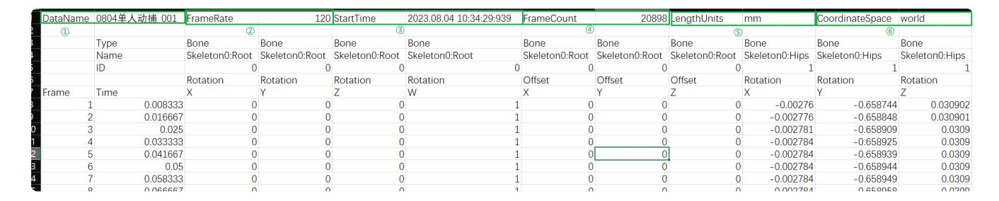
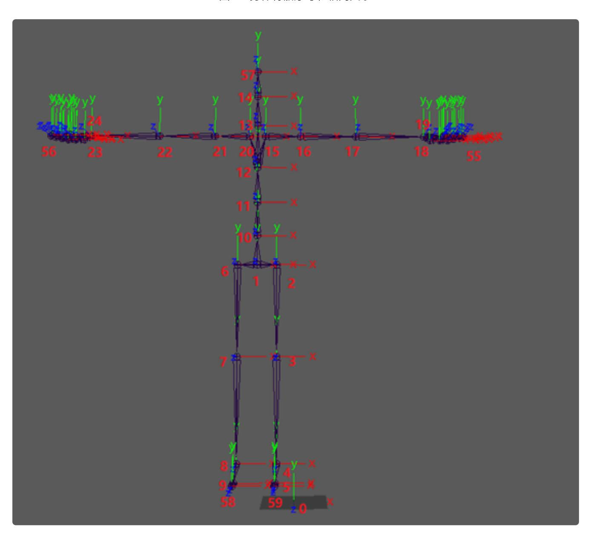
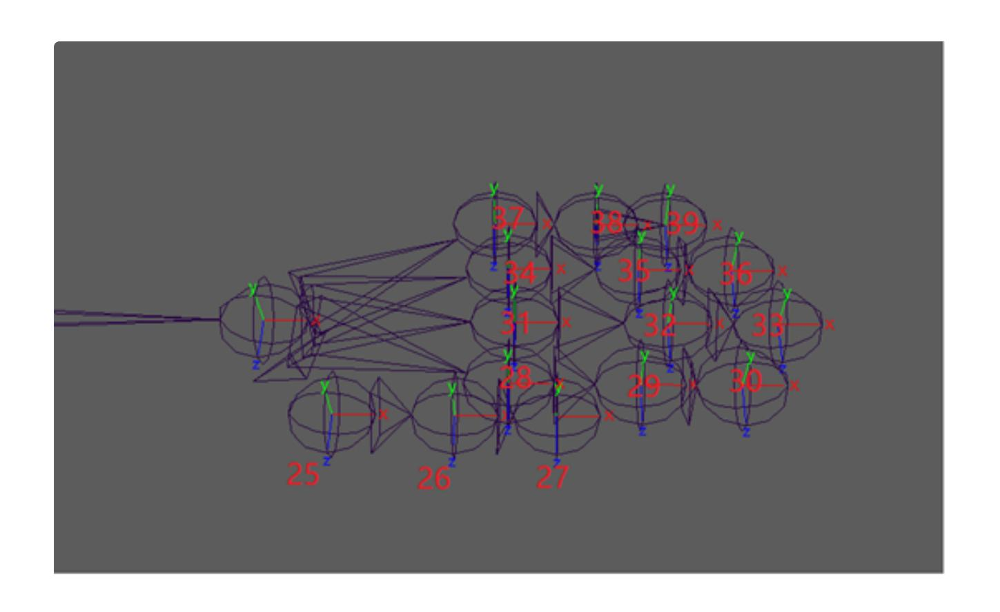
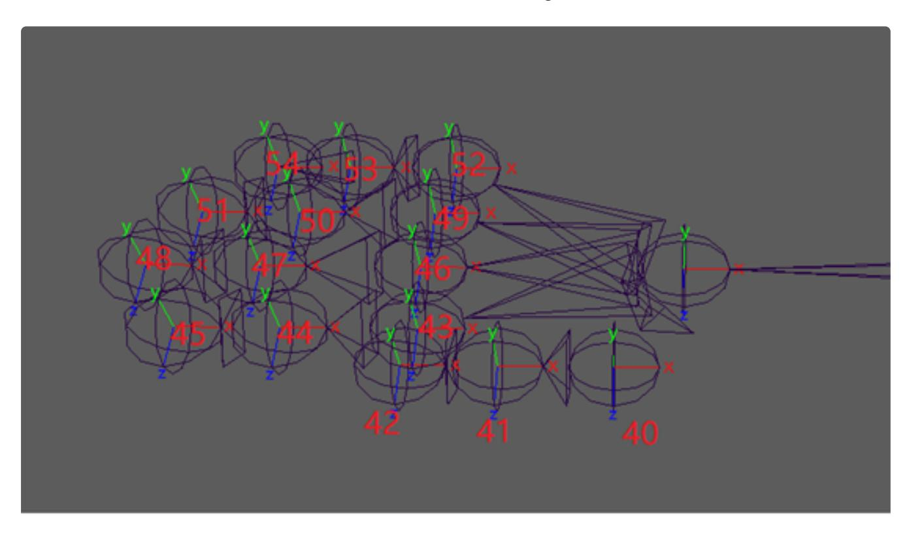

# FZMotion 导出 CSV ⽂件格式说明 V.

# 1.刚体 CSV ⽂件格式说明

本说明介绍从 FZMotion 导出的 .CSV ⽂件每⼀列的内容说明,说明只针对含刚体的数据。

#### 1.1.标题⾏内容说明 1

- 导出该 csv ⽂件时该条数据的名称; ①
- 该条数据的录制帧率; ②
- 该条数据的录制时间; ③
- 该条数据的录制总帧数; ④
- 数据的⽐例单位; ⑤
- 坐标系类型; ⑥

### 1.2.标题⾏内容说明 2

|           | U       | C           | U          | L          | 1          | U            | - 11       | 1           | ,          | IX.        | L          | IVI        |       |
|-----------|---------|-------------|------------|------------|------------|--------------|------------|-------------|------------|------------|------------|------------|-------|
| DataNam   | 刚体边缘    | FrameRate   | 120        | StartTime  | 2024.05.27 | FrameCoun    | 11620      | LenathUnits | mm         | Coordinate | World      |            |       |
| 1         |         |             |            |            |            |              |            |             |            |            |            |            |       |
| 2         | Type    | Riaid Body  | Riaid Body | Riaid Body | Riaid Body | Riaid Body   | Riaid Body | Riaid Body  | Riaid Body | Riaid Body | Riaid Body | Riaid Body | Rigic |
| 3         | Name    | Rigid1      | Rigid1     | Rigid1     | Rigid1     | Rigid1       | Rigid1     | Rigid1      | Rigid1     | Rigid1     | Rigid1     | Rigid1     | Rigic |
| 4         | ID      | 1           | 1          | 1          | 1          | 1            | 1          | 1           | 1          | 1          | 1          | 1          |       |
|           |         | Rotation(7) | Rotation   | Rotation   | Rotation   | Position (8) | Position   | Position    | Speed (9)  | Speed      | Speed      | Speed      | Acce  |
| Frame (5) | Time ⑥  | Χ           | Υ          | Z          | W          | X            | Υ          | Z           | XSpeed     | YSpeed     | ZSpeed     | Speed      | XAcc  |
| 1         | 0.00833 | 0.672609    | 0.701998   | 0.209241   | -0.104948  | -6912.076    | -5.685974  | 3192.8257   | 0.004708   | 0.00252    | 0.007714   | -0.005566  | j     |
| 2         | 0.01667 | 0.676174    | 0.698322   | 0.209612   | -0.105824  | -6911.268    | -5.270264  | 3192.7563   | 0.010457   | 0.0029     | 0.010854   | -0.000234  | Į.    |
| 3         | 0.025   | 0.676174    | 0.698322   | 0.209612   | -0.105824  | -6911.268    | -5.270264  | 3192.7563   | -0.000297  | 0.005596   | 0.011327   | -0.009844  | Į.    |
| 4         | 0.03333 | 0.668652    | 0.706176   | 0.207919   | -0.104834  | -6912.637    | -6.252693  | 3192.9539   | -0.021393  | 0.004424   | 0.034106   | -0.026191  | L     |
| 5         | 0.04167 | 0.674706    | 0.699384   | 0.210715   | -0.105987  | -6911.21     | -5.51758   | 3192.772    | -0.005608  | 0.000029   | 0.011177   | 0.009668   | 3     |
| 6         | 0.05    | 0.675833    | 0.697259   | 0.214207   | -0.105804  | -6910.952    | -5.303754  | 3192.7173   | 0.009173   | -0.002637  | 0.028538   | 0.026895   | j     |
| 7         | 0.05833 | 0.672749    | 0.700077   | 0.214399   | -0.106459  | -6911.602    | -5.858263  | 3192.9043   | -0.014112  | 0.003574   | 0.016596   | -0.007969  | )     |
| 8         | 0.06667 | 0.665248    | 0.710811   | 0.202255   | -0.106236  | -6911.682    | -6.540428  | 3192.9038   | -0.030484  | 0.003545   | 0.032247   | -0.009902  | )     |
| 9         | 0.075   | 0.661904    | 0.712815   | 0.206479   | -0.105567  | -6911.991    | -6.971426  | 3192.8962   | -0.01725   | -0.001406  | 0.023212   | 0.015469   | )     |
| 10        | 0.08333 | 0.662306    | 0.712087   | 0.20767    | -0.105627  | -6911.931    | -6.883223  | 3192.9036   | -0.032775  | 0.003164   | 0.037189   | -0.017285  | j     |
| 11        | 0.09167 | 0.661904    | 0.712815   | 0.206479   | -0.105567  | -6911.991    | -6.971426  | 3192.8962   | -0.040024  | 0.004307   | 0.047397   | -0.02502   | )     |
| 10        | 0.1     | 0 662744    | 0.700.40   | n 211002   | O 105560   | E011 E2E     | E E022E7   | 2102 0264   | 0.017056   | 0.001075   | 0.017064   | U UUUEOE   | al .  |

- 改⾏为预留空⾏,固有格式; ①
- 对应列资产的类型,Rigid Body 为刚体,SkeletonMarker 为刚体内的资产点,Marker 为散 点; ②
- 对应列资产的名字,如当前图⽚的刚体名称为 Rigid; ③

- 对应列资产的 ID; ④
- 帧 ID,每个数据都是从 1 开始的递增值; ⑤
- 帧时间,代表该帧录制时的相对开始录制的时间点; ⑥
- Rotation ⻆度值,该处为四元数(导出时可选欧拉⻆),XYZW,全局绝对⻆度; ⑦
- Position 位置值,XYZ,全局位置,单位毫⽶; ⑧
- Speed 线速度(可选导出),分为 XSpeed、YSpeed、ZSpeed、Speed 四个速度,分别为 X、Y、Z 速度分量和总速度,单位 m/s; ⑨

|    | IN                | U                 | ۲                 | ų                | к            | 5            | I            | U             | V             | VV            |
|----|-------------------|-------------------|-------------------|------------------|--------------|--------------|--------------|---------------|---------------|---------------|
|    |                   |                   |                   |                  |              |              |              |               |               |               |
|    | D: 11D 1          | 0: :10 1          | D: : 1 D . 1      | D: : 1 D . 1     | D: : 1 D . 1 | D: : 1 D . 1 | D: : 1 D . 1 | 0::10:1       | D: : 1 D . 1  | D: : 1 D . 1  |
| -  |                   | Rigid Body        |                   |                  | Rigid Body   | Rigid Body   |              | Rigid Body    | Rigid Body    | Rigid Body    |
|    | Rigid1            | Rigid1            | Rigid1            | Rigid1           | Rigid1       | Rigid1       | Rigid1       | Rigid1        | Rigid1        | Rigid1        |
| 1  | 10 1              | 1                 | 1                 | 1                | . U 1        | 1            | 1            | Rigid1 1      | 1             | 1             |
|    | AcceleratedSpeed  | AcceleratedSpeed  | AcceleratedSpeed  | AcceleratedSpeed | Palstance    | Palstance    | Palstance    | AccPalstance  | AccPalstance  | AccPalstance  |
|    | XAcceleratedSpeed | YAcceleratedSpeed | ZAcceleratedSpeed | AcceleratedSpeed | XPalstance   | YPalstance   | ZPalstance   | XAccPalstance | YAccPalstance | ZAccPalstance |
| 66 | -1.157979         | 0.161719          | 1.79659           | -1.364062        | 0.250561     | -0.004353    | -0.869953    | 54.115177     | -17.856035    | -133.128494   |
| 34 | 0.689845          | 0.045703          | 0.942006          | 0.639844         | -0.195578    | 0.121118     | 1.228516     | -53.53664     | 15.056451     | 251.816238    |
| 44 | -1.29042          | 0.323437          | 1.760537          | -1.153125        | -0.000003    | 0.000004     | 0            | 23.469006     | -14.533683    | -147.421921   |
| 91 | -2.531594         | -0.140625         | 3.205789          | -1.961719        | 0.709413     | -0.261767    | -2.542093    | 85.129936     | -31.412476    | -305.051025   |
| 68 | 1.89418           | -0.527344         | 4.731056          | 4.303125         | -0.780272    | 0.512924     | 2.103381     | -178.762253   | 92.962982     | 557.456787    |
| 95 | 1.773798          | -0.319922         | 2.742621          | 2.067187         | -0.751955    | 0.531676     | 0.435034     | 3.398087      | 2.250202      | -200.201584   |
| 69 | -2.794228         | 0.745312          | 5.085829          | -4.183594        | 0.297403     | 0.227893     | -0.94428     | 125.922958    | -36.454029    | -165.517731   |
| 02 | -1.96463          | -0.003516         | 1.978287          | -0.232031        | 2.748453     | -1.886796    | -2.694631    | 294.125946    | -253.76268    | -210.042084   |
| 59 | 1.588122          | -0.594141         | 3.484868          | 3.044531         | -0.64482     | 0.671604     | -1.030866    | -407.192719   | 307.008057    | 199.651764    |

- AcceleratedSpeed 线加速度(可选导出),分别为 X、Y、Z 速度分量和总加速度 , 单位 m/s²; ⑩
- Palstance ⻆速度(可选导出),分别为 X、Y、Z ⻆速度分量和总⻆速度,单位 rad/s; ⑪
- AccPalstance ⻆加速度(可选导出),分别为 X、Y、Z ⻆加速度分量和总⻆加速度,单位 rad/s²; ⑫

| ' (13) | RigidBodyMarker Rigid1Marker20100 | RigidBodyMarker Rigid1Marker20100 | RigidBodyMarker Rigid1Marker20100 |          | RigidBodyMarker Rigid1Marker20101 | Rig |
|-------------------|--------------------------------------|--------------------------------------|--------------------------------------|----------|--------------------------------------|-----|
| 1                 | 20100                                |                                      |                                      | 20101    | 20101                                | Rig |
| nce               | Position (14)                        | Position                             | Position                             | Position | Position                             | Pos |
| ance              | χ 🖽                                  | Υ                                    | Z                                    | Χ        | Υ                                    | Z   |
| 28494             | -6833.401855                         | -32.206242                           | 3099.398926                          | -6844.3  | -43.574409                           |     |
| 16238             | -6833.401855                         | -32.206242                           | 3099.398926                          | -6844.3  | -43.574409                           |     |
| 21921             | -6833.401855                         | -32.206242                           | 3099.398926                          | -6844.3  | -43.574409                           |     |
| 51025             | -6833.401855                         | -32.206242                           | 3099.398926                          | -6844    | -43.604229                           |     |

- RigidBodyMarker 资产点,该资产点为 Rigid 的资产点; ⑬
- Position 位置,资产点的 X、Y、Z 的位置信息,单位 mm; ⑭

## 2.散点 CSV ⽂件格式说明

#### 2.1.标题⾏内容说明 1

| DataName | 0804单人动捕 001 | FrameRate      | 120            | StartTime      | 2023.08.04 10:34:29:939 | FrameCount     | 20898          | _engthUnits    | mm             | CoordinateSpace | world          |
|----------|--------------|----------------|----------------|----------------|-------------------------|----------------|----------------|----------------|----------------|-----------------|----------------|
| 1        |              | 2              |                | 3              |                         | (4)            | D              | (5)            |                | 6               |                |
|          | Type         | Bone           | Bone           | Bone           | Bone                    | Bone           | Bone           | Bone           | Bone           | Bone            | Bone           |
|          | Name         | Skeleton0:Root | Skeleton0:Root | Skeleton0:Root | Skeleton0:Root          | Skeleton0:Root | Skeleton0:Root | Skeleton0:Root | Skeleton0:Hips | Skeleton0:Hips  | Skeleton0:Hips |
|          | ID           | 0              | 0              | 0              |                         | ) (            | 0              | 0              | 1              | 1               |                |
|          |              | Rotation       | Rotation       | Rotation       | Rotation                | Offset         | Offset         | Offset         | Rotation       | Rotation        | Rotation       |
| Frame    | Time         | X              | Υ              | Z              | W                       | X              | Υ              | Z              | X              | Υ               | Z              |
| 1        | 0.008333     | 0              | 0              | ) (            | ) 1                     | . (            | 0              | 0              | -0.00276       | -0.658744       | 0.03090        |
| 2        | 0.016667     | 0              | 0              | 0              | 1                       | . (            | 0              | 0              | -0.002776      | -0.658848       | 0.03090        |
| 3        | 0.025        | 0              | 0              | 0              | ) 1                     | . (            | 0              | 0              | -0.002781      | -0.658909       | 0.030          |
| 4        | 0.033333     | 0              | 0              | 0              | ) 1                     | . (            | 0              | 0              | -0.002784      | -0.658925       | 0.030          |
| 5        | 0.041667     | 0              | 0              | 0              | ) 1                     | . (            | 0              | 0              | -0.002784      | -0.658939       | 0.030          |
| 6        | 0.05         | 0              | 0              | ) (            | ) 1                     | . (            | 0              | 0              | -0.002784      | -0.658944       | 0.030          |
| 7        | 0.058333     | 0              | 0              | 0              | ) 1                     | . (            | 0              | 0              | -0.002784      | -0.658949       | 0.030          |
| 0        | 0.066667     |                |                |                | 1                       |                | 1 0            | 0              | 0.002704       | 0.600000        | 0.000          |

- 导出该 csv ⽂件时该条数据的名称; ①
- 该条数据的录制帧率; ②
- 该条数据的录制时间; ③
- 该条数据的录制总帧数; ④
- 数据的⽐例单位; ⑤
- 坐标系类型; ⑥

#### 2.2.标题⾏内容说明 2

|          | -                             |     |                              |               |               |               |         |
|----------|-------------------------------|-----|------------------------------|---------------|---------------|---------------|---------|
| dy       | Marker (1                     | )   | Marker                       | Marker        | Marker        | Marker        | Mε      |
| 1a       | Marker1002                    | 42  | Marker100242                 | Marker100242  | Marker100391  | Marker100391  | Μŧ      |
| 03       | ② 100                         | 242 | 100242                       | 100242        | 100391        | 100391        |         |
|          |                               |     |                              |               |               |               |         |
| 1        | Position (                    | 3)  | Position                     | Position      | Position      | Position      | Po      |
| <u> </u> | Position (                    | 3   | Position Y                | Position Z | Position X | Position Y | Po Z |
| 1 78  | Position (3 X -4727.265 | 9   | Position Y 2182.496338 | Z             | X             | Υ             | Z       |

- 散点的名称; ①
- 散点的 ID; ②
- Position 散点的坐标,X、Y、Z,单位毫⽶; ③

## 3.⼈体 CSV ⽂件格式说明

⽰例数据⽂件下载地址:[https://yunpan.lusterinc.com:/link/BFBEEE](https://yunpan.lusterinc.com/link/BF62BE200E53E9F56E15B36B024E2499)

[FEBBE](https://yunpan.lusterinc.com/link/BF62BE200E53E9F56E15B36B024E2499)

⽰例动作视频下载地址:[https://yunpan.lusterinc.com:/link/BDFA](https://yunpan.lusterinc.com/link/037BD30F831A82C1EA089BBBD183DA37)

[CEABBBDDA](https://yunpan.lusterinc.com/link/037BD30F831A82C1EA089BBBD183DA37)

#### 3.1.标题⾏内容说明 1

| DataName | 0804单人动捕 001 | FrameRate      | 120            | ) StartTime    | 2023.08.04 10:34:29:939 | FrameCount     | 20898          | _engthUnits    | mm             | CoordinateSpace | world          |
|----------|--------------|----------------|----------------|----------------|-------------------------|----------------|----------------|----------------|----------------|-----------------|----------------|
| 1        |              | 2              |                | 3              |                         | (4)            |                | (5             |                | 6               |                |
|          | Type         | Bone           | Bone           | Bone           | Bone                    | Bone           | Bone           | Bone           | Bone           | Bone            | Bone           |
|          | Name         | Skeleton0:Root | Skeleton0:Root | Skeleton0:Root | Skeleton0:Root          | Skeleton0:Root | Skeleton0:Root | Skeleton0:Root | Skeleton0:Hips | Skeleton0:Hips  | Skeleton0:Hips |
|          | ID           | (              | 0              | 0              | (                       | C              | 0              | 0              | 1              | 1               | 1              |
|          |              | Rotation       | Rotation       | Rotation       | Rotation                | Offset         | Offset         | Offset         | Rotation       | Rotation        | Rotation       |
| Frame    | Time         | X              | Υ              | Z              | W                       | X              | Υ              | Z              | X              | Υ               | Z              |
| 1        | 0.008333     | 3 (            | 0              | ) (            | 1                       |                | 0              | 0              | -0.00276       | -0.658744       | 0.030902       |
| 2        | 0.01666      | ′ (            | 0              | ) (            | 1                       |                | 0              | 0              | -0.002776      | -0.658848       | 0.030901       |
| 3        | 0.02         | 5 (            | 0              | ) (            | 1                       |                | 0              | 0              | -0.002781      | -0.658909       | 0.0309         |
| 4        | 0.033333     | 3 (            | 0              | ) (            | 1                       |                | 0              | 0              | -0.002784      | -0.658925       | 0.0309         |
| . 5      | 0.04166      | (              | 0              | ) (            | 1                       |                | 0              | 0              | -0.002784      | -0.658939       | 0.0309         |
| 6        | 0.0          | 5 (            | 0              | ) (            | 1                       |                | 0              | 0              | -0.002784      | -0.658944       | 0.0309         |
| 7        | 0.058333     | 3              | 0              | ) (            | 1                       |                | 0              | 0              | -0.002784      | -0.658949       | 0.0309         |
|          | U UEEEE.     | ,              |                | ١              | 1                       | -              | n              | 0              | U UU3201       | U SEOUEO        | บ บวกต         |

- 导出该 csv ⽂件时该条数据的名称; ①
- 该条数据的录制帧率; ②
- 该条数据的录制时间; ③
- 该条数据的录制总帧数; ④
- 数据的⽐例单位; ⑤
- 坐标系类型; ⑥

## 3.2.标题⾏内容说明 2

| DataNa | me | 0804单人动捕_001 | FrameRate | 120            | StartTime | 2023.08.04 10:34:29:939 | FrameCount | 20898          | LengthUnits | mm        | CoordinateSpace | world         |
|--------|----|--------------|-----------|----------------|-----------|-------------------------|------------|----------------|-------------|-----------|-----------------|---------------|
|        | 2  | Туре         | Bone      | Bone           | Bone      | Bone                    | Bone       | Bone           | Bone        | Bone      | Bone            | Bone          |
|        |    | Name         |           | Skeleton0:Root |           |                         |            | Skeleton0:Root |             |           |                 | Skeleton0:Hip |
|        | 4  | ID           | C         | 0              | C         | (                       | ) (        | 0 0            | 0           | 1         | . 1             |               |
| (5)    |    | 6            | Rotation  | Rotation       | Rotation  | Rotation                | Offset     | Offset         | Offset      | Rotation  | Rotation        | Rotation      |
| Frame  |    | Time         | X         | Υ              | Z         | W                       | X          | Υ              | Z           | X         | Υ               | Z             |
|        | 1  | 0.008333     | 7 (       | ) (            | C         |                         | 1 (8)      | 0 (            | 0           | -0.00276  | -0.658744       | 0.0309        |
|        | 2  | 0.016667     | (         | 0              | C         | 1                       | 1 (        | 0              | 0           | -0.002776 | -0.658848       | 0.0309        |
|        | 3  | 0.025        | (         | 0              | )C        | 1                       | 1 (        | 0              | 0           | -0.002781 | -0.658909       | 0.03          |
|        | 4  | 0.033333     | (         | 0              | C         | 1                       | 1 (        | 0              | 0           | -0.002784 | -0.658925       | 0.03          |
|        | 5  | 0.041667     | (         | 0              | C         | 1                       | 1 (        | 0              | 0           | -0.002784 | -0.658939       | 0.03          |
|        | 6  | 0.05         | (         | 0              | C         | 1                       | 1 (        | 0              | 0           | -0.002784 | -0.658944       | 0.03          |
|        | 7  | 0.058333     | (         | 0              | C         |                         | 1 (        | 0 0            | 0           | -0.002784 | -0.658949       | 0.03          |
|        | 8  | 0.066667     | C         | 0              | C         |                         | 1 (        | 0 0            | 0           | -0.002784 | -0.658958       | 0.03          |
|        | 9  | 0.075        | (         | 0              | C         |                         | 1 (        | 0 (            | 0           | -0.002784 | -0.65899        | 0.0308        |
|        | 10 | 0.083333     |           | 0              | C         |                         | 1 (        | 0 (            | 0           | -0.002784 | -0.659223       | 0.0308        |
|        |    | 0.001007     |           |                |           |                         |            |                |             | 0.000700  | 0.000.107       | 0.0000        |

- 改⾏为预留空⾏,固有格式; ①
- 对应列资产的类型,Bone 为⻣骼,SkeletonMarker 为⻣骼内的资产点; ②
- 对应列资产的名字,如 Skeleton:Root,该内容代表名为 Skeleton ⼈体资产中,根节点 Root 的数据; ③
- 对应列资产的 ID; ④
- 帧 ID,每个数据都是从 1 开始的递增值; ⑤
- 帧时间,代表该帧录制时的相对开始录制的时间点; ⑥
- Rotation ⻆度值,该处为四元数,XYZW,是相对⽗关节的⻆度; ⑦
- Offset 关节坐标,hips 关节为全局坐标会随着⼈体移动更新,其余⻣骼关节值为定值,是 相对于⽗关节的偏移量; ⑧

 此处还有⼀种类型 Position,针对资产点的属性,代表位置; 1、

#### 3.3.⻣骼对应关系说明

图 3.1 ⾝体⻣骼序号和轴向关系

图 3.2 左⼿⻣骼序号和轴向关系(Left Hand)

图 3.3 右⼿⻣骼序号和轴向关系(Right Hand)

表 3.1 全⾝⻣骼列表

| 序号 | 名称            | 备注 |
|----|---------------|----|
| 0  | Root          |    |
| 1  | Hips          |    |
| 2  | LeftUpLeg     |    |
| 3  | LeftLeg       |    |
| 4  | LeftFoot      |    |
| 5  | LeftToe       |    |
| 6  | RightUpLeg    |    |
| 7  | RightLeg      |    |
| 8  | RightFoot     |    |
| 9  | RightToe      |    |
| 10 | Spine1        |    |
| 11 | Spine2        |    |
| 12 | Chest         |    |
| 13 | Neck          |    |
| 14 | Head          |    |
| 15 | LeftShoulder  |    |
| 16 | LeftArm       |    |
| 17 | LeftForeArm   |    |
| 18 | LeftHand      |    |
| 20 | RightShoulder |    |
| 21 | RightArm      |    |
| 22 | RightForeArm  |    |
| 23 | RightHand     |    |
| 25 | FZLeftThumb1  |    |
| 26 | FZLeftThumb2  |    |

|  FZLeftThumb   |  |
|-------------------|--|
|  FZLeftIndex   |  |
|  FZLeftIndex   |  |
|  FZLeftIndex   |  |
|  FZLeftMiddle  |  |
|  FZLeftMiddle  |  |
|  FZLeftMiddle  |  |
|  FZLeftRing    |  |
|  FZLeftRing    |  |
|  FZLeftRing    |  |
|  FZLeftPinky   |  |
|  FZLeftPinky   |  |
|  FZLeftPinky   |  |
|  FZRightThumb  |  |
|  FZRightThumb  |  |
|  FZRightThumb  |  |
|  FZRightIndex  |  |
|  FZRightIndex  |  |
|  FZRightIndex  |  |
|  FZRightMiddle |  |
|  FZRightMiddle |  |
|  FZRightMiddle |  |
|  FZRightRing   |  |
|  FZRightRing   |  |
|  FZRightRing   |  |
|  FZRightPinky  |  |
|                   |  |

|  FZRightPinky |                               |
|------------------|-------------------------------|
|  FZRightPinky |                               |
|  LHandEnd     | 当导出左⼿⼿指时,⽆该⻣骼, 当不导出⼿指时有该⻣骼 |
|  RHandEnd     | 当导出右⼿⼿指时,⽆该⻣骼, 当不导出⼿指时有该⻣骼 |
|  HeadEnd      |                               |
|  LToeEnd      |                               |
|  RToeEnd      |                               |

@北京元客视界科技有限公司