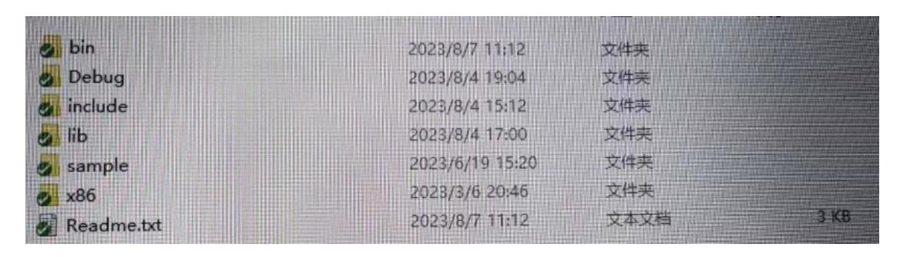

## **LuMoSDK**

# 使用说明

**Version 1.0.0 2023.08.07**

## 目录

| 目录                 | 1 |
|--------------------|---|
| 1 工具简介             | 2 |
| 1.1 工具原理           | 2 |
| 1.2 工具介绍           | 2 |
| 2 LuMoSDK 示例程序使用说明 | 3 |
| 2.1 c 语言版本示例       | 3 |
| 2.2 c++版本示例        | 3 |
| 2.3 python 版本示例    | 4 |
| 2.4 MatLab 版本示例    | 4 |
| 3 注意事项             | 4 |

## **1 工具简介**

LuMoSDK 是一个用于接收 FZMotion 广播数据的工具包,里面包括 c 语言版本, c++版本,python 版本,MatLab 版本的库,以及各个版本包含的一份示例代码。

#### **1.1 工具原理**

LuMoSDK 是通 过 zmq 接 收数据 包,通 过 Protobuffer 反 序列化为 FZMotion 发出的帧数据。

### **1.2 工具介绍**

如上图为 LuMoSDK 目录结构。

bin 目录:存放 x64 位 release 版本的动态依赖库。 Debug 目录:存放 x64 位 debbug 版本动态依赖库。

include 目录:存放编译时需要依赖的头文件。

lib 目录:存放 x64 位 release 版本的 LuMoSDK 静态库。

x86 目录:存放 x86 编译生成的 debug 版和 release 版的动态库以及静态库。

sample 目录:存放 c 语言版本,c++版本,python 版本,MatLab 版本的示例代码。

Readme.txt :里面包括 LuMoSDK 版本信息内容。

### **2 LuMoSDK 示例程序使用说明**

## **2.1 c 语言版本示例**

打开 sample 目录,LuMoSDKCAPI 文件夹下是 c 语言版本 LuMoSDK 示例程序。

双击 sample 目录下的 sample.sln 工程文件,VS 会自动将 c 语言版本以及 c++版本示例 代码加载进来。LuMoSDkCAPI 子工程为 c 语言版本,LuMoSDKSample 子工程为 c++版本。

鼠标右键点击 LuMoSDKCAPI,点击属性选项,配置设置为"活动(release)",平台设置 为"x64"。点击 VC++目录,常规-》包含目录-》引入头文件所在目录的相对路径"..\..\include"。 点击链接器-》输入-》附加依赖项-》引入静态库所在的相对路径"..\..\lib\LuMoSDKCAPI.lib"。

鼠标右键点击 LuMoSDKCAPI,点击属性选项,配置设置为"Debug",平台设置为"x64"。 点击 VC++目录,常规-》包含目录-》引入头文件所在目录的相对路径"..\..\include"。 点 击 链 接 器 - 》 输 入 - 》 附 加 依 赖 项 - 》 引 入 静 态 库 所 在 的 相 对 路 径"..\..\Debug\LuMoSDKCAPI.lib"。

#### 代码逻辑:

- 1、 初始化创建 LuMoSDK 接收端指针
- 2、 设置 Ip,连接 Ip
- 3、 判断是否连接成功
- 4、 获取相机信息
- 5、 获取帧数据(帧 ID,帧时间戳,相机同步时间戳,数据广播时间戳,散点数据,刚体 数据,人体数据)

编译运行程序,如果连接成功,先打印相机信息,然后打印帧数据。

## **2.2 c++版本示例**

打开 sample 目录,LuMoSDK 文件夹下是 c++版本 LuMoSDK 示例程序。

双击 sample 目录下的 sample.sln 工程文件,VS 会自动将 c 语言版本以及 c++版本示例 代码加载进来。LuMoSDkCAPI 子工程为 c 语言版本,LuMoSDKSample 子工程为 c++版本。

鼠标右键点击 LuMoSDKSample,点击属性选项,配置设置为"活动(release)",平台设置 为"x64"。点击 VC++目录,常规-》包含目录-》引入头文件所在目录的相对路径"..\..\include"。 点击链接器-》输入-》附加依赖项-》引入静态库所在的相对路径"..\..\lib\LuMoSDK.lib"。

鼠标右键点击 LuMoSDKCAPI,点击属性选项,配置设置为"Debug",平台设置为"x64"。 点击 VC++目录,常规-》包含目录-》引入头文件所在目录的相对路径"..\..\include"。 点击链接器-》输入-》附加依赖项-》引入静态库所在的相对路径"..\..\Debug\LuMoSDKd.lib"。 代码逻辑:

- 1、 实例化 LuMoSDK 接收端指针
- 2、 初始化
- 3、 连接 IP
- 4、 判断是否连接成功
- 5、 接收相机信息
- 6、 获取帧数据(帧 ID,帧时间戳,相机同步时间戳,数据广播时间戳,散点数据,刚体

数据,人体数据)

编译运行程序,输入 IP 地址,如果连接成功,先打印相机信息,然后打印帧数据。

## **2.3 python 版本示例**

打开 sample 目录下的 Python 目录, 双击打开 LuMoSDK.sln 工程文件,VS 加载 LuMoSDKPy\_sample.py 文件。

#### 代码逻辑:

- 1、 导入 python 版 LuMoSDK 库,"../../bin/"下的 LuMoSDKPy.pyd
- 2、 初始化用于接收数据的对象
- 3、 设置传输 IP,连接 IP
- 4、 判断是否连接成功
- 5、 接收相机信息
- 6、 获取帧数据(帧 ID,帧时间戳,相机同步时间戳,数据广播时间戳,散点数据,刚体 数据,人体数据)

运行程序,连接成功后,先打印相机信息,然后打印帧数据

## **2.4 MatLab 版本示例**

打 开 sample 目 录 下 的 MatLab 目 录 , 将 里 面 的 "LuMoSDKMPI.m", " printFrameData.m " ,"sdksample.m" 文 件 以 及 include 下 面 的"CLuMoSDkCAPI.h" ,"CluMoDataTypes.h",以及 bin 目录下"libprotobuf.dll" "libzmq-mt-4\_3\_4.dll""LuMoSDKCAPI.dll" 放 到 MatLab 外 部 依 赖 库 目 录 下 , 比 如 : " C:\Program Files\MATLAB\R2021b\extern\LuMoSDK"。

启动 MatLab,并且浏览到上述路径

使用 sdksample(\_ip\_)命令运行示例程序。其中 ip 为 FzMotion 数据发送主机的 IP 地址。

## **3 注意事项**

Python 版本的 LuMoSDK 不支持低于 3.11 版本的 python 库

#### **版权声明**

元客视界科技有限公司享有对本说明书的所有权利。未经书面授权,用户不得为任何目的、以任何形式(电子的、 机械的等)复制、修改、传播或翻译本说明书的任何部分。公司坚持科技创新,不断改进产品性能,提供产品品质, 保留修改本说明书而无需事先告知用户的权利。尽管我们做了大量的努力使本说明书尽可能的完善和准确,但疏漏和 缺陷之处在所难免。任何人或实体由于本说明书提供的信息造成的任何损失或损害,公司不承担任何义务或责任。

说明:This software contains Autodesk® FBX® code developed by Autodesk, Inc. Copyright 2018 Autodesk, Inc. All rights, reserved. Such code is provided "as is" and Autodesk, Inc. disclaims any and all warranties, whether express or implied, including without limitation the implied warranties of merchantability, fitness for a particular purpose or non-infringement of third party rights. In no event shall Autodesk, Inc. be liable for any direct, indirect, incidental, special, exemplary, or consequential damages (including, but not limited to, procurement of substitute goods or services; loss of use, data, or profits; or business interruption) however caused and on any theory of liability, whether in contract, strict liability, or tort (including negligence or otherwise) arising in any way out of such code.